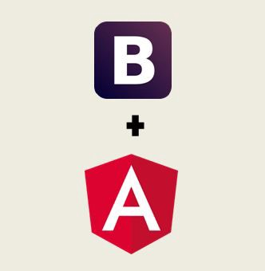
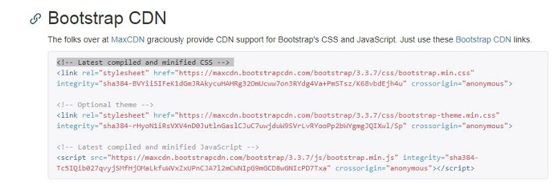
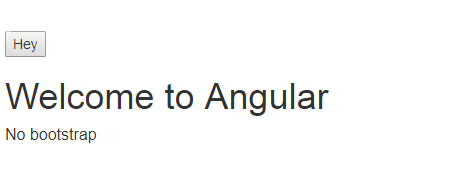
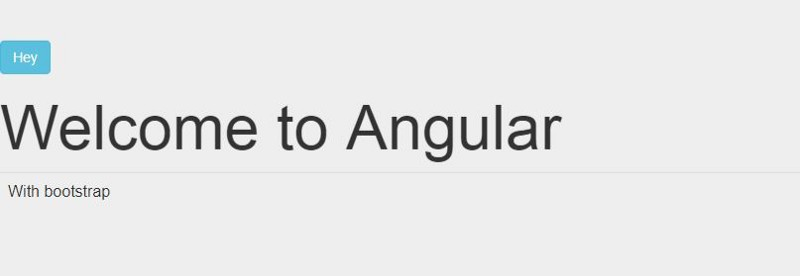


This article will help us understand the usage of bootstrap framework within Angular. To understand a little about bootstrap, Bootstrap is the most popular HTML, CSS, and JavaScript framework for web front-end development. It’s great for developing responsive, mobile-first web sites.

Bootstrap in Angular

**Step 1. Create a new Angular Project**So, to apply bootstrap to your angular project, the very first step is to create an angular project using ng new.

> $ ng new bs\_ang

**Step 2. Install Bootstrap**To add bootstrap to an angular project, there are different ways:  
— Adding Bootstrap from CDN  
— Adding Boostrap via NPM

### **From CDN**

The CSS and JS files of bootstrap can be directly accessed from a CDN (Content Delivery Network). The CDN links for Bootstrap can be found at <http://getbootstrap.com/getting-started/>

In the **index.html**, insert <link> element *(It will appear like given in the picture below)*to get the Bootstrap CSS file after the <head> tag.

Your index.html must look like this now.

https://gist.github.com/NishuGoel/8f56fa4dc3bfe26eab953421c7f587f2

### Now, to use this bootstrap inside one of our components, lets take this example.

In our app.component.html,i.e.,

https://gist.github.com/NishuGoel/22c561d3f08d5efc3fea94cba2324f3e

The result shows as follows if bootstrap framework is not applied.

Without bootstrap

However, when you apply the bootstrap framework in your app.component.html, i.e.,

https://gist.github.com/NishuGoel/8310fdd12cde1587bd33e380482c9c1f

it appears like:

With Bootstrap

> **Look at the difference in the presentation with Bootstrap applied to Angular!**

### **Via NPM**

> Use $npm install boostrap@3

After installing, find the bootstrap CSS file here: [*node\_modules/bootstrap/dist/css/bootstrap.min.css*](http://node_modules/bootstrap/dist/css/bootstrap.min.css)and add it to the <link> element in the index.html

And then, apply bootstrap to any component as we did earlier.

> We can also change the bootstrap theme from websites like **Bootswatch**, (<https://bootswatch.com/>) by simply copying the URL of a particular theme and pasting it in the **index.html**

