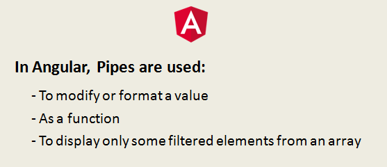


Previously known as Filters in AngularJS, Custom Pipes can be of two types. Pure and impure custom pipe. Pipe takes an input and returns an output based on the output of transform function evaluation.



Usage of Pipes

Angular has many built-in pipes. In this article, we’ll see how to create a custom one.

**Steps Involved In Creating a Custom Pipe In Angular are:**  
1) Create a Pipe Class and decorate it with the decorator ***@Pipe.***  
2) Supply a ***name***property to be used as template code name.  
3) Register your Pipe in the module under declarations.  
4) Finally, implement ***PipeTransform***and write transformation logic.  
5) Use your pipe in the HTML using **‘|’**, which represents a pipe.  
6) Also, add Custom arguments if you want to.

```typescript
import { Pipe } from '@angular/core';

@Pipe({
  name: 'demo'
})
export class DemoPipe{}
```

Once we are done creating the Pipe class, we go to app.module.ts and register our pipe.Once we are done creating the Pipe class, we go to app.module.ts and register our pipe.

```typescript
import { DemoPipe } from './demo.pipe';


@NgModule({
  declarations: [
    DemoPipe
  ],
  imports: [
    BrowserModule
  ],
```

To finally put some logic behind the task of our custom pipe, we use PipeTransform.

```typescript
import { Pipe, PipeTransform } from '@angular/core';

@Pipe({
  name: 'demo'
})
export class DemoPipe implements PipeTransform{
    transform(n: number) {}
}
```

So, to maintain the required contract to adhere to the standard structure, we use transform() method inside PipeTransform.

Now, our motive is to convert some random number to a readable format of megabytes, and to do that, we put logic inside transform() as follows:

```typescript
import { Pipe, PipeTransform } from '@angular/core';

@Pipe({
  name: 'demo'
})
export class DemoPipe implements PipeTransform{
    transform() : string {
        return (n *1000).toFixed(2) + 'Kg';
    }
}
```

Now to use it in the HTML,

```html
<div>
  <p>{{ demo.name }}</p>
  <p>{{ demo.n | demo }}</p>
</div>
```

To add a custom argument to your output, simply add the capability of extension to the Transform() method as follows.

```typescript
import { Pipe, PipeTransform } from '@angular/core';

@Pipe({
  name: 'demo'
})
export class DemoPipe implements PipeTransform{
    transform(n: number, extension: string = 'Kilograms') {
        return (n * 1000).toFixed(2) + extension;
    }
}
```

We can also add multiple arguments which can be separated using ‘:’  
For example,

> {{ result| pipe:argument1:argument2 }}

