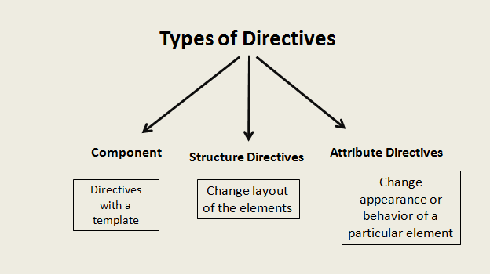
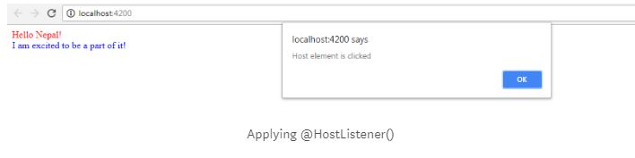
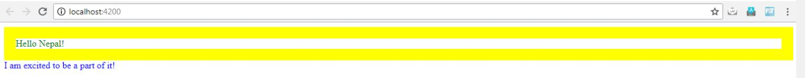


For those who do a lot of angular, you might have used ng-bind, ng-init somewhere in your project. These are the built-in directives that are provided to us by the angular team. We’ll see how to create our very own directive in angular.  
So to create one, we need to understand different types of custom directives.

There are few steps in the process of creating a custom attribute directive.  
Step 1. Create a directive by decorating a class with the @Directive decorator.  
Step 2. Inject Services ElementRef and Renderer  
Step 3. Register your directive in the module  
Step 4. Use your directive

https://gist.github.com/NishuGoel/d5dfecd5c325a64cc111d121b259c7c9

https://gist.github.com/NishuGoel/d5dfecd5c325a64cc111d121b259c7c9

To dive deep into the usage of Custom Attribute Directives, we need to understand some terminology. When a custom Directive is applied to an HTML element, that element is called the HOST ELEMENT. SO in the above scenario, the custom directive is [app-ch-color] and the HOST ELEMENT will be the div on which you apply [app-ch-color].

https://gist.github.com/NishuGoel/ea3ec526958097f28df1da68e29de917

https://gist.github.com/NishuGoel/ea3ec526958097f28df1da68e29de917

To capture the event of your Host Element, you need to use @HostListener().

https://gist.github.com/NishuGoel/f04bb901993866834c828462a37ab033

So, to capture event foo() for host element div, we use @HostListener() which alerts that the host element is clicked.

Similarly, to capture a property of the host element, we use @HostBinding().

https://gist.github.com/NishuGoel/4b9904497d2f84e345b88fd0d0a05ae4  
  
This is a very basic example to understand what Custom Directives are! We can solve much more complex requirements using Custom Directives in Angular.

