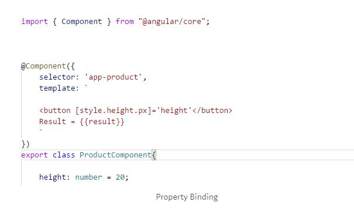
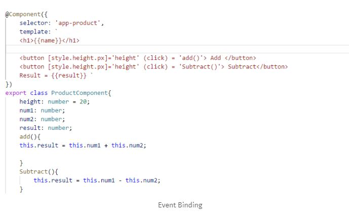
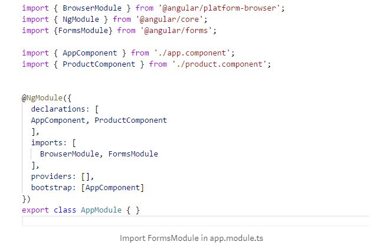
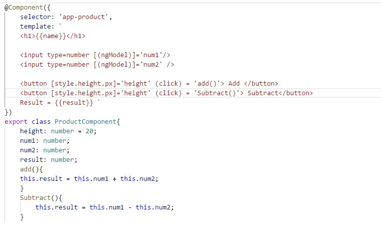


To understand data binding in angular, we need to know the meaning of binding the data. To put it simply, when the data changes its value, all the elements bound to it reflect changes automatically.

Data Binding can be both one-way or two-way. There are 4 types of Data Binding in Angular:

1. Interpolation
2. Property Binding
3. Event Binding
4. Two-Way data Binding

Interpolation is used to bind a value to a UI element. To interpolate a piece of data, simply put the elements inside curly braces in your HTML file.

> 
First Name: {{name}}

The value assigned to the variable ‘name’ in your typescript file is thus displayed with the help of interpolation.

Property Binding is another useful way of binding the value property of element with the variable name. For example, we want a button with its height as some specific value. To do property binding, the element is followed by [] with the property in these square brackets. As follows:

Event Binding is done to emit input event on the input element. Using event binding, input event would be bind to an expression.  
(input)= “expression” is event binding. Whenever input event will be fired expression will be executed. To do event binding, the element is followed by ()

To achieve two-way data binding, we use [(ngModel)]. To use ngModel directive, we need to import FormsModule in the application. Here is a snapshot of app.module.ts to see how FormsModule gets imported.

When typing into the input element, the input element’s value will be assigned to name variable and also it would be displayed back to the view.

This is how two-way binding takes place.  
<input type=number [(ngModel)]=’num1’/>  
<input type=number [(ngModel)]=’num2′ />


