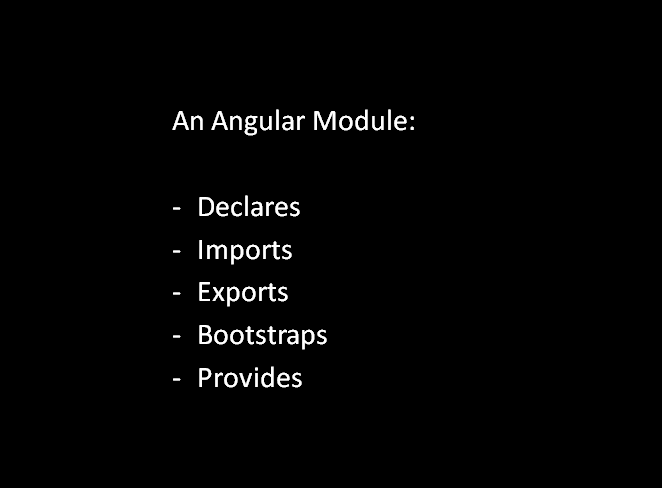


What is an Angular Module?  
A class with an @NgModule decorator which organizes the pieces of an application and extend our application with capabilities from the external libraries.

To start with, every angular application has a root application module, called AppModule and a root application component, called AppComponent. The AppModule bootstraps the AppComponent. Looks like this:

> bootstrap: [AppComponent]

Declarations array is used to declare components, directives, and pipes. All these declared components, directives, and pipes are private by default.

> declarations: [  
> AppComponent, bgColorDirective  
> ]

The Exports array of the NgModule allows us to share an angular module’s components, directives, and pipes with other modules. We export these so that they can be pulled in when some other module imports them.

The import array of NgModule allows us to import the supporting modules that export components, directives, and pipes.

> imports: [  
> BrowserModule, FormsModule  
> ]

In angular, we can register the provider service. In Angular version 6 and later, the way to register a service is by using the **providedIn**property in the typescript file of the Service. Like this:

> @Injectable () {  
> providedIn: ‘root’  
> }

In Angular, we can also create Feature Module and Shared Modules but that’s out of scope of this article. In the next article, we’ll discuss what is a Shared Module.

