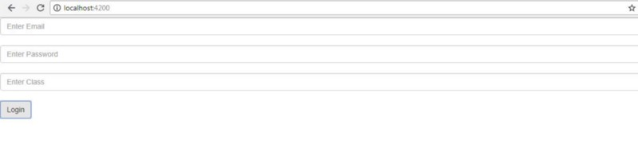
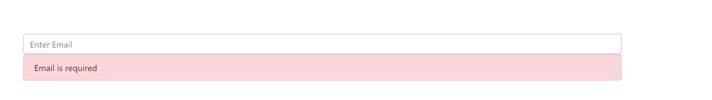
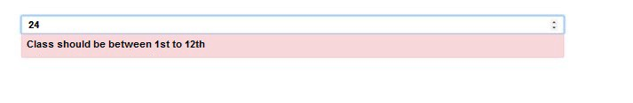


In Angular, there are two types of forms:  
— Template Driven Forms  
— Reactive Forms

If you are new to forms, understand these [**here**](https://angular.io/guide/forms). In this blog post, we will learn how to create custom validators for Angular Reactive Forms.

So, to start with, I assume that you have already created a project using **ng new.**Now, suppose we have created a reactive form using FormGroup.

https://gist.github.com/NishuGoel/e6a6b173daa9e40d2ff02b39225da7f2

Let’s attach it to the template of the component using property binding, as follows.

https://gist.github.com/NishuGoel/e158556d9562354fac07f9e292116661

This will display a reactive form like this.

Till now, we did not use any validation in our form controls. Angular provides us with many validators like maxlength, required etc. To use them, do not forget to import Validators in the component class.

i**mport { FormGroup, FormControl, Validators } from ‘@angular/forms’;**

Suppose we use validation on the email and password, here’s how it is done.

https://gist.github.com/NishuGoel/0a89e19a55993499d20bfe0bda8c5ba0

Inside **app.component.html**

https://gist.github.com/NishuGoel/34c7a628245b8cb9d6db0c35583f0875

This displays:

Now that we have applied validation to email and password, for class we want to create a validation for range such that the class should be from 1 to 12 only. In this case, we will have to write a custom validator as Angular doesn’t provide range validation.

So for that, we need to create a function that takes one input parameter of type AbstractControl and returns an object of key value pair in case the validation fails.

> function classValidator(control: AbstractControl) : {[key : string] : boolean} | null {  
> return null;  
> }

Here we have created a custom validator named classValidator where the user will be able to enter a class only if it’s in the given range. In case of failure of validation, it will return an object which contains key value pair.

In the component class,  
class: new FormControl(null, [classValidator])

On the Template, it goes like:

https://gist.github.com/NishuGoel/a039faadd732645fb488827e8430ce4b

This will display:

This is how Custom validators help us put validation to our form controls.

