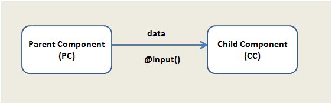


Want your components to share information? Yes, they can!  
Say you have two components, a parent component (PC) and a child component (CC) and you want the data to move from the parent component to the child component or vice versa, you use **COMPONENT COMMUNICATION/INTERACTION.**

There are multiple ways to achieve that. This article focuses on the use of **@Input()**to receive the data from the PC to CC.



@Input decorator is used to pass data from parent to child component. Now suppose we have created two components:  
***app.component.ts*** and ***child.component.ts***

Here, we have decorated the message property with the @Input() decorator so that value of the message property can be set from the parent component.

```typescript
import { Component,Input,OnInit } from '@angular/core';

@Component({
    selector: 'appchild',
    template: `<h2>Hi {{message}}</h2>`
})
export class ChildComponent  implements OnInit{

    _message: string; 
    constructor(){

    }   
    ngOnInit(){

    }
```

Now, let us modify the parent component AppComponent to pass data to the child component.

```typescript
import {Component } from '@angular/core';

@Component({
    selector: 'my-app',
    template: `<h1>Hello {{pmessage}}</h1>
  <appchild [message]="cmessage"></appchild>
  `
})
export class AppComponent  { 
  
        pmessage : string = "I am Parent";
        cmessage : string = "I came from Parent to child";
    }
```

Here we are setting the value of the child component’s property message with the help of parent component. To pass a value to the child component, we need to pass the property inside a square bracket and assign its value to any property of the parent component. We are passing the value of **‘cmessage’**property from the parent component to the ‘**message’** property of the child component.

Taking this example to the next level, there might be a situation where we’d need to intercept the data passed from the parent component. To do this, we need to use getter and setter on the input property.  
We create a property called \_message and using @Input() decorator, create getter and setter for the \_message property.

```typescript
import { Component,Input,OnInit } from '@angular/core';

@Component({
    selector: 'appchild',
    template: `<h2>Hi {{message}}</h2>`
})
export class ChildComponent  implements OnInit{

    _message: string; 
    constructor(){

    }   
    ngOnInit(){

    }
    @Input()
    set message(message : string ){
        this._message = message + "manipulated at child component"; 
    }
    get message(){
        return this._message;
    }
```

In the above example, we need to understand that the behavior of the parent component is not changed when we intercept the message. Now let us take another case where if the parent passes empty value, then the child component displays some default value.

```typescript
import { Component,Input,OnInit } from '@angular/core';

@Component({
    selector: 'appchild',
    template: `<h2>Hi {{message}}</h2>`
})
export class ChildComponent  implements OnInit{

    _message: string; 
    constructor(){

    }   
    ngOnInit(){

    }
    @Input()
    set message(message : string ){
        this._message = (message && message.trim()) || "I am default message";
    }
    get message(){
        return this._message;
    }
}
```

It checks here if the value passed is an empty string. If yes, we assign the default value for message in the child component.

This is one-way communication between components. In the upcoming article, we’ll see component communication both ways.

