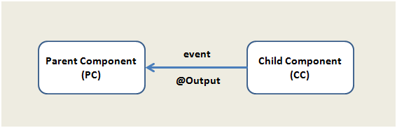


So, I have an event in one component and I want it to get handled in another component. Does Angular allow me to do that?

Big yes! In @angular/core, we have @Output and EventEmitter which allow us to emit event from one component to another.



Let us see how to do this.  
So, to execute a function of parent component on the click of a button in child component, we use the decorator @Output

Say there is a button inside the child component and we create a variable index which is passed as the parameter of the event.

```typescript
import { Component, EventEmitter, Output } from '@angular/core';
 
@Component({
    selector: 'app-child',
    template: `<button class='btn btn-primary' (click)="food()">Click me</button> `
})
export class AppChildComponent {
 
    @Output() foo = new EventEmitter();
    index = 0;
 
    food() { 
        this.index = this.index + 1;
        this.foo.emit(this.index);
    }
}
```

Here we have created a function food() which gets called on the click event of button and event foo is emitted. The parameter takes the value of index.  
Now, using the child component inside the parent component like:

```typescript
import { Component, OnInit } from '@angular/core';
@Component({
    selector: 'app-root',
    template: `<app-child (foo)='displayCounter($event)'></app-child>`
})
export class AppComponent implements OnInit {
  ngOnInit() {
  }
  displayCounter(count) {
    console.log(count);
  }
}
```

So this is how we could call the function in the parent component on the click event of the button placed in the child component.  
Each time we click on the button, the index value is increased by 1.

Using @Output comes very handy when it comes to providing better user interaction.

