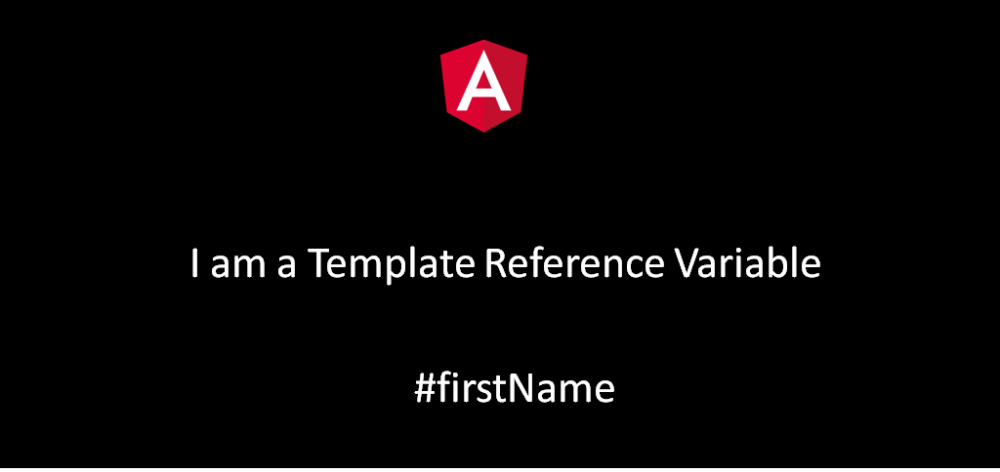


In this article, we will discuss the use of a template reference variable for component communication.



A template reference variable is used to give reference to a DOM Element, a component, directive, or a web component within a template. This variable can then be used anywhere inside the template.

This is done ***using a # symbol***inside the template. Let us see how it is done.

```html
<input type = "text placeholder = "What is your name?" #name>
<button (click) = display(name)>What is the name? </button>
```

Inside the typescript file, let us simply display the value of the template reference variable using ***console.log***

```typescript
import {Component, OnInit } from '@angular/core';

@Component({
  selector: 'app-root',
  templateUrl: 'app.component.html'
})
export class AppComponent { 
    display(name: HTMLInputElement){
      console.log(name.value);
    }
}
```

So this is how we create a template reference variable and use it anywhere inside the template.

