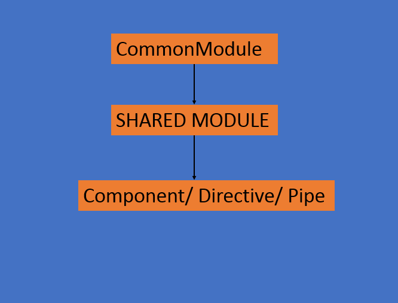
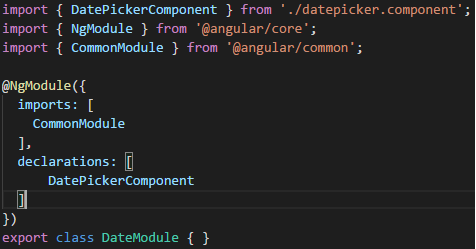


In Angular, we can create different feature modules for every feature. Each one of these features would require importing the CommonModule and other imports too. Do we really want to repeat all this for every feature module? Or do we have an alternative?

Yes, We can define a Shared Module.  
A Shared Module is used to organize a set of commonly used pieces into one module and export them to any module that imports the Share Module. This allows us to selectively aggregate the reusable components that we have and re-export them into one consolidated module.

So, suppose we create a Shared Module and we want to add the components, directives, or pipes. After adding some component, we would need to import a CommonModule because our components might need it. Remember that we always need to re-export the modules so that it is available to the components and any module that imports the Shared Module.

To create a shared module,

> ng g m shared/modshare –flat -m products/prod.module

Here, modshare is the name of our shared module which resides in the shared folder.  
The command –flat is used so that Angular CLI doesn’t create a new folder. To import the module into a different module, we use -m and the name of the module.

Our shared module looks like this now:

shared.module.ts

Now you can add other imports, declarations, exports etc. and use you shared module.

