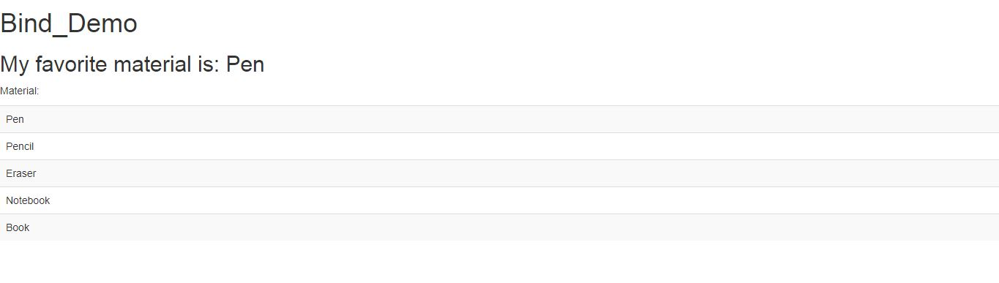
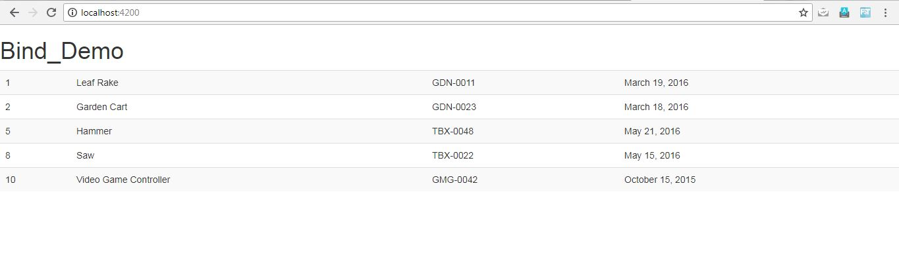


In this article, we will learn how to bind an array to a HTML table.  This means that we want the elements in our array and their attributes to be displayed on the view.

For this, we will mainly use some hard-coded data and structure directives like \*ngIf and \*ngFor.

So, initially, if we have a  component.ts file in our project, it will look like this:

```typescript
export class AppComponent {
  title = 'Bind_Demo';
  material = ['Pen', 'Pencil', 'Eraser', 'Notebook', 'Book'];
  mymat = this.material[0];
}
```

Now to display these items on the view, we would need to use \*ngFor which is a structure directive.  
So, inside the HTML file app.component.html,

```html
<h1>{{title}}</h1>
  <h2>My favorite material is: {{mymat}}</h2>
  <p>Material:</p>
  <table>
    <tr *ngFor="let mat of mymat">
     <td> {{ mat }} </td>
    </tr></table>
  
```

This will give result like:



Now, we want to display the attributes of these elements, so for the sake of convenience let us hard-code the data.

```typescript
import { Component, OnInit } from '@angular/core';

@Component({
  selector: 'app-root',
  templateUrl: './app.component.html',
  styleUrls: ['./app.component.css']
})
export class AppComponent implements OnInit {
  ngOnInit(): void {
    this.data = this.getData();
  }
  data: any;
  title = 'Bind_Demo';

  getData(){
  return [
    {
        "productId": 1,
        "productName": "Leaf Rake",
        "productCode": "GDN-0011",
        "releaseDate": "March 19, 2016",
        "description": "Leaf rake with 48-inch wooden handle.",
        "price": 19.95,
        "starRating": 3.2,
        "imageUrl": "http://openclipart.org/image/300px/svg_to_png/26215/Anonymous_Leaf_Rake.png",
        "width": 20,
        "height": 20
    },
    {
        "productId": 2,
        "productName": "Garden Cart",
        "productCode": "GDN-0023",
        "releaseDate": "March 18, 2016",
        "description": "15 gallon capacity rolling garden cart",
        "price": 32.99,
        "starRating": 4.2,
        "imageUrl": "http://openclipart.org/image/300px/svg_to_png/58471/garden_cart.png",
        "width": 30,
        "height": 30
    },
    {
        "productId": 5,
        "productName": "Hammer",
        "productCode": "TBX-0048",
        "releaseDate": "May 21, 2016",
        "description": "Curved claw steel hammer",
        "price": 8.9,
        "starRating": 4.8,
        "imageUrl": "http://openclipart.org/image/300px/svg_to_png/73/rejon_Hammer.png",
        "width": 20,
        "height": 20
    },
    {
        "productId": 8,
        "productName": "Saw",
        "productCode": "TBX-0022",
        "releaseDate": "May 15, 2016",
        "description": "15-inch steel blade hand saw",
        "price": 11.55,
        "starRating": 3.7,
        "imageUrl": "http://openclipart.org/image/300px/svg_to_png/27070/egore911_saw.png",
        "width": 20,
        "height": 20
    },
    {
        "productId": 10,
        "productName": "Video Game Controller",
        "productCode": "GMG-0042",
        "releaseDate": "October 15, 2015",
        "description": "Standard two-button video game controller",
        "price": 35.95,
        "starRating": 4.6,
        "imageUrl": "http://openclipart.org/image/300px/svg_to_png/120337/xbox-controller_01.png",
        "width": 20,
        "height": 20
    }
];
  }
}
```

And, inside the app.component.html, we display it like:

```html
<h1>{{title}}</h1>
<table class = 'table table-striped' >
    <tr *ngFor = 'let f of data'>
        <td>{{f.productId}}</td>
        <td>{{f.productName}}</td>
        <td>{{f.productCode}}</td>
        <td>{{f.releaseDate}}</td>
    </tr>
</table>
```

This will show up the table with all the elements and their attributes as follows:



This is how we bind our array to an HTML table. Your turn to try now!

