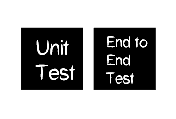
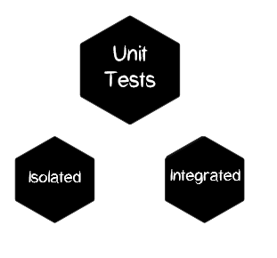
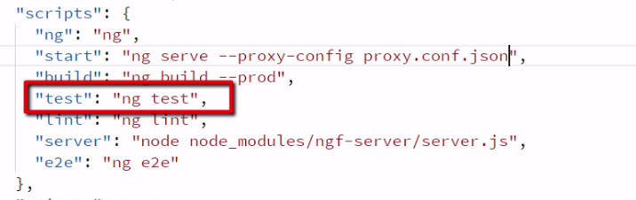
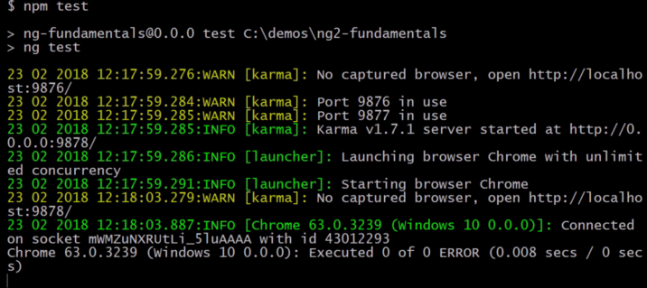
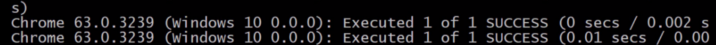


Before going on to test our angular code, we need to understand what is a unit test.

A Unit test is defined to be a test on a single unit,where unit can be a single class or a group of related classes.

There are 2 types of tests we often talk about:  
– Unit Test  
– End to End Test



Types of tests

Unit tests are fast and involve isolated pieces of code which is not the same case for end-to-end tests. In this article, we will focus on unit testing of our code.  
Talking about the structure of the Unit test, there are two:  
– AAA (Arrange, Act, Assert)  
– DAMP

In this process, the first step is to Arrange i.e., create.

> **var person = new User(“Shashank”);  
> person.friends = [“Vishwanath”]**

To act,

> **person.addFriend(“Sayoni”);**

Finally the assertion,

> **expect(person.friends.length).toBe(2);**



Isolated unit tests test the class only and not the template, whereas the integrated tests test the class and template. To test Services and Pipes, isolated tests are preferred. On the other hand, to test components and directives, integrated tests are used.

Now let us see how to run tests in Visual Studio Code.

**Step 1.** Go to package.json file and under scripts section, look for test script. it should look something like this:



**Step 2.** Go to command line and run **$npm test.** This will install Karma and also open the result in the browser window. Should look like:



**Step 3.** Now, Karma will look for a spec.ts file, so go to app and under that, create a new file **test.spec.ts**

```typescript
describe('first tests', () => {
  it('should be true', () => {
    expect(true).toBe(true);
  })
})
```

It will display as follows on the command line:



We can create more tests in the same file using the **it** method.

