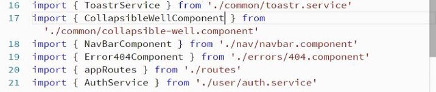


Want to change the content inside your component and re-use them? Well, That is what we use Content Projection for, in Angular.

Let us start by defining what Content Projection is. A feature with the help of which we can have a component with a kind of visual wrapper, and the content inside that wrapper decided beforehand.

For example, there is a dialog box which we can use with different pieces of content and that way, we would not need to re-implement common functionality.

Before going on to create one, we need to understand that since it is a common component that can be used anywhere, we need to create this new file inside the common directory.

https://gist.github.com/NishuGoel/56f721dda79c15bb0c8406e014984331

Here, we have created a new component collapse.component.ts and to make content projection work in it, we need to use the tag <ng-content> inside the template. However, we may want to add the toggle functionality to our content projection feature. To do that, we set it to visible using the structure directive \*ngIf.

Now that we have successfully applied content projection to our component, we will simply add it to the module and declare it.

module.ts

In the next article, we will learn multiple slot content projection.

