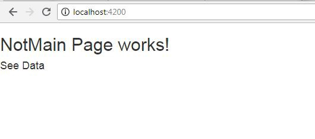
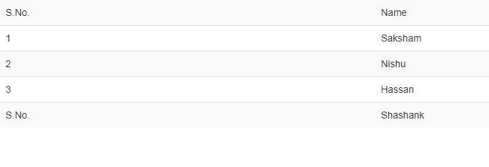


Traditionally, when we wanted to access a file, we used to ask the server to get that file and then it used to get displayed. Every time a file was retrieved, the page needed to get loaded.

However in the modern web applications and due to frameworks like Angular, it has become very simple now. We actually do not need to load all the pages but just index.html which will later help access all the other pages in the application.


Something like this!

To do this in Angular, we use the concept of Routes and navigation pages. Let us start by understanding what actually Routing is!

> Routing is displaying different content on different pages, splitting up content on different pages, creating special authorized access-only pages.

To start routing, the very first step is to import ***RouterModule***from ***@angular/router***Inside app.module.ts,

```typescript
import { BrowserModule } from '@angular/platform-browser';
import { NgModule } from '@angular/core';
import {RouterModule} from '@angular/router';
import { AppComponent } from './app.component';

@NgModule({
  declarations: [
    AppComponent, MessageComponent
  ],
  imports: [
    BrowserModule, RouterModule  
  ],
  providers: [],
  bootstrap: [AppComponent]
})
export class AppModule { }
```

After importing the router module, suppose we have created two components ***main.component.ts*** and ***notmain.component.ts***; Make sure adding these in the module.ts file.

```typescript
import {MainComponent} from './main.component';
import {NotmainComponent} from './notmain.component';

@NgModule({
  declarations: [
    AppComponent, MainComponent, NotmainComponent
  ],
  imports: [ 
    BrowserModule, RouterModule  
  ],
```

Now coming back to the import statement of RouterModule, we want to add a definition of how our route should look like. To do that, we need to add a method ***forRoot()***which accepts the array of routes. It will look like:

```typescript
imports: [
    BrowserModule, RouterModule.forRoot([
    {
      path: 'notmain',
      component: NotmainComponent
    },  
    {
      path: '',
      component: MainComponent
    }  
    ])
  ],
```

This renders the component we loaded into the router-outlet tag in the HTML file of app.component.

```html
<router-outlet></router-outlet>
```

This tag displays components which the component property of the RouterModule tells it to.  
The next step is to go to the HTML file of ***NotmainComponent***and,

> <p>NotMainPage works!</p>  
> <a routerLink= “\notmain”>See data</a>

This way, Angular tells that this particular link is not an external link but a special link that needs not reload.

Showtime! Let us see the output of what all we have done.



Page 1

After clicking on See Data, we get routed to Page 2 where our data is present.



Page to which we routed from page 1

This was a very basic example of routing that we just did. However, there are many more complex requirements that we are able to solve with Routing in Angular.

