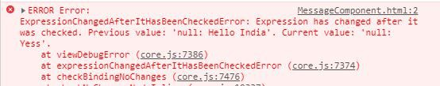
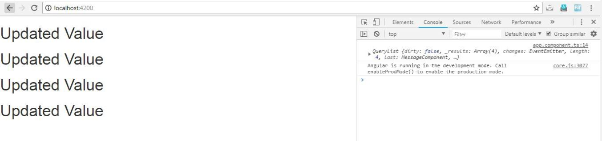


A ViewChild is a component, directive, or element as a part of a template. If we want to access a child component, directive, DOM element inside the parent component, we use the decorator @ViewChild() in Angular.

To understand this, suppose we have two components, a child and a parent one. Since the child component can be located inside the parent component, it can accessed as @ViewChild.

https://gist.github.com/NishuGoel/156f5c7c7efd38c53bd0b6c8797d9c65

In the above code, we imported @ViewChild decorator and then imported the lifecycle hook AfterViewInit and implemented it. Now, to change the property value, we can make use of the viewchild we just create like:

> ngAfterViewInit(){  
> this.chviewChild.message = ‘Changed value of View Child’  
> }

This will output the value **Changed value of View Child,** but will throw an error saying “**Expression has changed after it was last checked**”.

To handle this error, we use Change detection using ***ChangeDetectorRef***

https://gist.github.com/NishuGoel/9b9844ae2255b65743b65502449175d9

Here, we have imported ***ChangeDetectorRef***from ‘@angular/core’ and injected it to the constructor. We have also called the method ***detectChanges()***.

This was for one child element located inside the component template, but what in the case when we have multiple references to the child element?  
That is when @ViewChildren comes into play.

https://gist.github.com/NishuGoel/893dbf7e8a6d81fd8f3b9ac247230a67

Modifying the template,

https://gist.github.com/NishuGoel/d97c97ca24c62ef22f2d58246a056417

Finally, marking the reference of ViewChildren with type QueryList,

https://gist.github.com/NishuGoel/d5511ee247a738ae4022b4c5e0a1b8dc

Now, we can update the value of the message property using Viewchildren inside the ngAfterViewinit() life cycle hook like this:

> **this.chviewChildren.forEach((item) => {item.message = ‘Updated Value’;});**

Let us look at the final code now:

https://gist.github.com/NishuGoel/bcbb1f06e21d72b5b936006def00cd2b

This gives us the output as:


