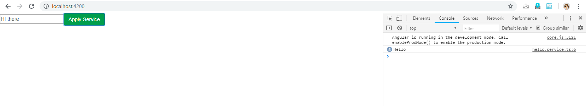
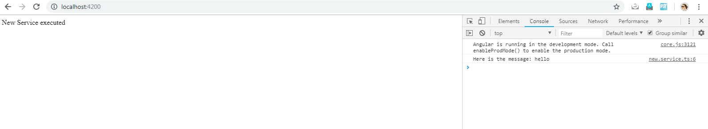
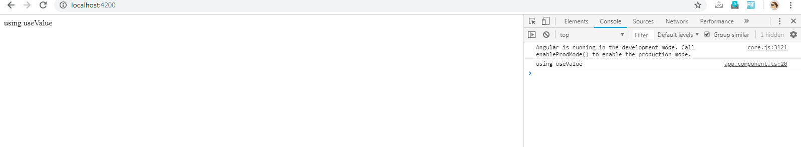


We have learnt the concept of Services and Dependency injection in our previous article. Read here: [Understanding Services and Dependency injection](https://nishugoel.wordpress.com/2018/08/24/understanding-services-and-dependency-injection/)

When we inject a service, the Angular injector needs to look at the Service providers to create an instance of that particular service.  The provider determines which instance of the service should be injected at the runtime in the component, module, pipe or directive.

To understand, let us create a service first.

https://gist.github.com/NishuGoel/d4694056f6e60ff11dd300839d9ae3ab

Inside the component,

https://gist.github.com/NishuGoel/aa8383a3db724a60f4da8922f16d19c6

Here, we imported the service, injected it and used it inside the component to log the hello message. Also, we provided the injected service inside the providers array. Let us look at the output.

After applying the service,

A providers therefore, determines that how the object of a particular token is created.

**TYPES OF PROVIDERS**

1. Type Provider
2. Class Provider
3. Value Provider
4. Existing Provider
5. Factory ProviderThe syntax for using providers is :

> providers: [{  
> provide: HelloService, useClass: HelloService  
> }]

The provide property here is used for locating the dependency value and registering the dependency. On the other hand, the second parameter  has 4 different values:

1. useClass
2. useExisting
3. useValue
4. useFactory

### **useExisting**

This is used to avoid creating two instances of the same Service. Inside the new service,

https://gist.github.com/NishuGoel/df0781c50730aabb2fb989a702b7f830

To use **useExisting inside the component now,**

https://gist.github.com/NishuGoel/4e0b773b75b8b511f152fae487922466

## **useValue**

When we do not want to create an instance but pass the object directly, we use **useValue****.**

https://gist.github.com/NishuGoel/2ae882a6608703aab5dfc2242a897f21

Output:

### **useFactory**

When the information about our dependency is dynamic, that is when **useFactory** comes into play.

https://gist.github.com/NishuGoel/c7e7480a8561d08b4f43986db4ef4e27

Here, when the value of i equals 0, the output comes from the first service, i.e., HelloService, in any other case, the output comes from the second service, i.e., NewService.

To see the working of what we just created , go to my project here on Stackblitz (<https://angular-9bljze.stackblitz.io>) and try yourself!

