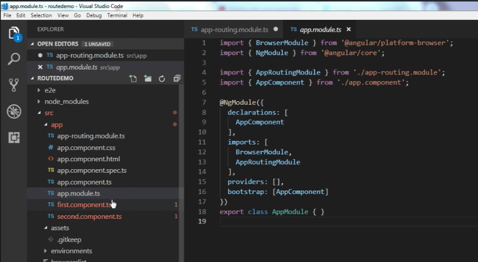
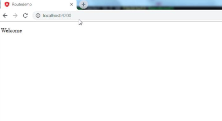
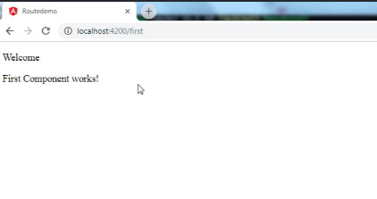
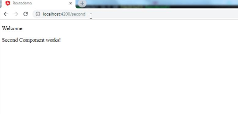


Displaying content on different pages, splitting up the content on different pages, creating special authorized access-only pages is what Routing is used for.

To create a basic route Angular application, let us start by creating a routing project using Angular CLI like stated below:

> ng new routedemo –routing

In the above command, we simply instructed Angular CLI to create a project which involves routing and that it must create a separate **app-routing** module. In Visual Studio Code, we can see:

Now that CLI has set up the environment for us, let us go on to import some statements.

**Step 1.**   Make sure that **AppRoutingModule** is imported inside the **app.module.ts**  
**Step 2.**   Inside app-routing.module.ts, use the following import statement.

> **import {Routes, RouterModule} from ‘@angular/router’;**

**Step 3.** Angular CLI also generates a routes array to include the list of pages which are to be routed to as:

> **const routes: Routes=[];**

Inside the routes array, there are two main properties:

a) path  
b) component

To begin with creating a route from one page to another, let us create two components. let us name them **first.component.ts** and **second.component.ts**

Our components should look like this:

##### 1first.component.ts

##### 2second.component.ts

Now, to give a path and component to our created components, we go to the routes array:

> {path: ‘first’, component: ‘FirstComponent’},
>
> {path: ‘second’, component: ‘SecondComponent’}

Now after compiling it, let us look at the results.

**Homepage (localhost:4200)**

**Route to First Component (localhost:4200/first)**

**Route to Second Component (localhost:4200/second)**

To summarize, using the path and component properties of the routes array and importing all the required modules, we can create basic routes in Angular.

