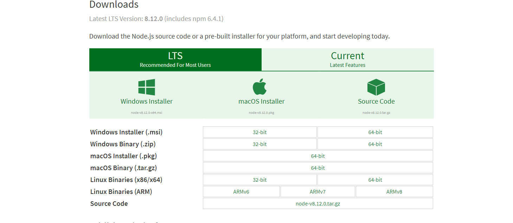
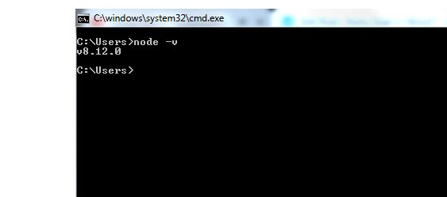
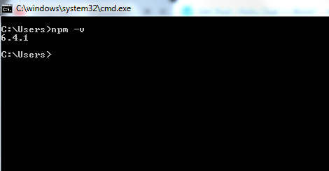
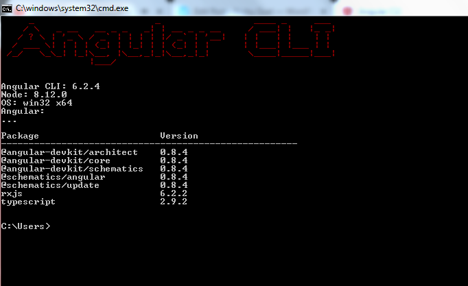


To begin working in Angular, a typescript-based framework, we need to set up the development environment in our systems.

In this blog post, we will see:  
– How to set up a node development environment (installing Node.js)  
– Checking the version of installed Node and NPM (Node Package Manager)  
– Installing Angular CLI  
– Checking the version of installed CLI

To continue with the first step of setting up the environment,  install the node if you don’t have it installed already. To install the latest version of node, go to [nodejs.org](http://nodejs.org)

Choose the zipped file as per the operating system in your machine, and install the file. To check if it is successfully installed, go to the command line and check the node version using the command:

> **node -v**

This is how the node version will get displayed if it is properly installed.

Also when we installed node, the node package manager also got installed with it. to check if npm too is installed in your machine, use command:

> **npm -v**

And this is how the npm version will get displayed if it is properly installed.

Now that we have node and npm installed properly on our machines, the next step is to install Angular CLI which is our major focus.  
To install Angular CLI, let us go to the command prompt and use the command:

> **npm install -g @angular/cli**

Here, we use the node package manager to install CLI and the latest version of it is installed in the machine. This is how it would look on the command prompt.

The angular CLI installed screen also displays the version of it, the version of node in the system, the Operating System. Also, it will display the different packages of angular installed.

Later sometime, if we want to check the angular version, we can use the command:

> **ng -version**

Now, we are all set to create a new project in Angular.

In the next blog post, we will see how to create a new project in Angular using CLI and compile it.

