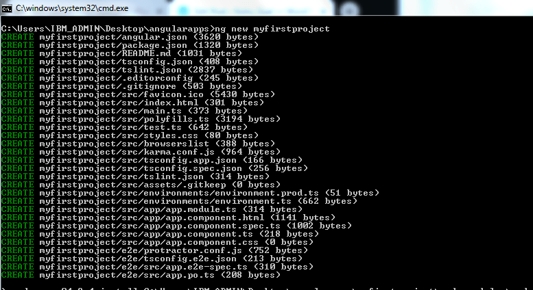
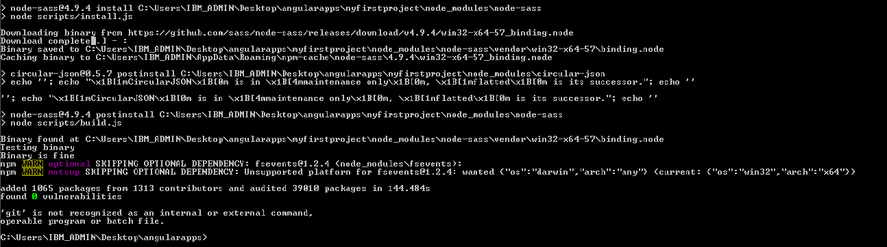
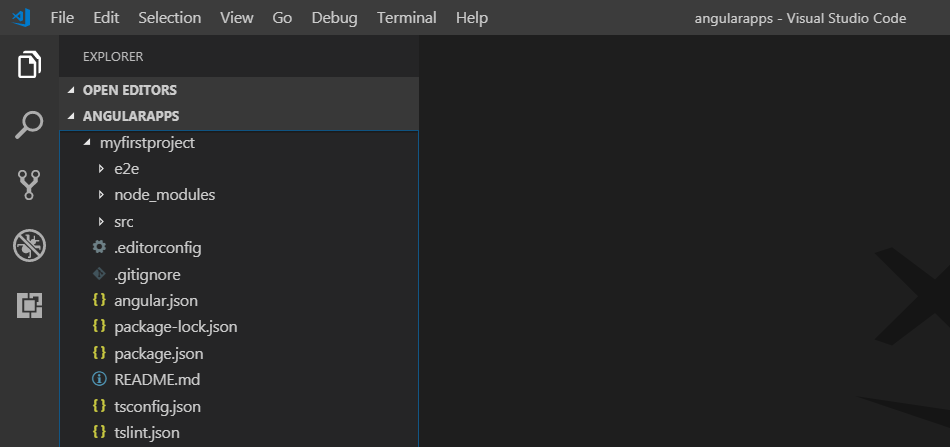
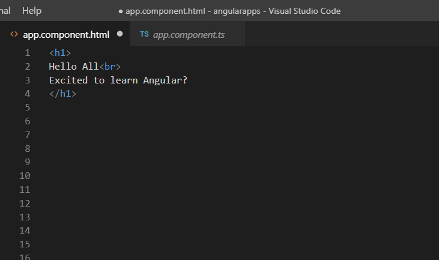
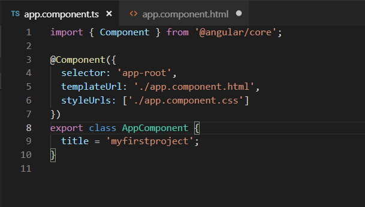
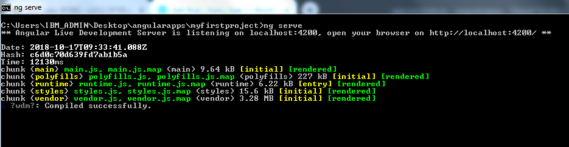
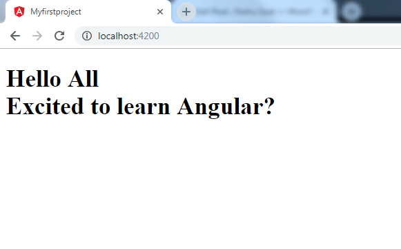
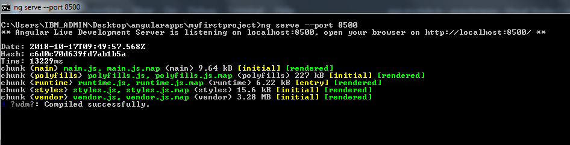
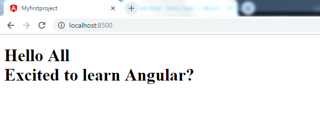


In this blog post, we will see how to create a new project and start working with all the concepts in Angular.

Some of the pre-requisites to begin with are:  
– Installed Node.js and Node Package Manager (NPM)  
– Installed Angular CLI  
– Visual Studio Code

Step 1 is to go to the command prompt and create a new Angular project. Make sure that you are inside the directory where you want to create this new project. The command used to create a new project is

> **ng new *project-name***

In this command, we instruct Angular CLI to create a new project using the new keyword and provide it with the name of the project. And then when we press **Enter,**various operations will start running on the terminal.

CLI just created a new angular project for us with all the required modules and components.  
Let us go to Visual Studio Code and see what has been done for us by CLI. To go to VS Code from the command prompt, we use:

> ***code .***

Inside VS Code now, we see CLI has create the component file and the app module for us. It looks like this:

Now, let us create a very simple program where in we want to display some text on the browser. Let us go to the HTML file of our AppComponent.

Inside the **app.component.ts**,

The **app.module.ts** looks like this:

Now that we have created our program, let us go and compile it.

To compile an Angular project, we go to the terminal and use the command:

> **ng serve**

We could compile our program successfully. CLI also displays the port no. which will be used on the browser.

In our case, the port is **localhost:4200**

We can also change the port no. in case the port that we are trying to access is already in use. To do that, we use the command:

> **ng serve –port portno**

Now, let us try to access this port on the browser,

And we have successfully created our first program.

