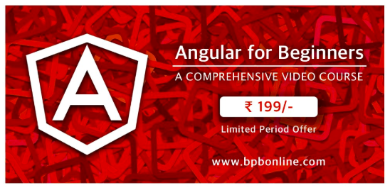


To all the beginners of Angular out there, here is a step-by-step video course for you all. This course will focus on creating web applications using the JavaScript framework Angular and will walk us through a journey of learning how to install Angular to learning how to route from one page to another using components, directives, modules, routing etcetera.

This course is made and published with **[BPB Publications](http://bpbonline.com)**, **Asia’s largest publishers of computer books in India from last 58 years.**By the end of this course, you will be able to create a dynamic Angular web application.

The course comprises the following topics:

**Setting up Development Environment**

a. Installing NodeJS : 30 sec

b. Installing Angular CLI

c. Create new project

d. Run project

e. Explain how you can change port number

**Adding Component**

a. Introduction

b. Add component using CLI

c. Add component manually

d. Show options of Template and TemplateURL

e. Show options of Style and StyleURL

**Data Binding**

a. Introduction

b. Interpolation

c. Property binding

d. Event Binding

e. Two way Binding

f. Demo on Binding

**Adding Module**

a. Introduction

b. Adding Module using CLI

c. Adding Module Manually

**Adding Service**

a. Introduction

b. Adding Service using CLI

c. Adding Service Manually

d. Demo on Service

**Component Communication**

a. Introduction

b. @Input

c. @Output

d. Temp Ref Variable

**Forms in Angular**

a. Introduction

b. Template driven forms

c. Reactive Forms

**Working with API**

a. Using $http service

b. Read data

Create data

Update data

Delete data  
**Routing in Angular**a. Introduction to Routing  
b. Create Basic Routes  
c. Create Route Modules  
d. Navigating from one route to another

Refer to the whole course here: <https://bpbonline.teachable.com/courses/angular-for-beginners>

**Consider watching it in just Rs. 199/- (2.73 USD).  
Any queries/feedback is welcome. Mail me at [nishu0505@gmail.com](mailto:nishu0505@gmail.com)**

