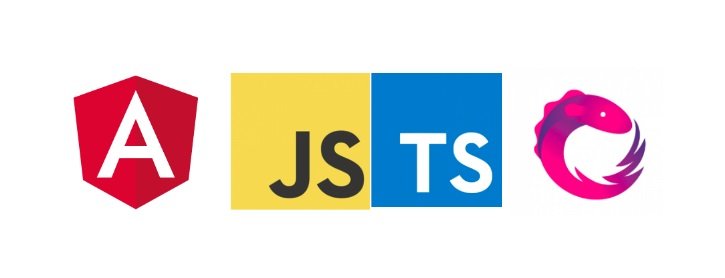


February 23, 2019 is the date.  I will be speaking in India’s largest Angular conference, **ng-India**. I will be talking about @HostBinding() and @HostListener() in Angular.

ng-ind.com

The conference starts at 7:30 AM in the morning with the registration process, some talks followed by timely snack and lunch breaks. A welcome note by the organiser of ng-India, [Mr. Dhananjay Kumar](https://debugmode.net/)

This will be followed by some more talks and then a panel discussion with the best speakers of the industry, finally coming to an end with the speaker felicitation process.

Venue: [**Fortune Select Excalibur Hotel, Gurgaon, India**](https://www.fortunehotels.in/gurgaon-fortune-select-excalibur.dh.35)

To get the tickets to the conference, **[buy here](http://ng-ind.com)**.

I am very excited to speak at **[ng-india](http://ng-ind.com)** and to see you all there.

