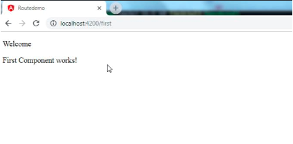
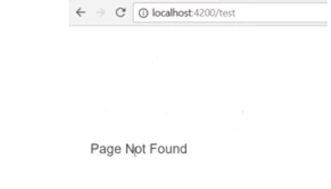


In a routing-based angular application, we create different routes to be directed to, and for that we create different components. If you are new to routing, refer to my previous article on how to create basic routes in Angular [**here**](https://nishugoel.wordpress.com/2018/10/10/creating-basic-routes-in-angular/).

To start with understanding what are wildcard routes, let us first assume that we have already created two routes in our angular application. These are First Component and Second Component.  
Inside app-routing.module.ts, we have:

#### {path: ‘first’, component: ‘FirstComponent’}, {path: ‘second’, component: ‘SecondComponent’}

And the code in components looks like:

https://gist.github.com/NishuGoel/6b79325e2b40e39b24a7a4774da00e0c

**FirstComponent**

https://gist.github.com/NishuGoel/69d6f73af2b10bb8f3d3c716460c9d36

**SecondComponent**

Now that we have two components ready to be routed to, let us try to understand the concept of WildCard routes.

If the requested route URL does not belong to what’s mentioned in the code, we get an error in the console. For example, I have two components in my application,  
localhost:4200/first and localhost:4200/second.   
Now if I try to request localhost:4200/test, Angular will throw an error in the console like this:

This is because inside our application, there is no component like TestComponent. So to avoid this error, and instead tell the user that the route doesn’t exist, we use **WILDCARD ROUTES.**

For this, we create a new component Page-Not-Found, and redirect the user to this component whenever there is an unknown route request. In the working of routes, the order of the routes matters a lot.  
Since the wildcard route match every other route, it needs to be mentioned in the last. This is so as to make sure that if none other route is matched, then only PageNotFound Component should be redirected to.  
Generate a new component using,  
**ng g c PageNotFoundComponent**

https://gist.github.com/NishuGoel/692c7cc891254c707631fa21219f3e82

PageNotFoundComponent

And now, specify it inside the const routes,

https://gist.github.com/NishuGoel/7aa350098c1b45ab1af85939d1c58cba

app-routing.module.ts

Now when we go to the browser, it displays page not found. this is because localhost:4200 is an unknown route because we have not defined it. So to do that, we create another route request in the app-routing.module.ts like this:

https://gist.github.com/NishuGoel/86ecc0ba54dcdef6e69c1f9969897930

This gives us the first default page as the FirstComponent.

Default

The other way of doing it is instead of specifying the component, we specify the path. To do this,

> {path: ‘ ‘, **redirectTo**: ‘/first’, **pathMatch**: ‘prefix’}

The other possible value of pathMatch is ‘full’ which basically says that if full URL is empty, then redirect to /first, which is the FirstComponent.

Now finally when we go to localhost:4200/test, we get this:


