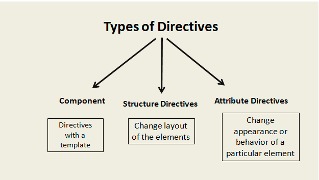


Want your DOM (Document Object Model) element to behave in a certain manner, yes you can do that in Angular. We can attach a specified behavior to a DOM element in our angular application. This is done with the help of a decorator @Directive.

Directives are a like a marker on our DOM elements which make them behave in a specified manner. There are a lot of built-in directives in Angular under different categories which we will discuss in a while.

### ***What for do we use Directives?***

Directives are mainly used when we want a re-usable HTML Component, a re-usable HTML behavior, or any time we interact with the DOM.

The naming convention followed by the directives is ***ng*** followed by the ***purpose of the directive***. However, when we create our own custom directives, we are free to use any convention as per our convenience.

Some of the most commonly used directives in Angular are:

* ng-bind,
* ng-model,
* ng-hide,
* ng-init etc.

Talking about the different types of Directives in Angular, there are three types of directives.

* Component
* Attribute Directives
* Structure Directives

### ***Components***

Components are the most commonly used directives in Angular which when used as a decorator above the class make it behave as per the specified behavior in the directive definition. These are also known as **Self-contained** directives.

Components have their own HTML known as template. An example of a component is listed below:

https://gist.github.com/NishuGoel/221df2d972ba13dc26b0315b7f319323

### *Structural Directives*

Structural Directives are the directives that are used to modify the layout by adding or removing the DOM elements. These are like conditional directives.

The most commonly used structural directives are **\*ngIf** and **\*ngFor**. Let us first see how \*ngIf works.

https://gist.github.com/NishuGoel/1d15cdc9ff540844216541d0b9cf399e

In the above code, if the value of show is true, it will display Show on the browser, else nothing; just like an if statement.

Similarly, an \*ngFor directive works like a for loop. Lets see the code in the listing below:

https://gist.github.com/NishuGoel/86eb868afa26583863d6ceb73f0fc4bd

There are many other structure directives like ngSwitch, ngSwitchWhen etc.

### ***Attribute Directives***

Now when we want to change the attribute, as the name suggests, the color, font style, background color, function of a property, we use attribute directives in that case.

Now suppose, I have some text on my browser and I want to change the color and the font size of that text. To do that, I would need to use attribute directive. One more important thing to know here is that we can also create our own custom attribute directives and apply our own specified behaviors to the objects, but we’ll come to that later.

Let us see an example of Attribute directives:

https://gist.github.com/NishuGoel/94c11bfc45526ef6837cff32c61e3351

This is one example of using Attribute Directives. As we discussed earlier, we can also create our own custom attribute directives.

These are the steps to be followed when ever we want to create our custom attribute directive.

1. Create a directive by decorating a class with  
   the ***@Directive*** decorator.
2. Inject Services ***ElementRef*** and ***Renderer*** for component communication.
3. Register your directive in the module.
4. Use your directive 🙂

To learn in deep about Custom Attribute Directives, refer [***here***](https://nishugoel.wordpress.com/2018/08/24/custom-directives-in-angular/).

