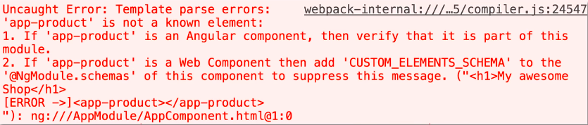
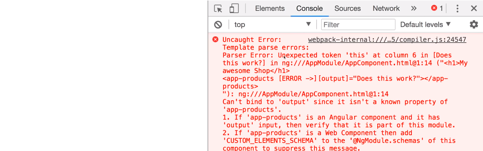
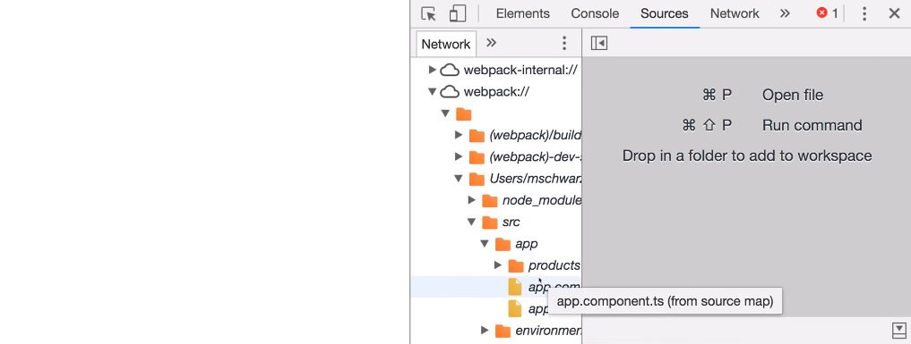


We have been working with a variety of concepts in Angular, but when it comes to debugging our Angular application, that’s when it becomes one of the hardest parts of the job.

The very first step when it comes to solving the errors in our application is reading and comprehending the error messages correctly. Most of the times, we end up figuring out the error to be something else which the compiler actually doesn’t mean or point to. Also, sometimes, the compiler gives the incorrect error but points to the correct file, and then when we go to the file and check, we are mostly able to find out the syntax error which resulted in the wrong compile error message.

#### ***Comprehending the error message***

For example, listed below is the error message displayed by the compiler.

In this case, the compiler says that app-product is not a known element for some reason. We often get such an error when we forget to declare our custom components inside the module. Or maybe when we have added the component, there might be a case that we have multiple modules inside our application but they aren’t interacting properly.   
Or check for syntax errors in the selector name or the component declarations.

And if still we aren’t able to figure out the error, GitHub and stack**overflow** threads always come to rescue!

#### ***Using console.log() approach***

Now after we have read the error messages correctly, another approach to debug our angular app is to use the conventional method of using **console.log()** and logging various properties, objects etc. to have a look at them in the JavaScript console in the browser and check their values at different stages in the program. This is obviously not the best approach to debug our application but comes handy many a time.

https://gist.github.com/NishuGoel/c7cb4d94fca191850fd368097979e81b

Here, console.log will display and check for bug, if any! We will be able to locate the error then.

#### ***Source Maps***

Another method is to use the Source
maps that CLI provides us. Source maps are the little files that are used by
the browser developer tools to create a bridge from the compiled JavaScript
code running in the browser to the original files that we find much easy to
read. So, Source Maps are used in conjunction with the browser developer tools.

For example,

We have this broken Angular code which shows some error. Now to us the source map, we go to the Sources section inside the browser console and look for the webpack folder under the CLI project. Inside the webpack folder, we’ll find src>app and this app folder replicates our app structure, so we can go peep into any of our typescript files and set the breakpoints there in to look at the property values at any point of the running application.

These tools are very powerful to use as they enable us to play around and check for bugs very easily. Also, the best part is that these tools are available online for free.

#### ***Augury***

Augury is a Google Chrome Dev Tool extension for debugging
Angular apps at runtime. It gives a detailed insight of the working of the app.
The pros of using Augury over the Browser Dev tools is that Augury is aware of
the Angular architecture i.e., it gives an overview of the components, properties,
dependency injections etc. which DOM doesn’t have access to!

Augury can be downloaded from the chrome dev tool extensions:

#### ***Redux Dev tools***

Last but definitely not the least, when we use NgRx, we take
help of Redux Dev tools, which are associated to the NgRx applications. We can
have a look at the NgRx store with the help of redux dev tools starting from
creating the Reducer to the Store.

These are some of the best tools to work with and debug the
Angular applications.

