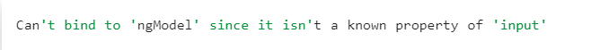
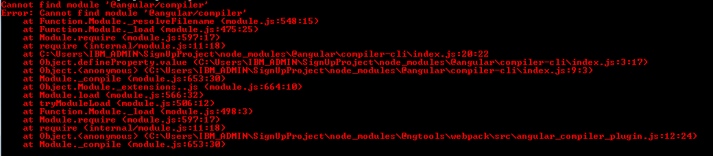


Recently, I was working on a project where in I was trying to connect Angular to Firebase database to do some back end work with Angular. The compilation after connecting the Firebase to my Angular application threw buckets of errors to me.   
That is when I realized an article on the common errors we face while bringing in something new to Angular is very much required.

So, in this blog post, I will talk about the most commonly faced errors during compilation of an angular application.

Beginning from the installation of the essentials, the very first error that might come up can be because of **improper npm installation**.

If you are on a Windows machine, and you are facing this issue, the best way to sort this out is to reinstall node from the official installer. Try reinstalling npm, if on Mac.  
This usually resolves the issue, but if not and you find some strange errors and you are not able to figure out what exactly is that about, trying ***npm cache clean*** is the only resort.   
While installed npm using npm install, if there comes some error and you do not understand what it exactly means, we can use ***–verbose*** option for more details.

When working on associating Angular with some server-side technologies or language, the most commonly occurring error is the **Compatibility issue**. It throws the error as No Compatible version found. 

***You have an outdated npm. Please update to the latest stable npm.***

To work with Angular built-in functions, we need to import modules. A very common mistake that we do at times is forgetting to import the required modules. For example,

This error indicates that the **FormsModule** has not been successfully imported into your angular application.

This issue generally comes up when there is some problem with the **package.json** file which is either not present in your Angular project or has some of the data wrong in it. If the package.json file has some issue with it, your application would never run properly.

Many more commonly occurring errors are always available on Stackoverflow and GitHub with the solutions to them.

