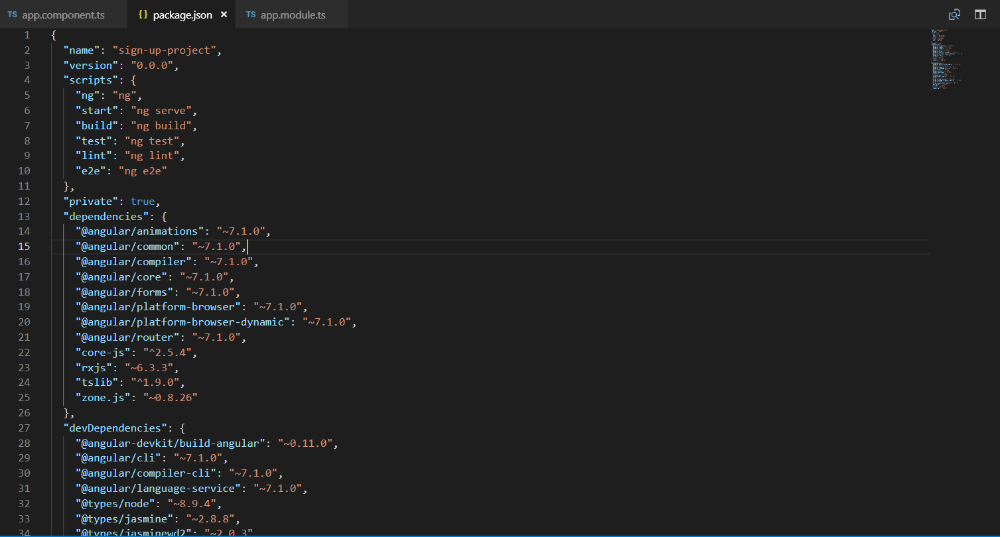
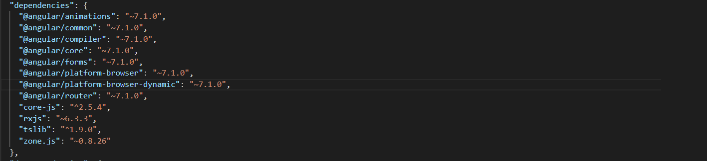
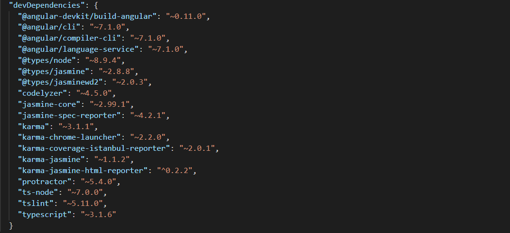


Our Angular applications use a lot of packages, modules and other files to work in the way they do. All the packages with their versions that our project depends on is what is contained inside this file called **package.json**. Anything that needs to be changed in the package can simply be updated inside the package.json file, thus, reflecting the changes inside our project.

The *package.json* file follows ***semver***, i.e., Semantic Versioning rules. Now this is a very interesting concept to understand. According to *semver*, the package version consists of three important fields; major, minor, and patch versions respectively. For example, some version is X.Y.Z, So Z here is the patch version, which denotes that there have been some bug fixes made. And change in this doesn’t break anything. Y is the minor version and change in minor version denotes that some change has been made in the functionality and this too, does not break anything if not updated. X is the most important one, being the major version.  If a change has been made in the major version, this denotes that some large changes has taken place and that if this version is not updated to, things will not work. This change breaks compatibility.

For example, the version of some package is 4.5.6, here major version 4, minor version 5, and patch version 6 are the constituents of the package version. if the major version 4 gets changed, then there is a need to update to the latest version so that it works.

The name and versions of the package installed are stored in it by npm or node.js

This is the look and feel of a package.json file. The properties that are involved in this JSON file are as follows:

* name
* version
* description
* main
* dependencies
* devdependencies
* engines
* browserslist

**name**  
name property helps set the package name according to some predefined rules and following the naming convention that the name must be less than 214 characters, must not have spaces, only contains lowercase letters, hyphens(-), and underscores (\_).

The name property looks like inside the package.json file.

> “name”: “sign-up-project”

**version**  
version property gives the version no. of the current project, yes that is the major, minor, and patch version of it.  
Although this version property is not bound to follow the semver rules but since it is the standard that is used by mpm and node.js modules, it prefers to follow the same convention.

The version property inside the package.json file looks like this.

> “version”: “1.0.0”

**description**  
This property contains a brief understanding of what is in the project in the human-understandable words. This property is indexed in a way to help to search with the help of the keywords used by the tools like **npm search** and **npm search CLI**.

This property generally describes what a module in the project does or what is the purpose of developer. Inside the package.json, This looks like:

> “description”: “A Signing Up Project which will authenticate the user in the database.”

**main**  
The main property inside the package.json describes the direction to the entry point of the module that our json file is describing. When we import this package in an application, that’s where the application will search for the module exports. It is actually a module ID.

In the json file, it looks like this:

> “main”: “src/main.js”

**dependencies**  
This property as the name suggests defines all the dependencies. To put in simple and easy-to-understand words, all those modules that our module is using are the dependencies that are stored and described inside the dependencies list. This property takes the name and version property of the object that it uses.   
We get to see very frequently used carets (^) and tilde (~) characters inside the dependencies list with the package version.

The dependencies inside the package.json file look like this:

**devDependencies**  
The devDependencies property is very similar to the role of dependencies property with only one key difference. In the dependencies property, there is a list of dependencies that a module needs to run during ***production***, whereas in the devDependencies property, there is this list of properties that a module needs to run during ***development***.

This looks like:

There are many other dependencies like peerDependencies, optionalDependencies, bundledDependencies etc.

We can also set a list of keywords that our module will use. It is always an array of the keywords involved inside the module. This happens inside the property **keywords** and looks like:

> “keywords”: [ “metaverse”, “virtual reality”, “augmented reality”, “snow crash” ]

**Engines**  
This property sets the versions of the node.js and other packages that our app will work and be based on. Like, for example, our project involves the use npm, node.js, and yarn, so this engine property will set the version of all three of these required. It looks like:

> “engines”: {  
>  “node”: “>= 6.0.0”,  
>  “npm”: “>= 3.0.0”,  
>  “yarn”: “^0.13.0”  
> }

There are many more properties that we can keep on talking about but now is the time to see how to create a package.json file.

### Creating a package.json file

We can also create package.json file by running a CLI questionnaire or creating a default package.json file.

Step 1 is to run the command **npm init** in the CLI and answer some questions given by CLI.  
In case you want to create a default package.json file, run the command **npm init –yes** and some default values get extracted from the current directory.

We can also set config options for the init command. Like:

> npm set init.author.name “nishu\_goel”

