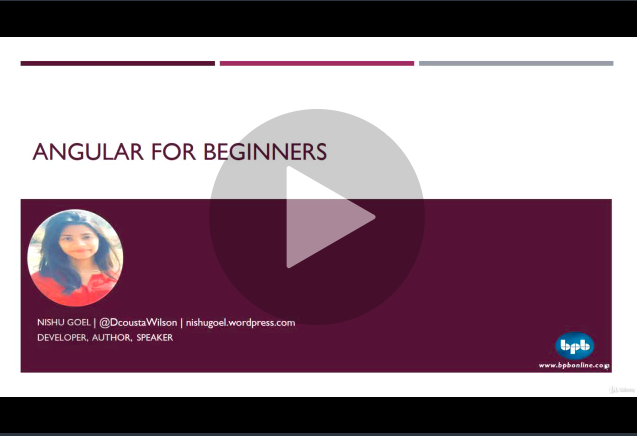


I am very excited to share that my course Angular for Beginners by BPB Publications has been published on **[Udemy.com](https://www.udemy.com/)**(<https://www.udemy.com/angular-for-beginners-l/>).

It is a step-by-step video course for all the Angular beginners  This course will focus on creating web applications using the JavaScript framework Angular and will walk us through a journey of learning how to install Angular to learning how to route from one page to another using components, directives, modules, routing etcetera.By the end of this course, you will be able to create a dynamic Angular web application.

To subscribe to this course, go on to buy it here: <https://www.udemy.com/angular-for-beginners-l/?> in just $10.7 (Rs. 770/-).

**Any queries/feedback is welcome. Mail me at [nishu0505@gmail.com](mailto:nishu0505@gmail.com)**

