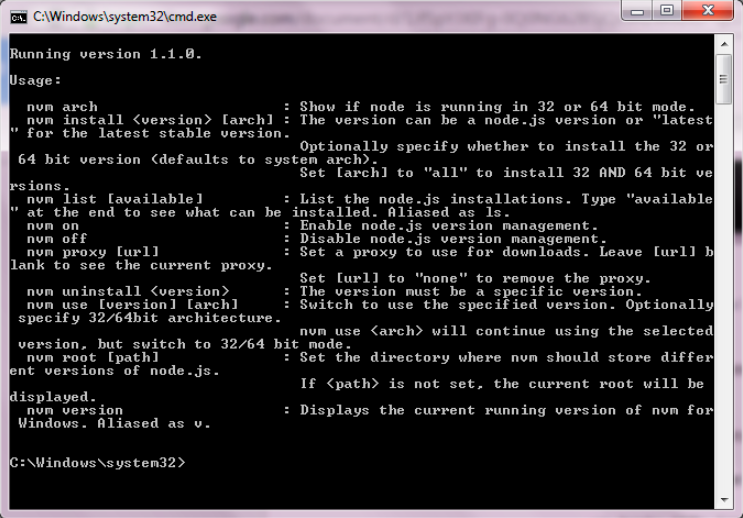
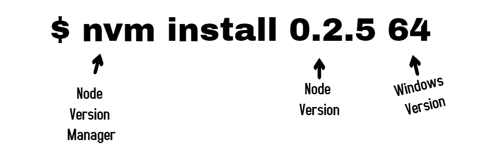


Can we manage and use different versions of **Node.js** on the same machine? Using **NVM**, we can!

Node Version Manager (NVM) is a tool that helps us to use different versions of Node.js on the same machine, each version running locally in its isolated environment. We can also switch between different versions with out hampering the working of our system as a whole.

To install NVM for Windows, go [here](https://github.com/coreybutler/nvm-windows).  
Once this is done, follow the steps in the setup wizard making sure that the drive where it is installed or by copying the **settings.txt** file from the nvm directory to the C:/ drive.

Now when we run the setup, this is what the command line shows up.

In the next step, install **node.js** if you haven’t installed it already. To install a specific version of **node.js** now with the use of **nvm**, we use

> $ nvm install 0.2.5 64

Here, it means:

Similarly, we can install many versions of node and see which one to use for which case.

To list the different versions of node that we have installed under **nvm**, we use:

> $ nvm list

This will display all the versions of **node.js** available in the system. To use a specific version of node to run a particular program, we use:

> $ nvm use 4.2.1 64

and run the program with:

> node file-name.js

This is how using **nvm**, we can deal in different versions of **node.js**. However, we can use ***nvmw*** and ***nodist*** too.

