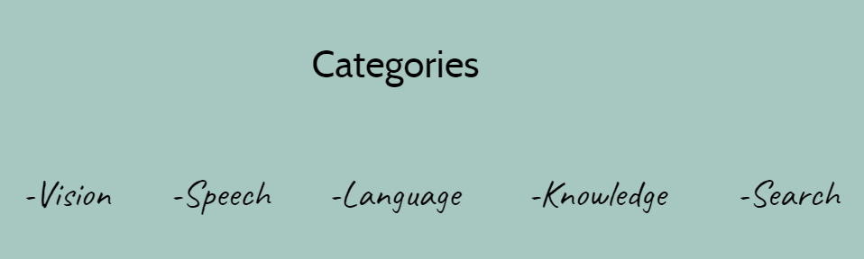


In this article, I will be talking about Microsoft Cognitive Services and give you an idea of what all can we achieve with the help of Cognitive Services and the different APIs.

To call a cognitive service is a very easy task. We get a key and then from our application, we can use the key to work with Cognitive Services. There is another step to it sometimes, which is obtaining an access token first with the help of the key and then being able to call the cognitive service.

These services are mainly divided into 5 categories:

Categories of Cognitive Services

### The Vision APIs

The Vision APIs comprise of a list of different APIs like: Computer Vision API, Face API, Content Moderation API. These APIs are further classified into their own types. If we go to the site of Cognitive Services, we also see Emotion API and Custom Vision Service listed, however, Emotion API has now become a part of Face API.

In a **Computer Vision API**, we get to submit an image as a body of our message as a post call, and ask it to do many things depending on the URL we post the image to! For example, if we want to get the description of the image, we post the image to the URL **/describe** and we will get the description of the picture that posted.

To go deep into it, we can also ask it to **analyse** the picture. Now there are different ways for the analysis of the picture. It can categorize the picture according to the 86-category classification. It can tag the picture, detect faces in the picture. The Face API also does this but dives deep into face detection.

For example, let us take this picture:

#### **DESCRIBE**

> “A car”

#### **ANALYSE**

> Categories: “Vehicle\_Car”  
> Tags : ‘tags’: [  
> {  
> “name”: “car”,  
> “confidence”: 0.999999  
> },  
> {}  
> ]

We can also call an endpoint called **/recognizetext**. This will analyses the text from the image and also tell us at which part of the image did it read the text.

In a **Face API**, we feed the image to it and the API then provides it a face ID, which is a GUID, which the API remembers for 24 hours. It also gives the Face Landmarks which are 27 predefined landmark points.   
It detects the face attributes like:

> age, gender, headPose, makeup, smile, noise etc.

Some of the standards of an image for Face API Recognition are:

* The faces in the image must be between 36\*36 pixels and 4096\*4096 pixels
* The supported formats are JPG, PNG, BMP, and GIF
* The supported image size is from 1KB-4MB

A very interesting feature of Face API is Person Recognition wherein we set a group of persons within categories and pass one person to the API through a REST Call, the API will then tell who that person is giving us the person ID and the name too.

We can also do content moderation with the help of Vision APIs.

* Image Moderation
* Video Moderation
* Text Moderation
* Human Review Tool

We can also create Custom Vision services with the help if Vision APIs. They help us create our own models in the API. We can also do video indexing and come up with a lot of insights about the video.

In the next article, we will see how to tag images with the help of Vision API in a demo.

