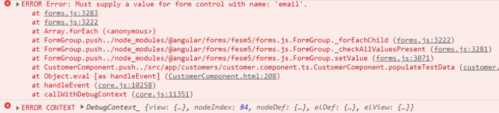


In this blog post, we will see that when building Reactive Forms, if we need to update the input elements on the form from our component class, we use **setValue** and **patchValue**.

If you are new to Reactive Forms, I would recommend you to go through this article : [Reactive (Model-Driven) Forms](https://nishugoel.wordpress.com/2018/10/17/angular-model-driven-reactive-forms/)

We use **setvalue** to set the value of every form control on the form. For example, here we have three form control in our form model. And now because we want to update the value of each one of these, we use setValue.

```
this.myForm.setValue({
  name: 'Wilson',
  city: 'Bangalore',
  email: 'wilsondcousta@gmail.com'
});
```

However, if we only want to set the subset of the values, we then use **patchValue**. In this example, we set only of the three values.

```
this.myForm.setValue({
  city: 'Gurgaon'
});
```

Let us try our hands on it now!

In the component template, Let us take a button to check the data like this:

```
<button type = "button" (click) = "checkData()"> 
Check Data 
</button>
```

Now let us take this method inside the component.ts file.

```typescript
checkData() : void {
  this.myForm.setValue({
    name: 'Wilson',
   city: 'Bangalore',
   email: 'wilsondcousta@gmail.com'
  });
}
```

Now when we check this in the browser, it populates the data in the browser as:

> Value {“name”: “Wilson”, “city”: “Bangalore”, “email”: “wilsondcousta@gmail.com”}

In case, in the **checkData()** method, we do not set the value of name and email and set it just for the city, like this:

> this.myForm.setValue({  
>        city: ‘Gurgaon’  
> })

In this case, the console throws an error like:



To solve this, simple solution!  
We use patchValue, since we are making a change to only a subset of the form element and not all the elements of the form.

In place of the above code, we will write:

> *this.myForm.patchValue({*  
> *city: ‘Gurgaon’*  
> *})*

And then, it works well.

