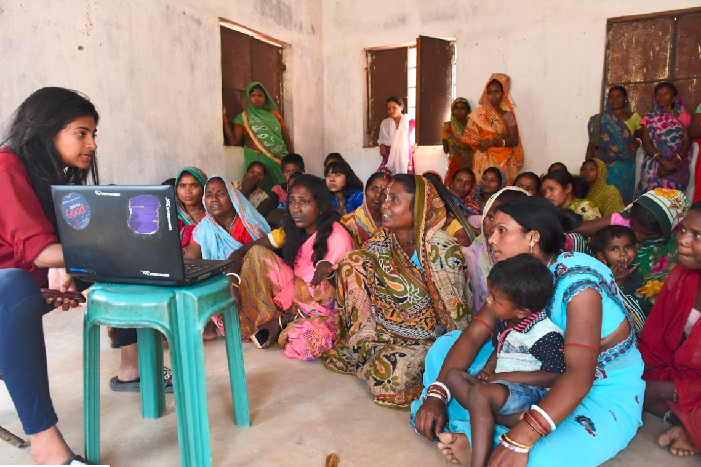
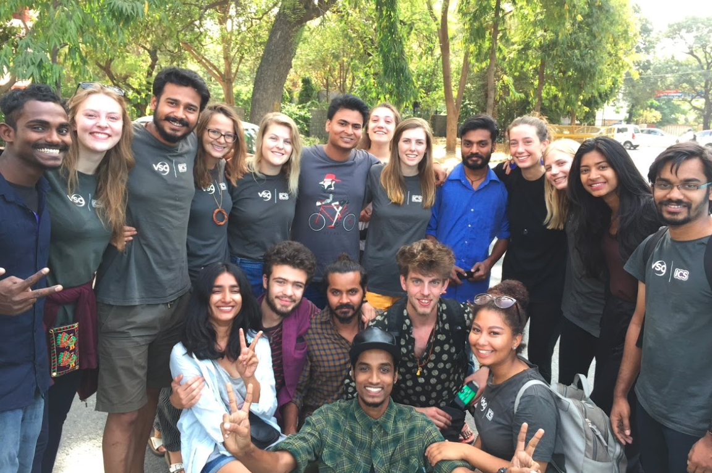
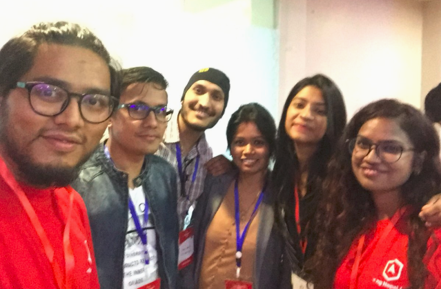
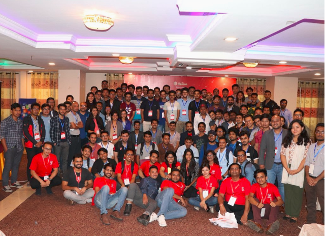
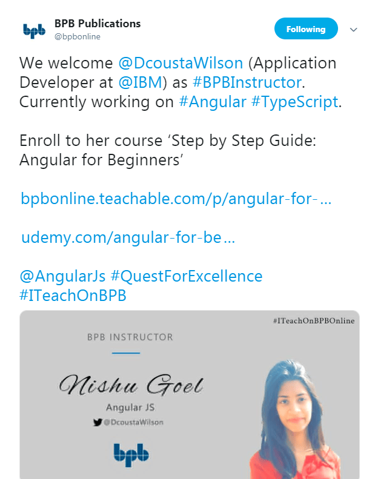
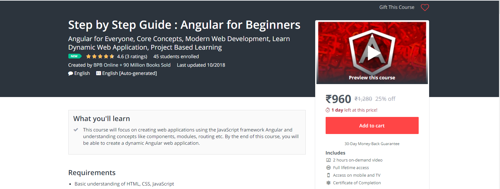
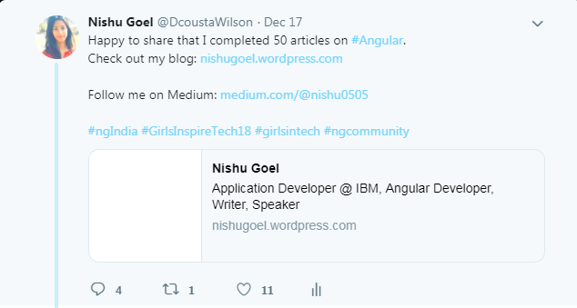


Graduating from the university in this year, 2018 was a revolutionary year for me. This was due to loads of things happening around. Since it was a break time after college and my campus placement at this renowned company, IBM was still months away for joining, I went for a fellowship program based on Community Development by Voluntary Service Overseas (VSO).   
International Citizen Service was a 3-month placement into some rural community of the country with people from cross-cultures to work on the **Sustainable Development Goals (SDGs)** like Gender Equality, No Hunger etc.

Working with the people from UK, Cambodia, Bangladesh, Nepal and the community women of the village Massanjore in **Jharkhand, India** was definitely a once-in-a-lifetime experience.

* 
* 

As and when I returned from the fellowship programme, I still had time on my plate to learn something and my Twitter feed was attracting me a lot towards the JavaScript framework Angular with people like **[Ben Lesh](https://twitter.com/BenLesh)**, **[Dhananjay Kumar](https://twitter.com/debug_mode)** doing many exciting things in Angular and talking frequently about it.

I referred to Deborah Kurata’s amazing course **Angular: Getting Started**on [**PluralSight**](http://pluralsight.com/)to learn Angular. Mr. Dhananjay proved to be a great mentor during the whole process. He helped me learn and clear my doubts at times, making sure to let me know about the opportunities and projects going on in Angular. And this interest was triggered by the great opportunity to speak at Nepal’s Angular Conference, [**ng-nepal**](http://ngnepal.com/). This was about to be my first-ever conference speaking, thanks to the organizers for keeping trust in me and providing me the platform. I spoke on the topic **HostBinding and HostListener** in Angular. It was a wonderful experience with the welcoming and cheerful audience of the country Nepal and this obviously motivated me more to dive deep into Angular framework.

* 
* 

Some glimpses of the Nepal conference are here in this video:

<a class="yt" href="https://www.youtube.com/watch?v=5aPi-fnCQsY" data-id="5aPi-fnCQsY" data-start="" style="background-image:url(https://i.ytimg.com/vi/5aPi-fnCQsY/hqdefault.jpg)">ng-Nepal 2018 Event Summary</a>

Once I was through with the basic concepts, that is when I started writing articles about important topics of this framework and building a [blog](https://nishugoel.wordpress.com/)to help out the community and the people in the learning phase.

I knew I was working in the right direction when community groups like [**Swiss Angular**](https://twitter.com/SwissAngular), [**Data Driven Investor**](https://medium.com/datadriveninvestor) started recognizing the work and mentioning my articles on their feed.

It was time now that I started getting projects from Publishing houses, Technical blogs and companies to write Technical blogs in Angular and creating tutorial videos for them.

The big shot of these was to create a 2-hour long video course of basics of Angular for [**BPB Publications**](https://bpbonline.com/) which was to be published on the global learning platform **[udemy.com](http://www.udemy.com)**.

Here is the link to the course: <https://www.udemy.com/angular-for-beginners-l>

I finally received joining call from my campus placement job and it was time to move from the Gurgaon city to Bangalore. I was assigned the position of Sterling Developer.

Working after office hours and on the week-ends, I wrote **50 articles** in Angular by the last month of the year with some blog posts on the topics like:

* [Using setValue and patchValue](https://medium.com/@nishu0505/using-setvalue-and-patchvalue-4e332d4e0d96)
* [Debugging Angular Apps](https://medium.com/@nishu0505/debugging-angular-apps-12104ff9b250)
* [Wildcard Routes in Angular](https://medium.com/@nishu0505/wildcard-routes-in-angular-edbf9433a9ba)
* [Using @ViewChild in Angular](https://medium.com/@nishu0505/using-viewchild-in-angular-de1854a51872)

Some of the articles that I wrote for **[DotNetTricks](https://www.dotnettricks.com/)** were:

* [Angular Component LifeCycle Hooks](https://www.dotnettricks.com/learn/angular/angular-component-lifecycle-hooks-explained)
* [Exploring Pipes in Angular](https://www.dotnettricks.com/learn/angular/pipes-custom-pipes-example-usages)
* [Angular Model-driven Forms](https://www.dotnettricks.com/learn/angular/model-driven-reactive-forms-example)

Some of the tutorial videos that I
created for **[BPB Publications](https://www.youtube.com/channel/UC9Z4nDqYYBgZFZ5KdT3dEYA)** are:

* [Using @Input in Angular](https://www.youtube.com/watch?v=RpxZsuyEHPk&index=1&list=PL4EIEoYVTTUzxBaR3Wb884InXKaRqLxYs)
* [Services](https://www.youtube.com/watch?v=ep8c8iE-US8&index=6&list=PL4EIEoYVTTUzxBaR3Wb884InXKaRqLxYs)
* [Forms in Angular](https://www.youtube.com/watch?v=dcC0ZIr0rkU&t=52s)

The year ended with the news of another opportunity to speak at India’s largest Angular conference in Gurgaon, India which will be held in February, 2019. I am very excited to speak at [**ng-india**](http://ng-ind.com).

> Some of the things that happened behind the scenes were:  
> – I got selected for **Gramya Manthan**— a 10-day community development opportunity in Gujarat, India. This was after returning from the fellowship in **Jharkhand**.  
> – Completed **micromasters**in ***Data, Economics, & Development Policy*** from **MIT**on **edX**.  
> – Did a course on ***Data Structure Fundamentals*** from the **University of San Deigo**on **edX**.

The no. of books that I read in this year is 13 which is mach better than the last year’s count. To name them:

### — India is for Sale by [**@chitraSD**](https://twitter.com/chitraSD)  — The Originals by [Adam Grant](https://medium.com/@AdamMGrant)  — Contact by **Jan Morris**  — Eleven Minutes by [Paulo Coelho](https://medium.com/@paulocoelho_99622)— Marry Me, Stranger by **Novoneel Chakraborty**  — Seeing like a feminist by **Nivedita Menon**  — On love & Loneliness by**J KrishnaMurthy** — Men without Women by**Haruki Murakami**  — The creeds of our times by**Dalai Lama**  — Milk & Honey by**Rupi Kaur**  — Rich Dad, Poor Dad by**Robert T Kiyosaki**  — Remind me again why I need a man by**Claudia Carroll**  — Short Stoies by**Franz Kafka**

To summarize, it has been a very
productive year for me and now, I hope to fasten my belt in the upcoming year
2019 by diving deep into Angular concepts, writing more informative articles,
getting to speak at more Angular conferences with the hope of getting to
interact more and more with the community.

