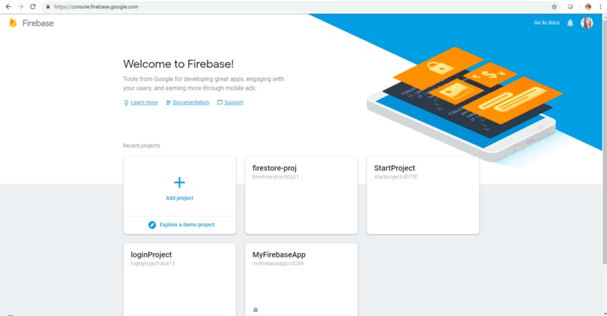
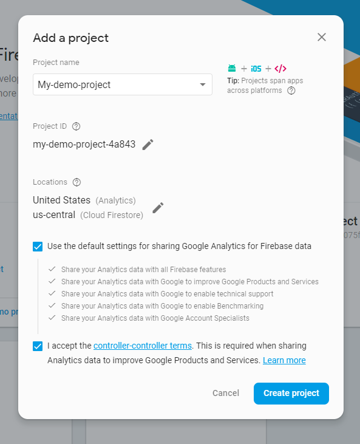
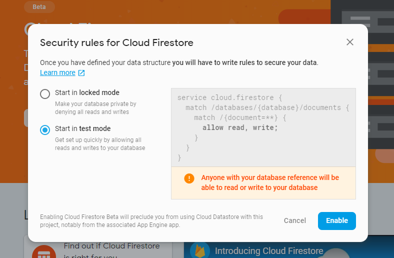
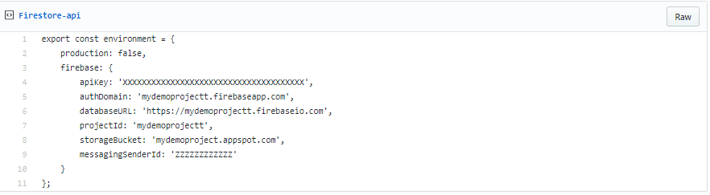
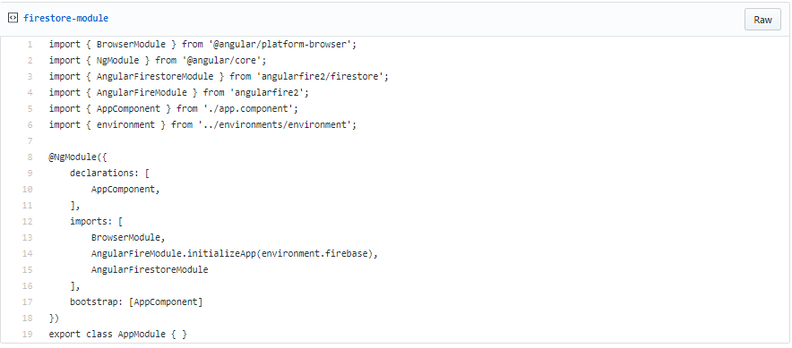
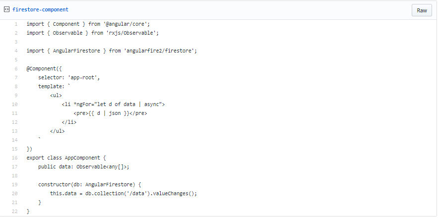
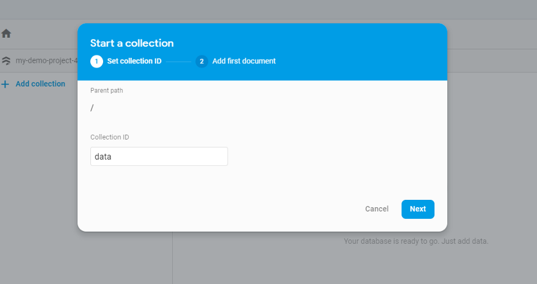
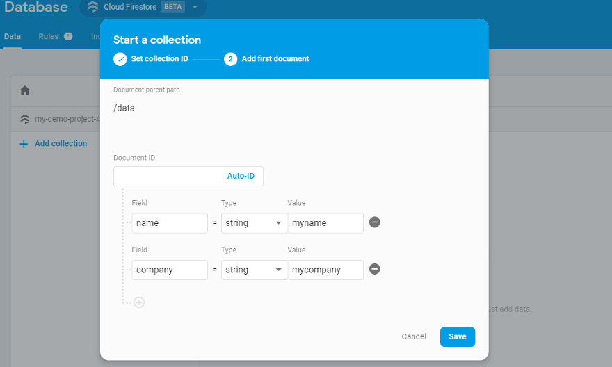
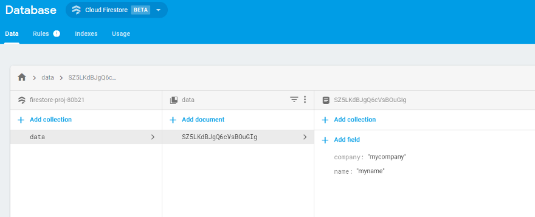
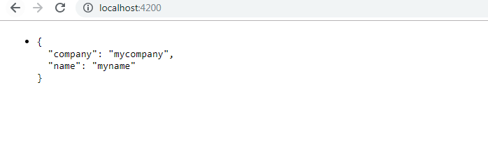


This confusion about the difference between FireStore and Firebase comes to many. In this article, I put focus on why Firestore was launched and how it can be used with Angular.

Firestore can be called as the evolution of the **Firebase realtime database**. This is because it provides a data model that captures all the interesting features by adding query creation tools which is not very good with Firebase. Another good thing with Firestore is that it offers offline support for mobile and web development so we can build apps regardless of poor connectivity.

The difference in these two can be found [**here**](https://firebase.google.com/docs/firestore/rtdb-vs-firestore)in detail.  
Now let us dive into setting up Firestore to use with Angular.

On the **firebase**console, login with your google account and create a new app by clicking on **Add Project.**It looks like this:



After clicking on Add Project, give any name to your project. It appears as follows:



Now lets go to Firebase console-> Develop -> Database. This will take us to the screen below clicking on **Create Database**.



Set this to test mode as it helps to disable the database access controls and we are doing a demo application. This will be restored later during production.

This sets up the Firestore. Time to go and set it up inside our Angular Application.

**INSIDE ANGULAR**

Suppose we have already created an Angular application named **firestore-proj**. To create a new one, use **ng new *project-name.***Here I am assuming that you have already installed the latest Angular version, if not, install using:

```
npm i -g @angular/cli@latest
```

Now, let us install the official library of Angular for firebase,

> npm install @angular/fire firebase — save

Now to finally set up the configurations for cloud firestore inside our project, go to firebase console and click on “Add Firebase to your web app”, copy the configurations.

Paste into ***src/environments/environments.ts*.**Do the same for ***environments.prod.ts.***It should look like this:

<https://gist.github.com/NishuGoel/470fe6bf00ba26474026e2ddd80ee4c6>



Now, importing the modules and updating the component.ts, it should look like:

**app.module.ts**

<https://gist.github.com/NishuGoel/6c9079469fde418cdf725e6ce52b7b3f>



**app.component.ts**

<https://gist.github.com/NishuGoel/3d0ab2c95ad900cd7a8f846e6d4b94db>



Now, this data that we have mentioned in the component can be found from the database and be updated on the browser.

To do that, go to **Firebase Console -> Database -> Data**and click on Add Collection.



Next step is to put in some data to your collection,



After clicking save, the data that we just put in will go to the browser and will get displayed on the browser.



Let us compile our application now using ***ng serve***and see the results.



A basic project on understanding working with Firestore in Angular.

Happy coding, people!

