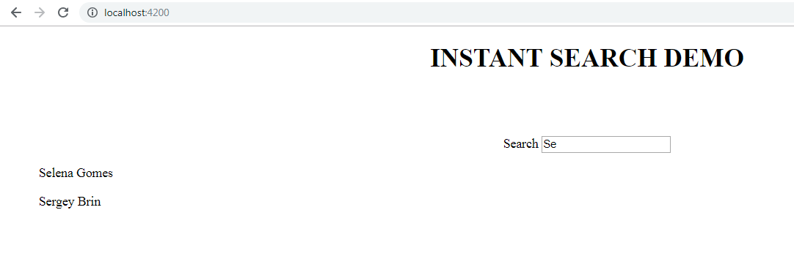
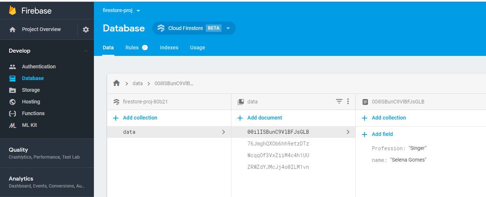
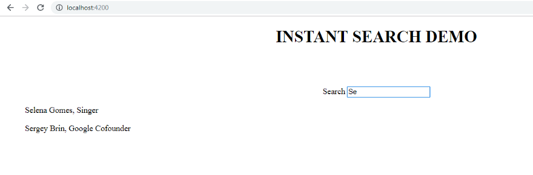
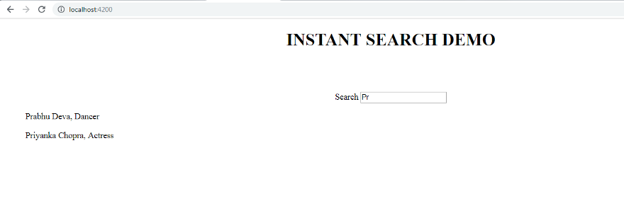


### In this blog post, we will learn doing Instant search in Angular using the data from Cloud Firestore. So let us first assume what we actually want to have as the results on the browser.

We want to create a search tab on the browser which has a placeholder saying **“Search by name”**. As we type a character, we want our application to give us suggestions based on the data that is stored on our Firestore. It should look some thing like this:



To do that, let us assume we have some data inside our firestore database. For learning how to add data in the database of Firestore, refer to my article **[Firestore with Angular](https://medium.com/@nishu0505/firestore-with-angular-but-firebase-c4050f1f6173)**. Our data in Firestore looks like this:



We have created four documents with the details of different personalities, each containing the name and profession of that personality.

Our task now is to create a search tab on the browser. Let us do that.

```
<div align = "center">
  <h1>INSTANT SEARCH DEMO</h1><br><br><br>
  Search <input type = "text" [(ngModel)] = "searchterm" (keydown) ="search($event)" id = "search" placeholder="Search by name">
</div>
```

In this code, we have done two-way data binding for the property **searchterm**defined in the component as a string. Also, to record the recently typed value somewhere, we take a variable inside the component.

```
search($event){
    let q = $event.target.value;
}
```

Our next step is to prepare the search box to give suggestions on the basis of the characters that we are typing. To do that, let us add a list which will display those suggestions. Now, the most important part of the process is to add two subjects from the RxJS library namely startAt and endAt.

> **startAt = new Subject();  
> endAt = new Subject();**

Also, we will take two observables to use the subjects as observables.

> **startObs = this.startAt.asObservable();  
> endObs = this.endAt.asObservable();**

Now, since this functionality works on calling the method search(), so inside it, we mention,

> **search($event){  
> this.startAt.next(q);  
> this.endAt.next(q + “\uf8ff”);  
> }**

I understand you might be wondering where this strange looking character comes from! I had the same reaction.


Learn more on this here.

[**Pattern matching**](https://stackoverflow.com/questions/38618953/how-to-do-a-simple-search-in-string-in-firebase-database)

Now, subscribe the value of the observables inside the lifecycle hook ngOnInit().

> **ngOnInit(){  
> Observable.combineLatest(this.startObs, this.endObs).subscribe((value) => {  
> this.firequery(value[0], value[1]).subscribe((names) => {this.names = names;  
> })  
> })  
> }**

Till this point, this is how our component looks:

```
import { Component, OnInit } from '@angular/core';

import {Subject} from 'rxjs/Subject';
import {Observable} from 'Rxjs/Rx';
import { AngularFirestore } from 'angularfire2/firestore';

@Component({
  selector: 'app-root',
  templateUrls:''
})
export class AppComponent implements OnInit {
  searchterm: string;

  startAt = new Subject();
  endAt = new Subject();

  startObs = this.startAt.asObservable();
  endObs = this.endAt.asObservable();

  names;

  public data: Observable<any[]>;

  constructor(private db: AngularFirestore) {
    // this.data = db.collection('/data').valueChanges();
  }

  ngOnInit(){
    Observable.combineLatest(this.startObs, this.endObs).subscribe((value) => {
      this.firequery(value[0], value[1]).subscribe((names) => {this.names = names;
    })
    })
  }

  search($event){
    let q = $event.target.value;
    this.startAt.next(q);
    this.endAt.next(q + "\uf8ff");
  }

  firequery(start, end){
    return this.db.collection('data', ref => ref.limit(4).orderBy('name').startAt(start).endAt(end)).valueChanges();
  };
}
```

Let us update our template now to put the results on the browser.

# INSTANT SEARCH DEMO

  
  
  
Search

{{name.name}}, {{name.Profession}}

Try searching by name

Using this list now, we are displaying the data using interpolation and putting a structural directive **\*ngIf**for if the character length is less than 1, it displays the given statement.

Let us finally look if we have get the desired results now.

> Run **ng serve** anddd….




Here is the output and this is definitely an improved version of what we had desired. Awesome! So this was about creating a Instant Search Tab in Angular by retrieving data from Firestore.

