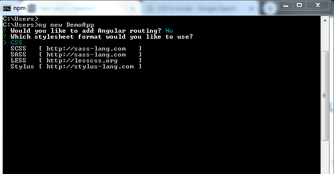
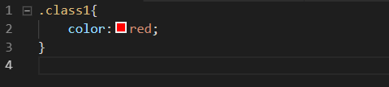
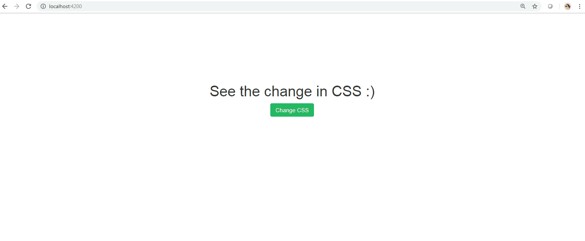


To start with this blog post, let me put focus on some of the terminologies that I have used in the title of it. So, the agenda is to change the CSS of our Parent Component with the help of a button inside our child component.

For those who are totally new to Angular, CSS stands for Cascading Style Sheets which help developers to style their Angular Applications. With the release of Angular 7, when we create a new Angular application using CLI, it asks us which style sheet format would we like to add to our application. See in the image below:

* 

Proceeding after choosing the convenient stylesheet format, CSS for the sake of this blog post, we will create two components inside our application.

To create a component using CLI, we use:

> **ng g c *component-name***

To start with, create a button inside the template of a component.

```
Change CSS
```

Now to access this button to change the CSS on the parent component, we use @Output() and EventEmitter. To do that,

```
import { Component, EventEmitter, Output } from '@angular/core';

export class ChildComponent{

  @Output() change = new EventEmitter();
  i=5;
  changeCSS(){
  this.change.emit(this.i);
  }
}
```

Now, let us go to other component to use this button and change the CSS.

```
<h1 align = "center" [ngClass]="{'class1': class1 }">See the change in CSS :) </h1>
    <app-child [classname]="class1" (change)= 'displayChange($event)'></app-child>
```

And the Parent Component looks like this.

```
import { Component } from '@angular/core';

@Component({
  selector: 'app-root',
  templateUrl: './app.component.html',
  styleUrls: ['./app.component.css']
})
export class AppComponent {
  class1= false;
  displayChange(i){
    this.class1 =!this.class1 ;
  }
}
```

If we look at the CSS file now, it is kept very simple for understanding this article.



Having done this, let us look at the results now:

* 

