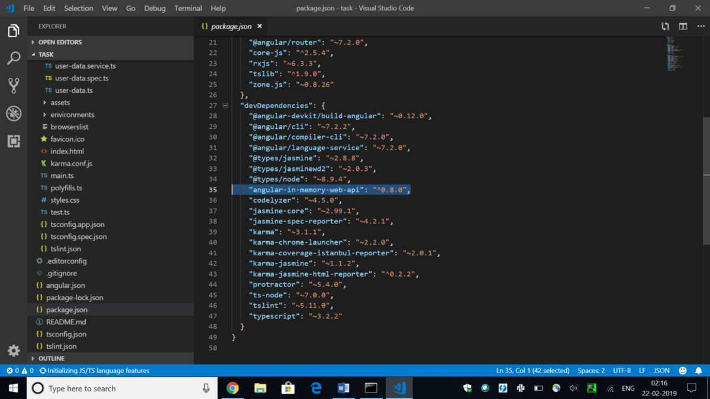
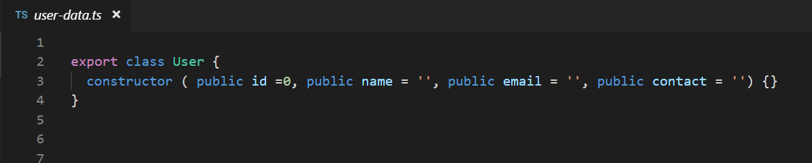
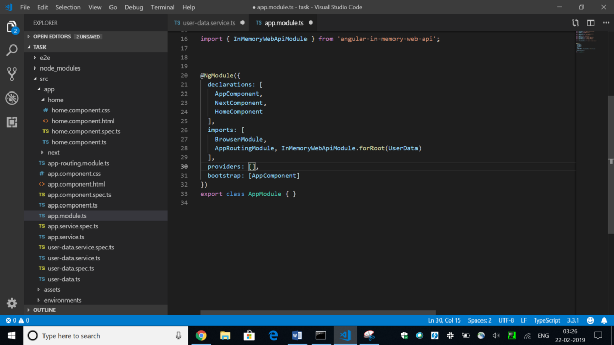
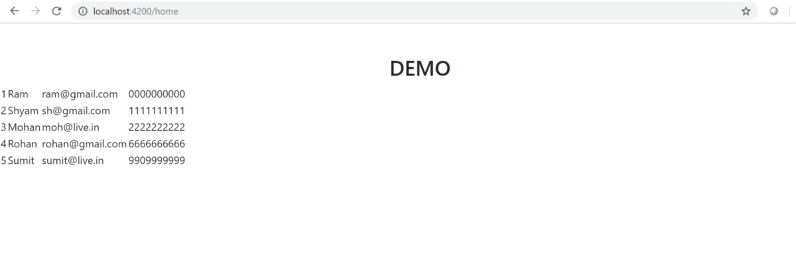


In this blog post, we will see how to work with data without using a real server. This means without having to use a server where the data resides or without having to working with $http services or requesting APIs, we can use the data and perform CRUD operations with that.

Wait, what is CRUD operations? In computer applications, working with data as to creating, reading, updating, and deleting it on the server or wherever you grab the data from, is what is meant by performing CRUD operations. Any Angular application working with data must be able to perform these four basic operations to be able to read and write the data.


Coming to the major focus point of this blog post, we will see how to use angular in-memory web API to work with data without actually having to access the data from a real server using http get or post option or through some $http service. This means, we can fake a back-end server and use the application for testing purposes, just like we do on a local emulator.

Angular in-memory web API helps us to work with data for testing purposes. It makes an HTTP request and gets the data from a data store where we have all the data available through a remote API instead of going to the real server .To work with it, we need to install it as a dependency inside our application.

To install angular in-memory web API from the CLI, use the command:

> **npm install angular-in-memory-web-api — save-dev**

Let us break this down. In this command, we install the dependency called angular in-memory web api using npm install. Make sure you have npm and nodejs installed in your machine. Next – -save-dev is used to save the dependency that we just installed for the development purpose.

Now that, we have angular in-memory web api up and runnign in our Angular application, we can quickly go and check inside the package.json as to where this dependency has been updated.



Here you go! Under the devDependencies in the package.json, you can find your installed dependency with it version mentioned. devDependencies are those dependencies which are used for the development purposes.

Now, we go on to perform CRUD operations using this installed web dependency.

Step one is to create an entity class where we mention the class name and its properties.



After our entity class is ready, we will implement InMemoryDbService inside a new class as a service. See the next code for this.

```
import {InMemoryDbService} from 'angular-in-memory-web-api';
import {User} from './user-data';

export class UserData implements InMemoryDbService {
  createDb(){
    const users: User[]=[
      { id: 1, name: 'Ram', email: 'ram@gmail.com', contact: '0000000000'  },
      { id: 2, name: 'Shyam', email: 'sh@gmail.com', contact: '1111111111'  },
      { id: 3, name: 'Mohan', email: 'moh@live.in', contact: '2222222222'  },
      { id: 4, name: 'Rohan', email: 'rohan@gmail.com', contact: '6666666666' },
      { id: 5, name: 'Sumit', email: 'sumit@live.in', contact: '9909999999'  }

    ];
    return {users};
  }
}
```

In this, we are overriding the createDb() method and creating a collection of the entity Users which returns its collection in the end. Another thing that we do here is to import the InMemoryDbService. To use all these, we need to register these inside the module as follows:



After we have registered it inside the module, we are finally ready to perform the CRUD operations using the angular in-memory web api now.

To do that, let us create a service and perform HTTP operations inside that.

```
import { Injectable } from '@angular/core';
import {HttpClient, HttpHeaders} from '@angular/common/http';
import {Observable, throwError} from 'rxjs';
import { tap, catchError } from 'rxjs/operators';
import {User} from './user-data';

@Injectable({
  providedIn: 'root'
})
export class AppService {

  apiurl = 'api/users';
  headers = new HttpHeaders().set('Content-Type', 'application/json').set('Accept', 'application/json');
  perfop = {
    headers: this.headers
  };

  constructor(private http: HttpClient) { }

  private handleError(error: any) {
    console.error(error);
    return throwError(error);
  }
}
```

Now, let us try to understand this code. We have create this service AppService. Inside this service, we are accessing the data through the remote API with the help of this line 12 in the above code i.e.

> apiurl = ‘api/users’;

Next step is to inject the service HttpClient but before we do that, some important files need to be imported.

> import {HttpClient, HttpHeaders} from ‘@angular/common/http’;  
> import {Observable, throwError} from ‘rxjs’;  
> import { tap, catchError } from ‘rxjs/operators’;

The code in line 14 is setting the variable perfop to perform http operations. Now finally we want to read the data which we receive through this remote call.

To do that, we take a method getUsers() like below:

```
import { Injectable } from '@angular/core';
import {HttpClient, HttpHeaders} from '@angular/common/http';
import {Observable, throwError} from 'rxjs';
import { tap, catchError } from 'rxjs/operators';
import {User} from './user-data';

@Injectable({
  providedIn: 'root'
})
export class AppService {

  apiurl = 'api/users';
  headers = new HttpHeaders().set('Content-Type', 'application/json').set('Accept', 'application/json');
  perfop = {
    headers: this.headers
  };

  constructor(private http: HttpClient) { }

  private handleError(error: any) {
    console.error(error);
    return throwError(error);
  }
  getUsers(): Observable<User[]> {
    return this.http.get<User[]>(this.apiurl).pipe(
      tap(data => console.log(data)),
      catchError(this.handleError)
    );
  }
}
```

Now, in the AppComponent,

```
export class AppComponent implements OnInit {
  users: User[] = [];

  ngOnInit(){
    this.getUsers();
  }
  getUsers() {
    this.appservice.getUsers().subscribe(data => {
      this.users = data;
    });
```

We are calling the getUsers() method and returning the data to the created variable users. Also, we are calling the getUsers() method inside ngOnInit() which is the life cycle hook.

Let us finally output what we have created on the component html.

```
<table>
  <tr *ngFor="let u of users">
    <td>
      {{u.id}}
    </td>
    <td>
      {{u.name}}
    </td>
    <td>
      {{u.email}}
    </td>
    <td>
      {{u.contact}}
    </td>
  </tr>
</table>
```



Here is how we can read the data using the Angular in-memory web api. Similarly, we can perform other CRUD operations like create, update and Delete.

