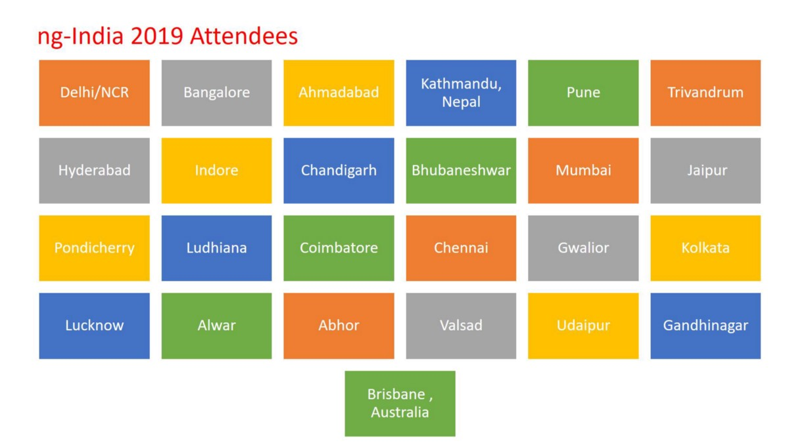
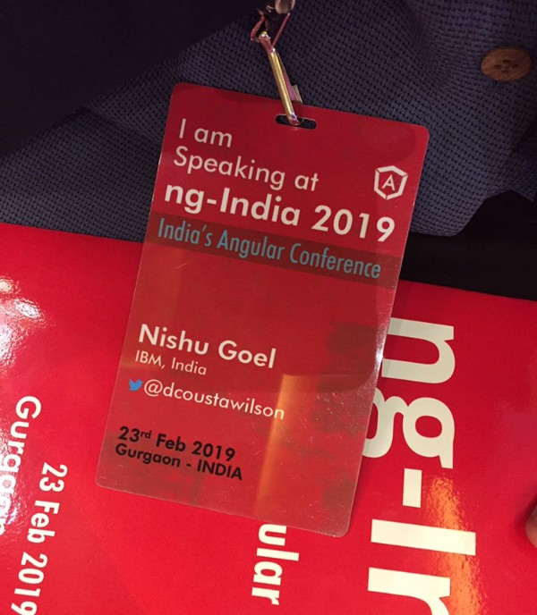
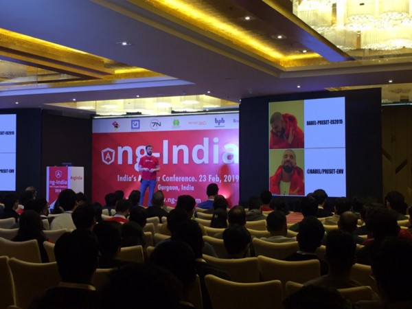
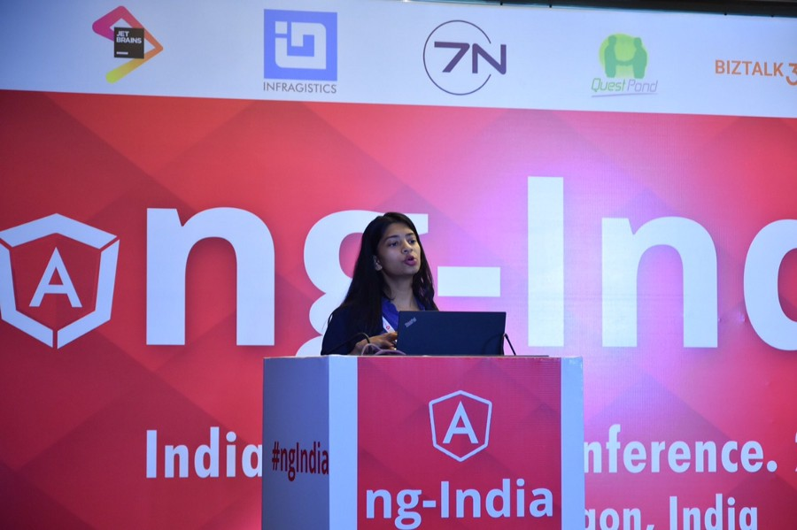
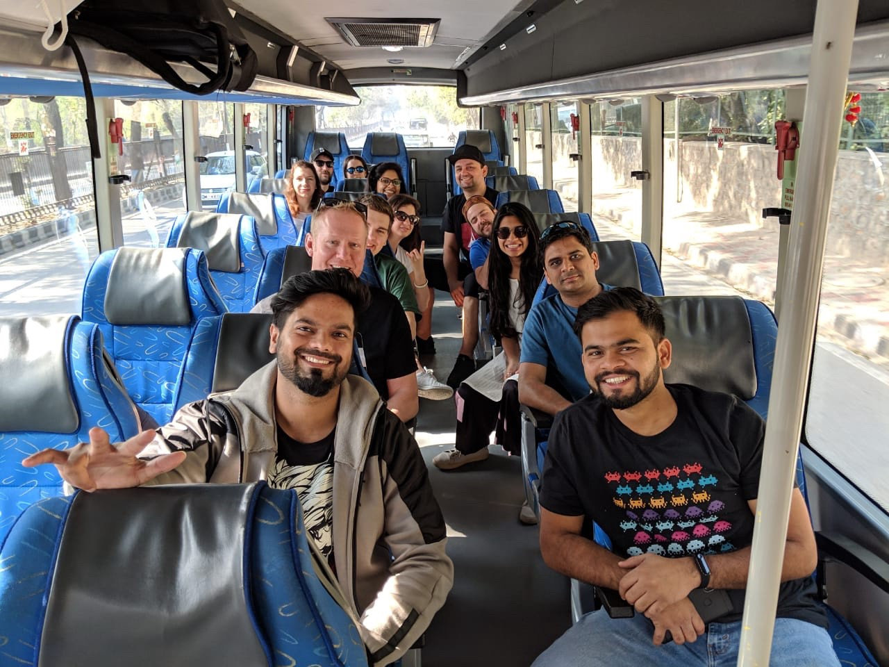


Organised on February 23, 2019 in Gurgaon, India, [**ngIndia**](http://ng-ind.com/)rightly proved its stature as the largest Angular conference of India. Starting from the love of the audience to the super informative sessions from all the speakers, the one-day conference did great justice to the community with people coming in from so many different cities/countries like Chennai, Ludhiana, Nepal etc.

Had it not been for ngIndia, there was no such united community of people who love Angular.

The day started off with the lightening talks about topics like Change Detection, HostBinding & HostListener, PWAs, etc.followed by the welcome session by Dhananjay Kumar, organiser, ngIndia.

Dhananjay Kumar gathered full attention of the audience with his welcome note mentioning stuff like how “JavaScript is like a religion” and doing a small activity on answering yes/no to questions from the previous talks. This was followed by the keynote by Jason Beres, Senior Vice President where they launched the book “Angular Essentials” by Dhananjay Kumar, with everyone getting a signed copy from the author.

After great lunch, people learnt about RxJS, Ivy, Angular’s new renderer, Babel, JavaScript objects etc.

The talks came to an end with a ‘**Question to speakers’** session where in Vikram Subramanian, Google mentioned how Angular framework has the largest community. And people from audience came up with a variety of questions asking different speakers covering almost all the topics in and around Angular.  
The conference ended with speaker felicitation and people clicking loads of pictures with the speakers, organizer, among themselves.

The speakers were also taken to see Taj Mahal, Agra which actually gave them much more time to socialize among themselves.

Some of the pictures from the conference:

[**Manish Jain on LinkedIn: “Launch of Angular Essentials book by Dhananjay Kumar @ Angular-India…**  
*February 23, 2019: Manish Jain posted on LinkedIn*www.linkedin.com](https://www.linkedin.com/feed/update/urn:li:activity:6504971523982491648)

I spoke on the topic “HostBinding() and HostListener()” and did some code during the talk to show how directives work. Here is the Stackblitz demo for the same: [**https://stackblitz.com/edit/ngindia**](https://stackblitz.com/edit/ngindia)

Find the slide deck here: [**https://speakerdeck.com/nishugoel/ngindia-hostbinding-and-hostlistener**](https://speakerdeck.com/nishugoel/ngindia-hostbinding-and-hostlistener?slide=9)

