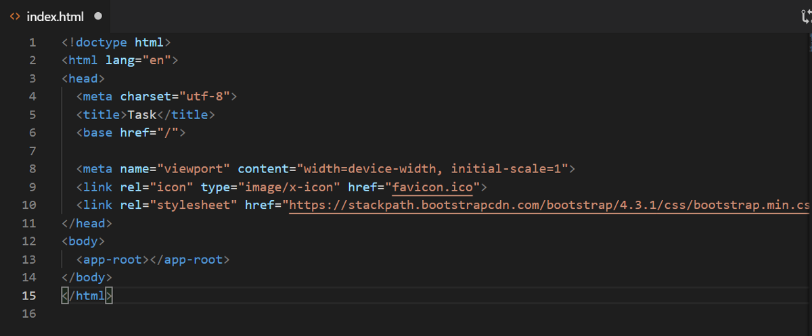
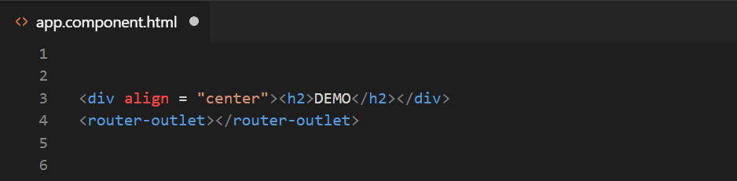


Hello there!

Planning to start your first ever Angular application based on routing? Here are some of the most important configurations that you need to make in your project before starting with routing.

Starting off with the list of files required to work with when creating routes inside an Angular application,   
index.html is the first file where you need to go and see if any modification is required. This is because index.html comes with the CLI and we do not need to create a new file being called index.html

So inside this file, there is a very simple change that we need to make and that is in the base tag. The value of the base tag should be equal to a forward slash and should look like this:



After having set up the index html file, the next task is to import the router modules inside the app.module.ts.

The import statements required here are:

> import { Routes, RouterModule } from ‘@angular/router’;

Now to import the routes into the application, we use RouterModule.forRoot() and the routes array is given the value of different components to route to. For example,

```
import { NgModule } from '@angular/core';
import { Routes, RouterModule } from '@angular/router';
import { NextComponent } from './next/next.component';
import { HomeComponent } from './home/home.component';
import { PageNotFoundComponent } from './pagenotfound/pagenotfound.component';

const routes: Routes = [
  {path: 'home', component: HomeComponent},
  {path: '', redirectTo: 'home'},
  {path: 'next', component: NextComponent},
  {path: '**', component: PageNotFoundComponent}
];

@NgModule({
  imports: [RouterModule.forRoot(routes)],
  exports: [RouterModule]
})
export class AppRoutingModule { }
```

Now, one very important thing to understand here is that to display the components, router needs to put them somewhere! And for that, it uses <router-outlet></router-outlet> inside the template of a component.



Next step is to link an anchor or button with the route we want it to direct to. To do that, we use routerLink directive. Example:

```
  <button routerLink="/next"> NEXT </button
```

Also, if we want specific CSS styling for a particular button in a route which is currently active, we can do that for that active route by applying CSS to it using routerLinkActive. It looks like:

```
 <button routerLink="/next" routerLinkActive="my-style"> NEXT </button>
  
  //Here "my-style" is a CSS class which defines the styling for the active route.
```

We can put routerLinkActive equal to any CSS class according to which we want our routerLink to styled.

In case, the user doesn’t want to go the any of the defined routes, in our case, NextComponent, how to stay at the home component? In that scenario, we use path property equal to an empty string and redirectTo property as the name of the HomeComponent, with another pathMatch property being set to ‘full’. It should look like this:

> {path: ‘’, redirectTo: ‘home’, pathMatch: “full”}

In a scenario when the user gives some unknown url/path, we specify a PageNotFoundComponent like this:

> {path: ‘\*\*’, component: PageNotFoundComponent}

where in your PageNotFoundComponent simply displays “Wrong url” or “Cannot find the page you are looking for!”.

Now, suppose you have a list of students and the user directly wants to access the student with roll number 5. in that case, we need to specify the parameters to the route. To do that, we specify the parameter to a route using **routename/:id**

This take us to the StudentComponent but with the specific id. It looks like this:

```
const routes: Routes = [
  {path: 'home', component: HomeComponent},
  {path: '', redirectTo: 'home', pathMatch: "full"},
  {path: 'next', component: NextComponent},
  {path: 'student/:id', component: StudentComponent},
  {path: '**', component: PageNotFoundComponent},
];
```

Now the user would always need to specify the roll no. of the student he wants to look up the information of. In case, the user now wants to access the url, localhost:4200/student, this will not be recognized and will direct to PageNotFoundComponent. This is because the StudentComponent now needs the id to be specified to work.

Also, we can have children to a particular route. For example,

```
const routes: Routes = [
  {path: 'home', component: HomeComponent},
  {path: '', redirectTo: 'home', pathMatch: "full"},
  {path: 'next', component: NextComponent},
  {path: 'student', component: StudentComponent, children: [
  {path: 'c1', component: C1Component},
  {path: 'c2', component: C2Component}
  ]},
  {path: '**', component: PageNotFoundComponent},
];
```

In this case, it will direct to localhost:4200/student/c1 or localhost:4200/student/c2

These are some of the basic configurations required to start off with routing in your Angular application. You can dive deep into it while working with routing using RouteGuards, routerService etc.

