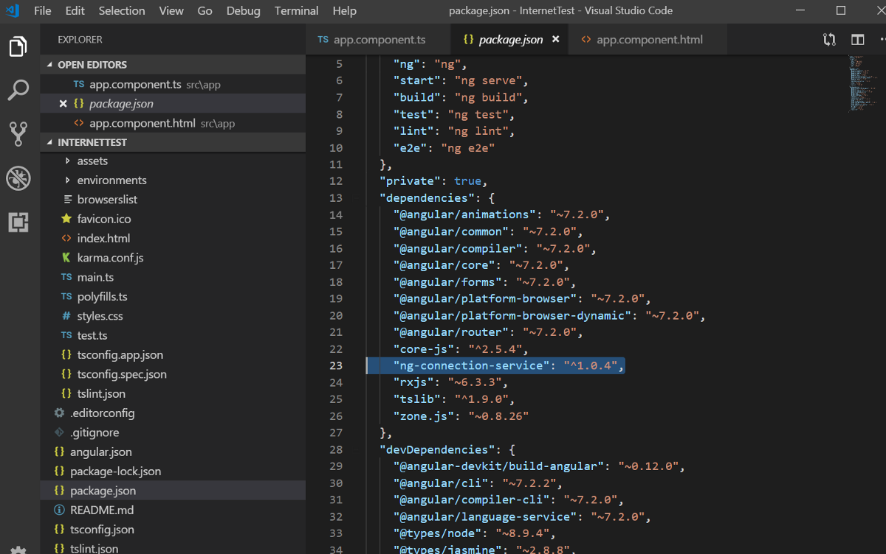
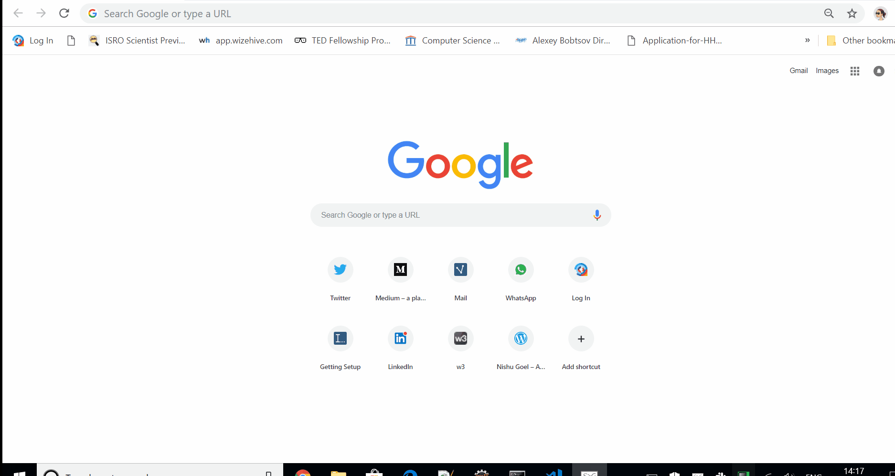


Here is a small and easy Angular application to check if you are connected to Internet or not!

Here is a small and easy Angular application to check if you are connected to Internet or not!

First thing you need to do is install a package called ng-connection-service in your angular application. Lets see how do we do that.

Create a new Angular application from the CLI using

> ng new *InternetTest*

Install the ng-connection-service package inside the application from the CLI using:

> npm install ng-connection-service — save

Once the packages the installed, go to package.json to check if it has been successfully installed.

Inside package.json, you should see,



Now that your required packages are installed, go to the component.ts file and import your Connection service like:

> import {ConnectionService} from ‘ng-connection-service’;

Let us finally inject the service inside the component. If you are familiar with service, you’d know that to inject a service, we go to the constructor of the component class and inject it as follows:

> constructor(private ConnectionService: ConnectionService){  
> });

To add the functionality of checking the internet connectivity, we use the service’s functions and toggle the value of isConnected property which is initialized to be true by default and the status property initialized to be ‘ONLINE’ by default. See the code below:

```
export class AppComponent {
  title = 'InternetTest';
  status = 'ONLINE';
  isConnected = true;

  constructor(private ConnectionService: ConnectionService){
    this.ConnectionService.monitor().subscribe(isConnected =>  {
      this.isConnected = isConnected;
      if(this.isConnected){
        this.status = "ONLINE";
      } else {
        this.status = "OFFLINE"
      }
```

Now we finally alert the status of the connection inside the component class and the completed component looks like this:

```
import { Component } from '@angular/core';
import {ConnectionService} from 'ng-connection-service';

@Component({
  selector: 'app-root',
  templateUrl: './app.component.html',
  styleUrls: ['./app.component.css']
})
export class AppComponent {
  title = 'InternetTest';
  status = 'ONLINE';
  isConnected = true;

  constructor(private ConnectionService: ConnectionService){
    this.ConnectionService.monitor().subscribe(isConnected =>  {
      this.isConnected = isConnected;
      if(this.isConnected){
        this.status = "ONLINE";
      } else {
        this.status = "OFFLINE"
      }
      alert(this.status);
    });
  }
}
```

Your component html looks like:

```
# Welcome to {{ title }} using Angular!


#### Check if you connected to Internet or not!

Switch on/off your connection

</div>
```

This is how the result looks like:



The demo has been put up on Stackblitz as well.   
Find it here:


<iframe class="wp-embedded-content" data-secret="6DvrnZ1SAb" height="400" sandbox="allow-scripts" security="restricted" src="https://stackblitz.com/edit/testinternet?embed=1#?secret=6DvrnZ1SAb" title="testinternet - StackBlitz" width="745"></iframe>



