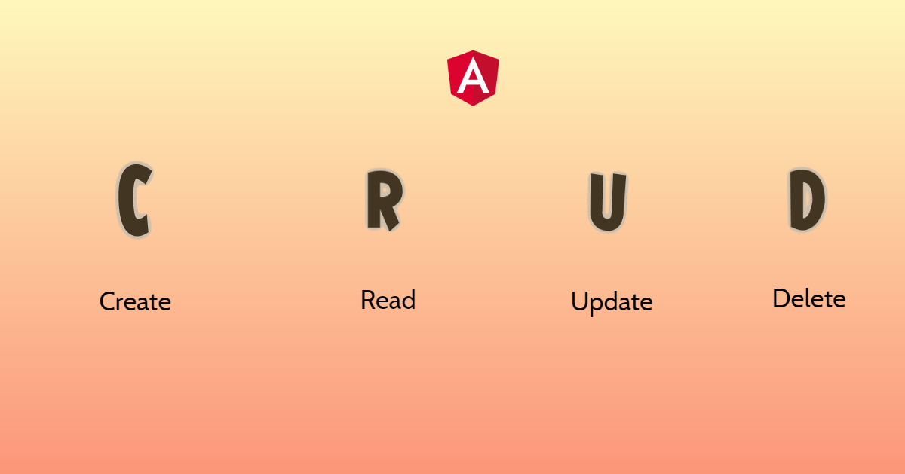
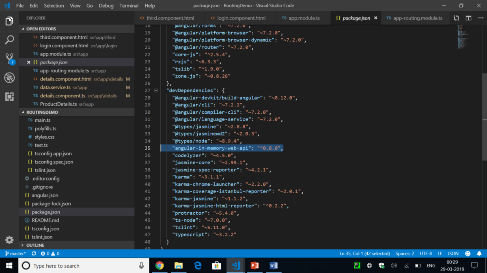
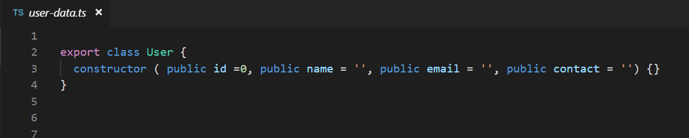
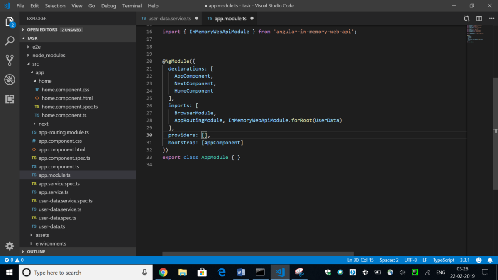
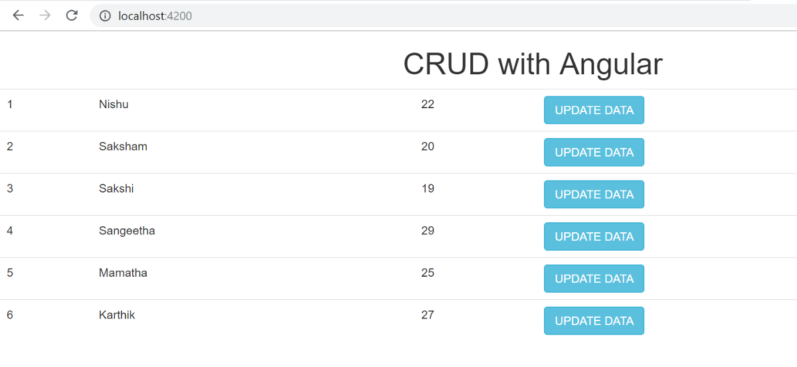
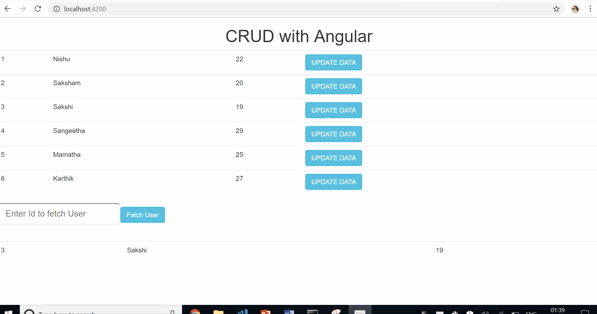
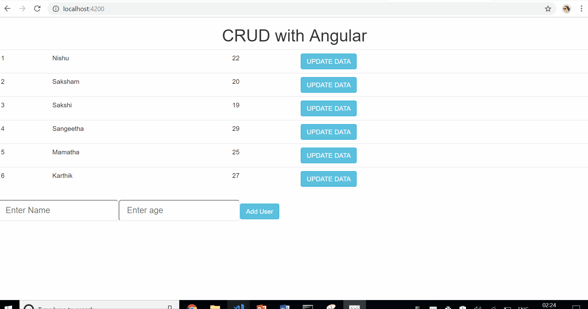
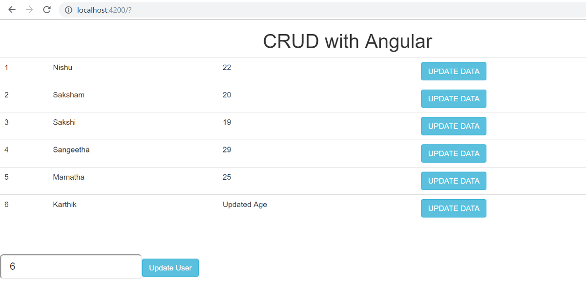
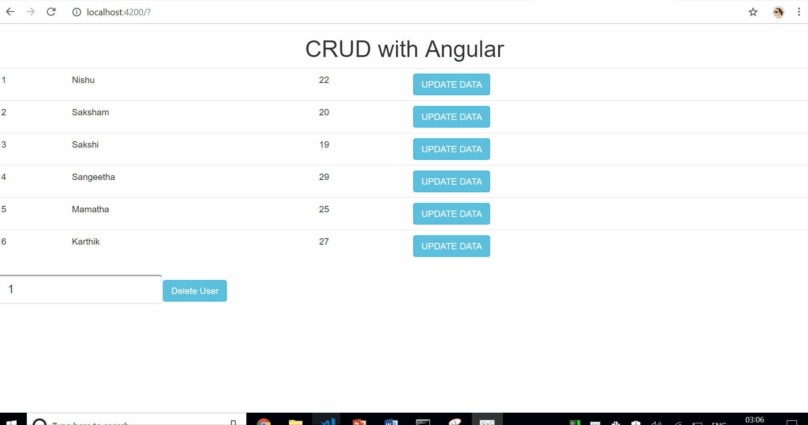




In almost any application that we work with, the first important thing to do is to deal with data, loads and loads of data. And this data which resides on the server is dealt with by the use of HTTP operations. We perform HTTP GET and POST operations to work with that data.

Now, in a real application, this data is stored on the server and received through API. However, for testing purposes, instead of using a real server, we can actually fake the back-end server.

Read about this here: <https://medium.com/@nishu0505/faking-a-back-end-server-in-angular-960ff33275ba>

The different ways to use a fake back-end server are:

* Create a file, hard-code the data, and return this data.
* Create a local JSON file and use it
* Use Angular in-memory-web-api

The best out of all to perform CRUD operations for development and testing purposes, is to use Angular in-memory-web-api. Using this, we can actually simulate a server and return mock data with the HTTP requests.

### Angular in-memory-web-api

This angular-in-memory-web-api is not a part of Angular Core but it is provided as a service in the Angular documentation. This will now send the HTTP requests to the local in-memory data store in place of the remote server and make our task a lot more easier.

The main purpose of this blog post is to put light on using angular-in-memory-web-api to produce a working CRUD application with Angular. By the end of this blog post, you should be able to create, read, update, and delete the data .

To start, the very first task is to install angular-in-memory-web-api using the command:

> ***npm install angular-in-memory-web-api — save-dev***

The save dev flag is used here to save this dependency that we will use for the development purpose.   
Once done, you’ll be able to see it in the dependencies inside your package.json file.



Now that we have this dependency saved in our application, we can go forward with using the angular-in-memory-web-api for performing CRUD operations inside our application.

To refer to the creation of the local in-memory data store with your data, refer to this article:   
<https://medium.com/@nishu0505/faking-a-back-end-server-in-angular-960ff33275ba>

---

I assume you have created your in-memory data store by now with the help of angular-in-memory-web-api and your progress till here looks like:



```
import {InMemoryDbService} from 'angular-in-memory-web-api';
import {User} from './user-data';

export class UserData implements InMemoryDbService {
  createDb(){
    const users: User[]=[
      { id: 1, name: 'Ram', email: 'ram@gmail.com', contact: '0000000000'  },
      { id: 2, name: 'Shyam', email: 'sh@gmail.com', contact: '1111111111'  },
      { id: 3, name: 'Mohan', email: 'moh@live.in', contact: '2222222222'  },
      { id: 4, name: 'Rohan', email: 'rohan@gmail.com', contact: '6666666666' },
      { id: 5, name: 'Sumit', email: 'sumit@live.in', contact: '9909999999'  }

    ];
    return {users};
  }
}
```



app.module.ts

By now, our data is set up in the in-memory-web-api and we are ready to obtain the data from the fake server and perform CRUD operations with that.

Now, to get the data from anywhere, what is the best resort? Services!

So, now, we go on to create a service which will obtain data from the API and provide us that data to work around with that.

```
import { Injectable } from '@angular/core';
import {HttpClient, HttpHeaders} from '@angular/common/http';
import {Observable, throwError} from 'rxjs';
import { tap, catchError } from 'rxjs/operators';
import {User} from './user-data';

@Injectable({
  providedIn: 'root'
})
export class DataService {

  apiurl = 'api/users';                 // Our created Data can be accessed here at api/users
  headers = new HttpHeaders().set('Content-Type', 'application/json').set('Accept', 'application/json');
  perfop = {
    headers: this.headers
  };

  constructor(private http: HttpClient) { }                     //Injecting HTTP service to communicate with the data

  private handleError(error: any) {
    console.error(error);                                       //Created a function to handle and log errors, in case
    return throwError(error);
  }
}
```

### What exactly are we doing here?

We have created this service DataService. Inside this, we are accessing the data through the remote API with the help of this line 12 in the above code i.e.

> apiurl = ‘api/users’;

Next step is to inject the service HttpClient but before we do that, some important files need to be imported.

> import {HttpClient, HttpHeaders} from ‘@angular/common/http’;  
> import {Observable, throwError} from ‘rxjs’;  
> import { tap, catchError } from ‘rxjs/operators’;

The code in line 14 is setting the variable perfop to perform http operations. Now finally we want to read the data which we receive through this remote call.

And we are all set to perform the CRUD operations now.

### READ DATA

To read the data from the API, we need to use http.get() method inside the service that we created.

We will read the data with the help of Observables returned from the created UserData array.

```
import { Injectable } from '@angular/core';
import { HttpClient, HttpHeaders } from '@angular/common/http';
import { throwError, Observable } from 'rxjs';
import { tap, catchError, map} from 'rxjs/operators';
import { UserData } from './user-data';
import { User } from './User';

@Injectable({
  providedIn: 'root'
})
export class DataService {
  apiurl = 'api/users';

  headers = new HttpHeaders().set('Content-Type', 'application/json').set('Accept', 'application/json');
  httpOptions = {
    headers: this.headers
  };

  constructor(private http: HttpClient) {}

  private handleError(error: any) {
    console.log(error);
    return throwError(error);
  }

  getUsers(): Observable<UserData[]> {
    return this.http.get<UserData[]>(this.apiurl).pipe(
      tap(data => console.log(data)),
      catchError(this.handleError)
    );
  }
```

Here, we are using pipe and tap operators to read the data from the observable and catchError method to handle the error if it occurs during the HTTP request.

To call the getUsers() method, we will now subscribe to the returned observable inside the Component.

```
import { Component, OnInit } from '@angular/core';
import { UserData } from './user-data';
import { DataService } from './data.service';
import { FormGroup, FormControl } from '@angular/forms';
import { User } from './User';

@Component({
  selector: 'app-root',
  templateUrl: './app.component.html',
  styleUrls: ['./app.component.css']
})
export class AppComponent implements OnInit {
  title = 'Let's CRUD';
  users: UserData[]=[];

  constructor(private dataservice: DataService){}
  getUsers(){
    this.dataservice.getUsers().subscribe(data => {
      this.users=data;
    });
  }

 
  ngOnInit(){
    this.getUsers();
  }
```

This reads the data from the API, and displays it on the template as:

```
# CRUD with Angular

<table class ="table">
  <tr *ngFor="let u of users">
    <td>
      {{u.id}}
    </td>
    <td>
      {{u.name}}
    </td>
    <td>
      {{u.age}}
    </td>
    <td>  
      <button class= 'btn btn-info' (click)="updateUser()"> UPDATE DATA</button>
    </td>
  </tr>
</table>
```

Gives the results as:



Reading Data with angular-in-memory-web-api

Reading the data from server is the easiest of all CRUD operations and performing the read of data is not very similar to how the functionality for creating, updating and deleting the data would work. We need to fetch the user with a particular id to update or delete that particular user. Similarly, to create a new user as the data, we would need the details to be input and then save them as some initialized User array.

### Fetch User

To perform this, let us first see how to get a user with a particular id.

> getUser (id: number): Observable<User> {  
> const url = `${this.apiurl}/${id}`;  
> return this.http.get<User>(url).pipe(  
> catchError(this.handleError)  
> );  
> }

On the component.ts, call the method getUser that you just created inside the service.

```
fetchId = 1;

  getUser() {
    this.dataservice.getUser(this.fetchId).subscribe(data => {
      this.user = data;
     this.displayData= true;
    });
  }
```

Create an input box on the template asking the user to input the id of user they want to fetch the details of.



### CREATE DATA

To create the data in the API, we need to perform HTTP POST operation and pass the data that needs to be inserted in the database.  
We will take a method addUser() for that.

```
 addUser (user: User): Observable<User> { 
    user.id=null;
    return this.http.post<User>(this.apiurl, user, this.httpOptions).pipe(
    tap(data => console.log(data)),
    catchError(this.handleError)
  );
}
```

On the component, call the addUser() method and subscribe to the returned observable.

```
  addUser() {
    this.dataservice.addUser(this.userFormGroup.value).subscribe(data => {
      this.user = data;
      console.log(this.user);
    });
    this.getUsers();
  }
```

On the template create a form for the user to input the details of the new data and this gives the results as:



### Update Data

Similarly, now to update the data, we’ll take an id of the user he wants to update from the user and update the age of that particular user.

```
updateUser(user: User): Observable<User>{
  const url = `${this.apiurl}/${user.id}`;
  return this.http.put<User>(this.apiurl, user, this.httpOptions).pipe(
    map(() => user),
    catchError(this.handleError)
  );
}
```

An important thing to notice here is that, whenever we want to perform the update operation, we use http.put() method.

On the component.ts,

```
idtoUpdate = 1;
  updateUser() {
    this.dataservice.getUser(this.idtoUpdate).subscribe(data => {
      this.user = data;
      this.user.age = 'Updated Age';
      this.dataservice.updateUser(this.user).subscribe(data1 => {
        this.getUsers();
      });
    });
```



We have seen how to update the data by taking an input from the user as to which user to update with the new age.

Next, we will see how to delete the data from the list of Users created in the database.

### DELETE DATA

To delete a record from the database, we use http.delete() method and subscribe to the returned observable in the component by creating a method deleteUser().

```
deleteCar (id: number): Observable<User> {
  const url = `${this.apiurl}/${id}`;
  return this.http.delete<User>(url, this.httpOptions).pipe(
    catchError(this.handleError)
  );
}
```

On the component, we subscribe to the observable using:

```
 idtodelete=1;
  deleteUser() {
    this.dataservice.deleteCar(this.idtodelete).subscribe(data => {
       this.getUsers();
    });
  }
```



deleteUser

### SUMMARY

Coming to the end of this blog post, let us have a quick recap of what we did.

* Created an in-memory data store to mock a call to the API.
* Generated a service to get the data from the API
* Performed http.get() method to read data, http.post() method to create data, http.put() method to update data, http.delete() method to delete data.
* Subscribed to the returned observable in the respective methods in the component.ts file.

