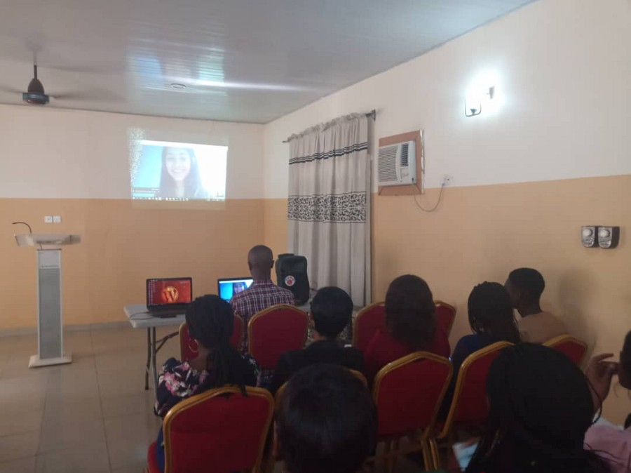
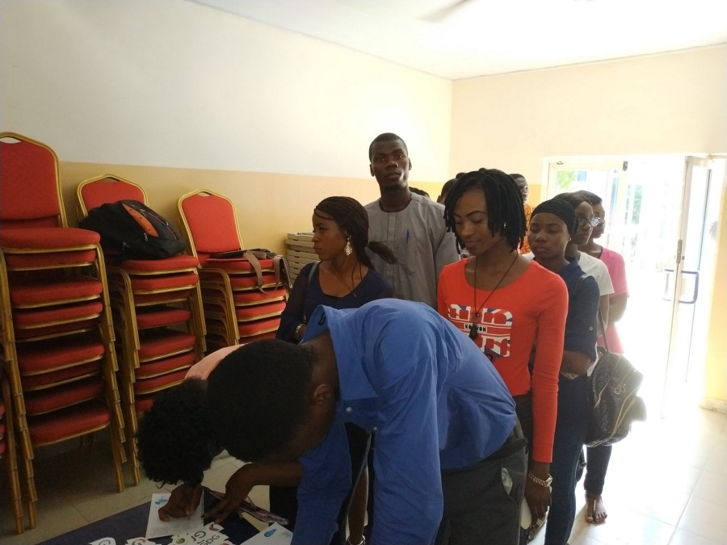


In the March of 2019, [**Pius**](https://twitter.com/ea_pius) contacted me to share my knowledge about the basic concepts of Angular with the audience of Makurdi, Nigeria. It was organised as a celebration of International Women’s Day 2019.

On the 31st of March 2019, I joined the audience in Makurdi via a Hangout session and discussed the topics starting from the basic set up required to work on an Angular application to component communication, directives etc.

This was my first online session teaching an international audience and there was no less energy in the crowd than that in an offline/physical session.

However, the session could not be recorded due to network issues.  
The topics taught in the session are covered in this Beginners course on Angular by me here: <https://www.udemy.com/angular-for-beginners-l/>

> Contact me at: nishu0505@gmail.com

