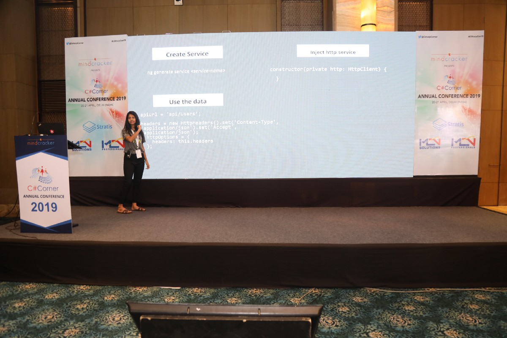
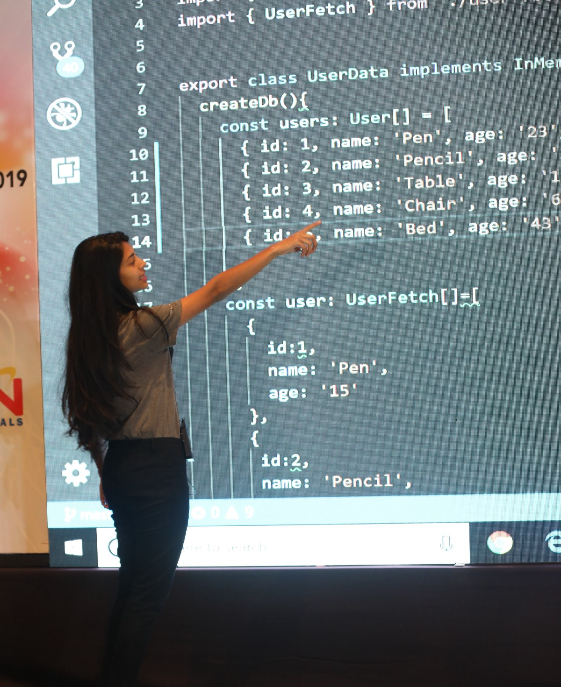
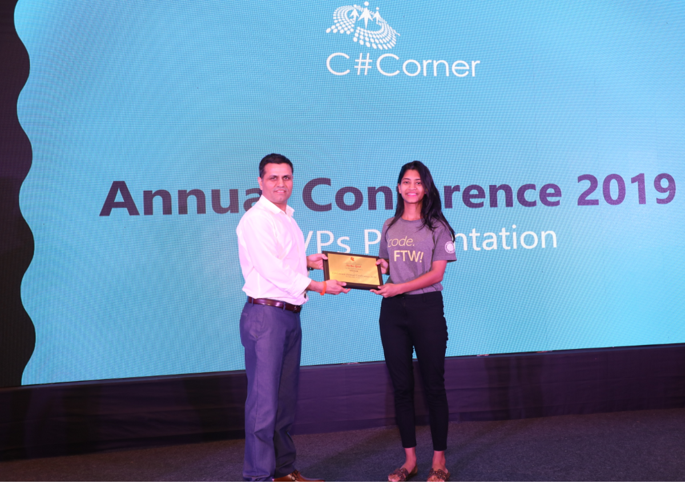


In the month of April 2019, I got the opportunity to speak at the annual conference of CSharp Corner. CSharp Corner is the worldwide community of software professionals and developers located in the USA.

The conference included talks on diverse technologies such as .NET, BlockChain, Docker, Angular et cet era. With Angular being one of the talk topics, I grabbed the opportunity to speak on performing CRUD operations wit Routing in Angular 7. The idea behind choosing this as a topic was that the audience was supposed to be diverse and people not from web development background or Angular as the background should be able to keep up and be interested to attend the talk. And CRUD operations are definitely something every developer needs to perform in almost any application that they work with. So it could help them relate to the topic.

This being said, a few days before the conference, I prepared a blog post for people to get an idea about what the talk will focus on. Here is the link to the blog post: <https://medium.com/@nishu0505/crud-with-angular-5d8f39805c49>

### Day of the Conference

The audience is welcoming and responsive. Although a lot of people attending my talk were not already working in Angular, their interest to learn this new thing seemed to be very positive.

Here are some of the pictures from the conference:

Here is the slide deck for my talk: <https://speakerdeck.com/nishugoel/crud-operations-in-angular-7>

Some of the amazing things following my talk were the amazing talks by other speakers, keynote sessions where speakers shared their journey to where they stand now.

The day came to an end with [Mahesh Chand](https://twitter.com/mcbeniwal), Founder, CSharp Corner, sharing about the achievements of the platform from the last year and expectations for the coming year, followed by the felicitation ceremony for speakers and C# Corner MVPs and obviously, the delicious food.

Connect with me on Twitter: [@DcoustaWilson](https://twitter.com/DcoustaWilson)

