
> NOTE: The article is relevant to the earlier versions of Angular and with the version 7 and above, we can create a library in Angular using the command ***ng generate library <library-name> .*** For more on this, refer to the documentation here: [**https://next.angular.io/guide/creating-libraries**](https://next.angular.io/guide/creating-libraries)

When you have a small application with three or more components, and they do not share a relationship among themselves when it comes to sharing data through component communication. For such components, we have seen the usage of services. Services come to be of great help when we have to use the same data in more than one components. This data is then used inside the component by using dependency injection.

This is when we have the components inside one module which contains the service. However, if we want to use the data from the service in multiple modules, a better idea is to put this data inside the service somewhere, from where you can actually import it in whichever module and component you wish to.

Now, this is about one application, what if you want maximum applications to use the same data and you definitely do not want to copy paste the code for each of your applications. Also, you do not want any of the applications to communicate with each other, but just share some data from an external source to all the applications.

That is when Libraries and packages come into the picture. In this blog post, we will see how to create an Angular library and what are the requirements to create one. When researching more about Angular libraries, I came across this great talk [Create and publish Angular libs like a Pro](https://www.youtube.com/watch?v=K4YMmwxGKjY) by [Juri Strumpflohner](https://twitter.com/juristr) wherein he explains the need for a library with this image.

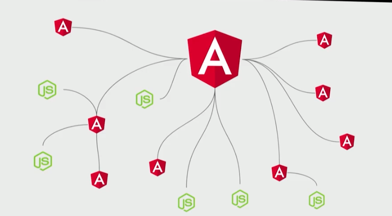

It explains how our applications comprise of different javascript files and other external libraries and tools and how they are assembled together.

To start with, let us look at the points to consider when creating a library.

### A library should be:

* Distributed
* Platform-independent
* Bundled
* Supporting Ahead-of-time compilation
* Work with TypeScript doing type checking, autocompletion, etc.

All these requirements together make a perfect Angular library, and it has come up with a solution called Angular Package format to support building the Angular libraries. This format is a recommended way of building Angular libraries and distributing the packages. Libraries which are built using this format will be handled properly by the Angular applications, node packages, npm.

It is a set of guidelines which Angular team uses to distribute packages and if we follow those guidelines while developing an Angular library, we put ourselves on a safe side because then our library is supported by a lot of tools that are used in the ng ecosystem and the packages then integrate easily with these tools. It will also have an optimized bundle size and a build time which are some of the very important factors.

### Steps to produce an Angular library

* Since the library should be bundled all in once place, the first step should be to inline all the external templates.
* The next step is to compile this with the ngc compiler which is sort of a wrapper around the tsc. The ngc will produce the javascript files out of the typescript ones and also produce the the d.ts files to do the Ahead-of-time compilation by creating the metadata for this library.
* Build different ESM2015, UMD formats.

### ng-packagr

We can developer libraries using the ng-packagr, which is a project on nom and Github. These libraries can then be put inside the Angular Package Format. The libraries create all the bundles for us. It is consumed by different module loaders, inline the templates by itself, creates the type definitions (.d.ts files)

To install ng-packagr using npm, so that it can then be used globally from the command line,

$ npm install -g ng-packagr

Once you have installed it, you will be able to see the version of it inside the package.json file as a dependency.

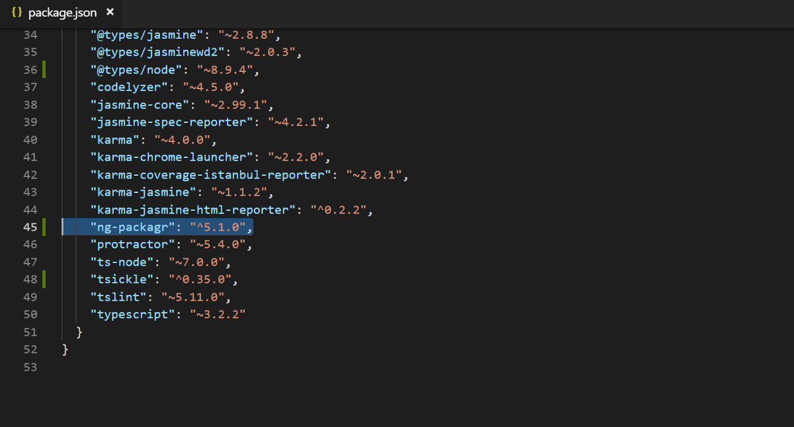

So the task is to create the code files which have the logic for our application (.ts files), a .d.ts file which contains the entry point to the file and the metadata files that is the package.json.

Inside the package.json file, we need to pass in the property ngPackage which will contain the configuration.

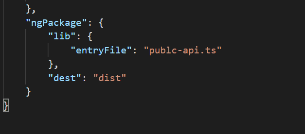

We pass in the entry file for it and the destination where it should be created.

With these three files, we are good to proceed and we put these three files with the ng-packagr and get the following files as the output.

* \*.d.ts
* package.json
* Bundles
* ESM2015
* ESM5

An important thing to remember before we proceed is:

> If you import anything from the library using the ES6 import statement, it has to be present in the entry file of the library mandatorily.

Now let us finally go and create one library with the ng-packagr.

We need to have Angular CLI globally installed in our machine. Once we have that, we go on to create a new project with the help of CLI using:

#### $ ng new <project-name>

CLI asks if you want to add routing to your application and which stylesheet you want to use. We do not want routing as of now since we will be focusing on the building of a library and we can choose any stylesheet.

Once our project is created, we go on to create a new folder with a src folder inside it.

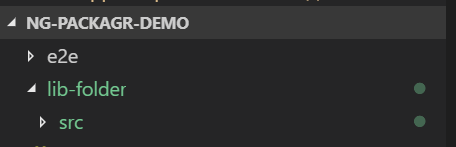

Our Angular code comes inside the src folder. Create a component file with inline template.

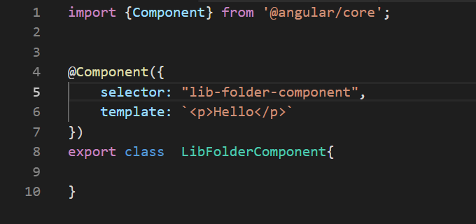

Create a module file next.

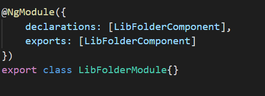

Once we have created the module and component class, the next step is to create the **public\_api.ts** file which will be the interface to the library.

Inside this file, we export both the module and the component data. And then create a configuration file, package.json

Inside the package.json file,

We put properties such as name, version, peerDependencies, etc.

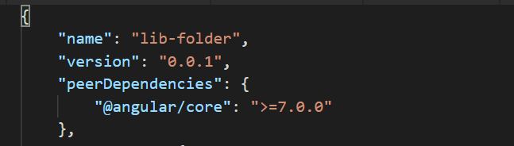

Now to make the files inside the lib folder ready to become a library, we need to perform some steps.

* Install ng-packagr and tsickle using npm

> $ npm install ng-packagr tsickle – -save-dev

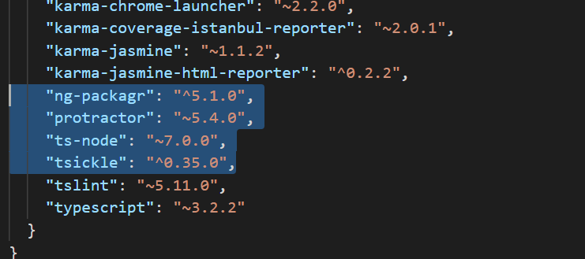

* Reference the package.json file of the lib folder inside the main package.json

> “build-lib”: “ng-packagr -p lib-folder/package.json”

Now to use the ng-packagr, we need to define a section inside the lib-folder/package.json and create an ngPackage object.

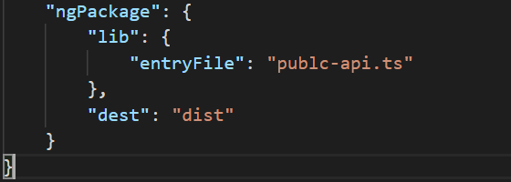

Here, we give the name of the entry file and the destination folder.

By this point, all the required files are created manually for an Angular Library.

Let us run npm run build-lib in the console now and see the different files it creates for us:

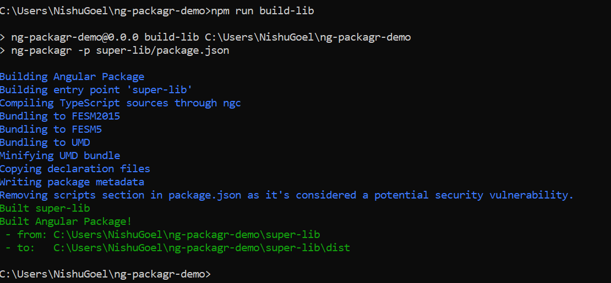

If you now go to the destination folder to check what has been created for you in your library, you can see this:

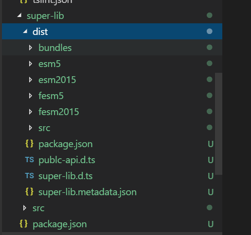

All the bundle files, esm2015, fesm2015 files have been created and are ready to be consumed in an Angular application.

Now, install the library inside your application using npm.

> $ npm install <library-name>/<destination-folder-name>

You will be able to see the installed and your-own-created library inside the package.json file.

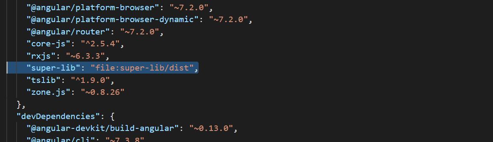

And you would be able to use this library inside your application now. Inside appmodule, import it just like any other library and use the component coming from your library.

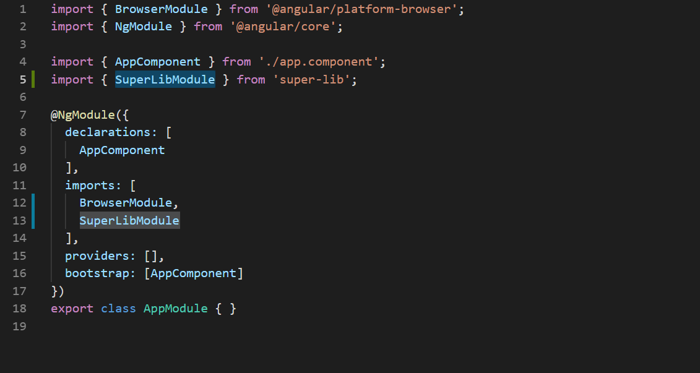

app.module.ts

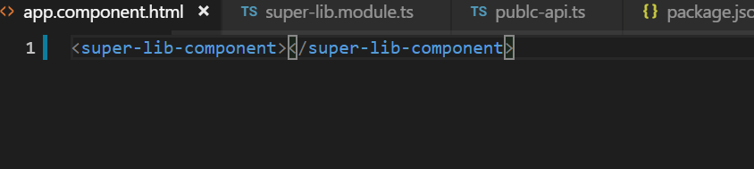

app.component.html

Go to the browser to see if the component from the library gives you the output in your Angular application.

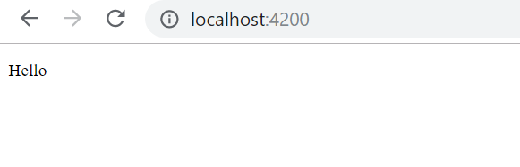

The output from the library in your application

Here you go! You have created your first simple Angular library using the ng-packagr.

