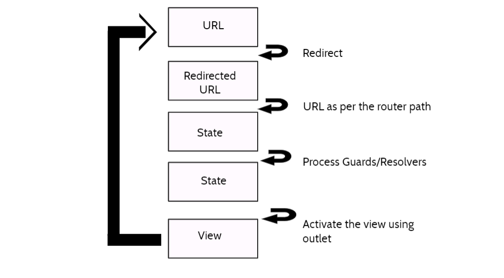
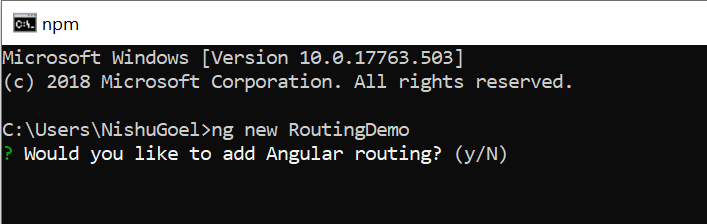
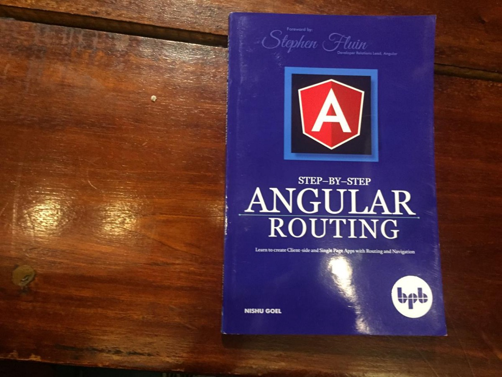


When I started my journey of learning Angular, the concept that captured my interest totally was the routing and navigation techniques in the framework. First of all, my basic understanding of web apps was that there are multiple pages and clicking on one element on a page would link to the next page having a different set of information. After all, We have all evolved from the time when we used websites involving a number of HTML pages interlinked.

So, I was new to the idea of Single page applications but then when I started exploring more and diving deeper into this area, I was intrigued by how there are multiple views in a single page application and that we can navigate from one view to another with the help of Angular Routing.

With an understanding of the file structure in Angular applications, I moved further to learn about other Routing concepts like Route guards, Route params, route resolvers, lazy loading et cet era. The most important bit to understand firsthand was the working and the lifecycle of Angular Router, which comes as a part of Angular core packaged as @angular/router.

The following diagram concisely shows the lifecycle of a router:

Having my concepts clear about the router, I moved on to start creating routing-based Angular applications. Another best thing comes in then with the CLI being super-friendly. When we create a new Angular app from the CLI using **ng new**, it would ask if we would want to add Routing. It then does the necessary configurations and creates a separate routing module for our routing-based application.

All these concepts were getting interesting and I was enjoying my learning phase.

And this is when the idea of writing a book, yes A BOOK on Angular Routing came to my mind. This was not because I started feeling I became an expert of the topic but because I thought that this learning should be put in one place and be shared and definitely out of this dream of mine of writing a book someday.

With concepts like Named Router outlets, grouping routes, preloading strategies while lazy loading routes, performing CRUD operations with Routing, the idea could actually be put into action.

On May 10, 2019, my first book on Angular Routing was published worldwide as “Step-by-Step Angular Routing” on [**Amazon**](https://www.amazon.com/Step-Step-Angular-Routing-client-side-ebook/dp/B07SVHF2SJ/ref=sr_1_1?crid=27KMKSKVA3XW2&keywords=step+by+step+angular+routing&qid=1560084156&s=gateway&sprefix=step+by+step+angular+%2Caps%2C824&sr=8-1).

I have tried my best to keep the language very simple to understand, in the hope to make this book an easy read for the audience and for the beginners in Angular. I also set up a GitHub repository to code reading the chapters in the book.

Many thanks to Stephen Fluin for writing a foreword for the book and supporting. Many thanks to Dhananjay Kumar a.k.a DJ for the constant motivation. Thanks to BPB publications for publishing the book.


