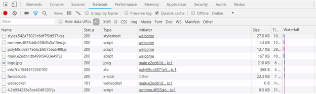


We all know lazy loading is one of the most useful concepts of Angular Routing, and for those of us who have been working with Angular, we know how it brings down the size of large files. This is done by lazily loading the files that are required occasionally.

To start with lazy loading by asynchronously loading the feature module for routing whenever required, we go to the route configuration and use the property **loadChildren**. Let us see what this property does.

> **{path: ‘user’, loadChildren: ‘./users/user.module#UserModule’}**

This property loadChildren is used for lazily loading the routes and is not related to child routes or such.

Let us break down what the property’s value means. The loadChildren property accepts a string value which contains the route to the feature module followed by a hash symbol and then the name of the feature module.

Now when the route gets activated, this loadChildren property will get activated and load the requested module. It will then load the requested component and display that component’s template.

Once we have configured this property, we go to the console to see which files are generated.

We will see an extra bundle file generated.  
Now if you go to the network tab in the console to see the files generated on routing to the UserModule, you will see one extra file created with some numeric value which might look something like this:

This is how lazy loading gets implemented using the loadChildren feature in the route configuration for the specific feature module. And this creates another bundle file only when that route is navigated to and the data is requested.

This is how we have been working with lazy loading till now, right?

### But…

If we look at the route config again,

> {path: ‘user’, loadChildren: ‘./users/user.module#UserModule’}

the loadChildren property accepts a string which means that even if there is a wrong module name or a typo while writing the code, Angular would not know there is something wrong and accept whatever is there as a string until we try building it.

So, let us say we write the config as :

> {path: ‘user’, loadChildren: ‘./users/user.module#**UserModulee’**},

with an extra ‘e’, it will not throw any error considering it a part of the string.

### Therefore,

Angular 8 comes up with support for dynamic imports in our router configuration. This means that we use the import statement for lazy loading the module and this will be understood by the IDEs, webpack, etc.

So when you update to Angular 8, this will automatically accommodate the changes in your application.

Now if you look at how lazy loading is done,

> {path: ‘user’, loadChildren: () => import(‘./users/user.module’).then(m => m.UserModule)};

Now your editor, let’s say VSCode understands what is this syntax and will recognize if there is some mistake and we won’t have to wait till build time to realize about an error.

This new syntax now means that loadChildren is a function which will execute when it tries to access the user module. This will asynchronously load the import statement and implement the module.

This new lazy loading is explained by Stephen Fluin in this video: <https://www.youtube.com/watch?v=jPXl7sCPCOA>

