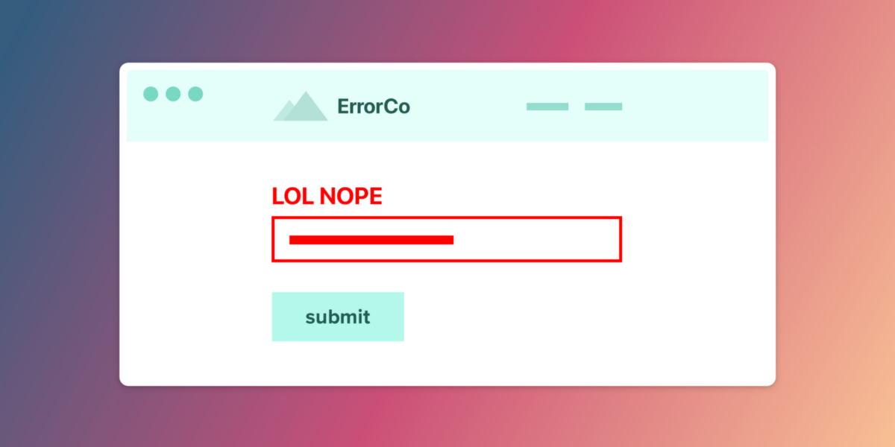
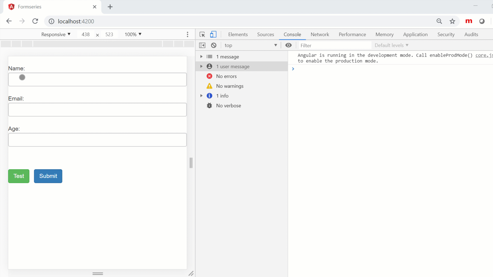
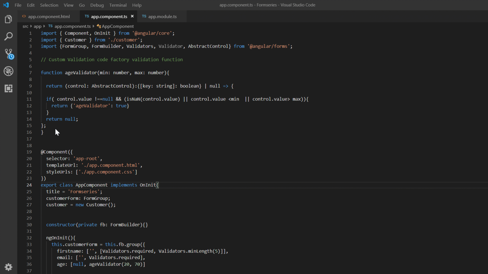



pageclip.co

When working with forms in Angular, we are provided with a choice. The choice is similar to the one between choosing tea or coffee. This choice is about choosing which types of forms we should use as per the requirement of our solution.

And the two options that we get are:

* Template-driven forms
* Model-driven forms a.k.a Reactive Forms

Now each of these have their own advantage over another and it totally depends on the developer that which one he prefers to use for this set of requirement. Is he looking to quickly get an input from the user without much interest in all the fancy validation and stuff OR is she wanting to leverage all the possibilities that a form is capable of providing.

One of the reasons somebody would choose to work with template-driven forms can be to get the work done without really wanting to have a form model inside the component, leaving alone the unit testing bit which gets difficult to do against the DOM.

One of the reasons somebody would choose to work with model-driven forms (Reactive forms) can be to do most of the task from the component class only putting the instances of the input fields on the template, making it easier to unit test and use up other great features of reactive forms, for example, Custom validation.

In this blog post, we will see how we can use custom validation inside our forms and make the best use of reactive forms.

Now a validator is nothing but a function. To create this validator fucntion, the syntax goes like this;

> **function classValidator(control: AbstractControl) : {[key : string] : boolean} | null {  
> return null;  
> }**

Let us break this down now and understand.

Since our custom validator is a function, we use the function keyword followed by the name of our validator that we want to create. As an argument comes the FormControl or FormGroup for which use the base class i.e., AbstractControl. The next part in it means what type of value will be returned by the function. So it there is something wrong with the input field, it returns an object in the form of a key-value pair, where the value is of type boolean and the key is of type string. If everything works fine with the input field, it returns null.

So lets create a simple **range validator** for age here:

To apply this to your input field, use the name of your custom validator on the form control name inside the form group,

On the template,

> Only for age group 20 to 70

Let us look at the results in the browser now.

Well, here we were actually passing in the hard-coded values. What if we want it to return some parameters? What do we do then? We cant pass more parameters to this Validator function.

Enter the factory validator functions!

To pass in parameters to our validator function, we wrap it inside a factory validator function and then pass in the parameters. Let us see how to do that.

Let us see if it still works on passing the parameters not as a hard-coded value.

And it does. Our custom validator function with passed in parameters worked! Yay!!!

Find the GitHub source code here:

https://github.com/NishuGoel/Customvalidator-ReactiveForms

