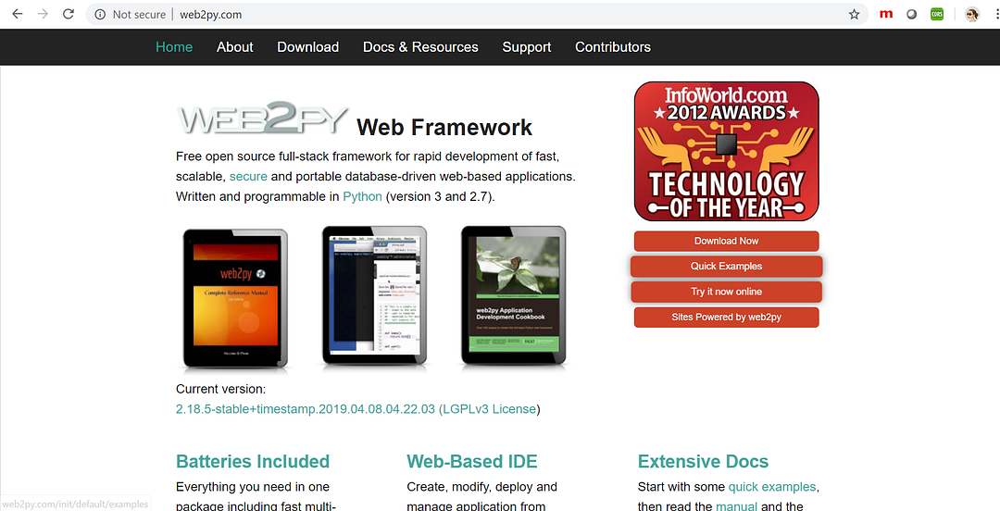
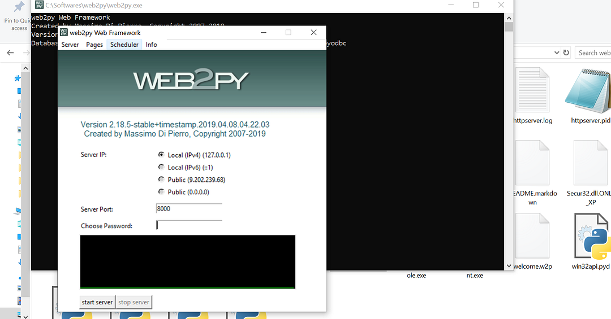
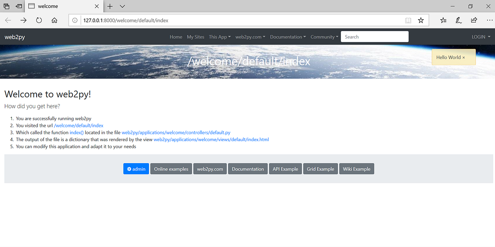
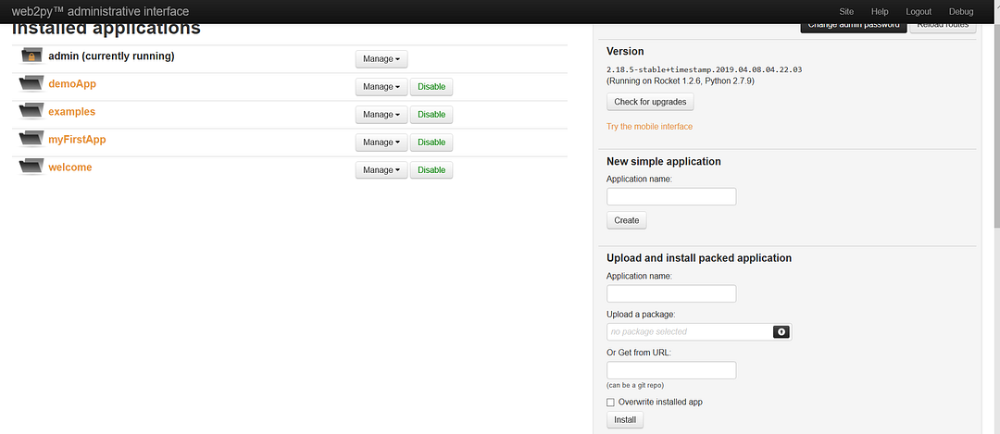
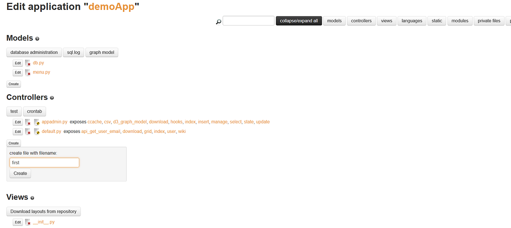
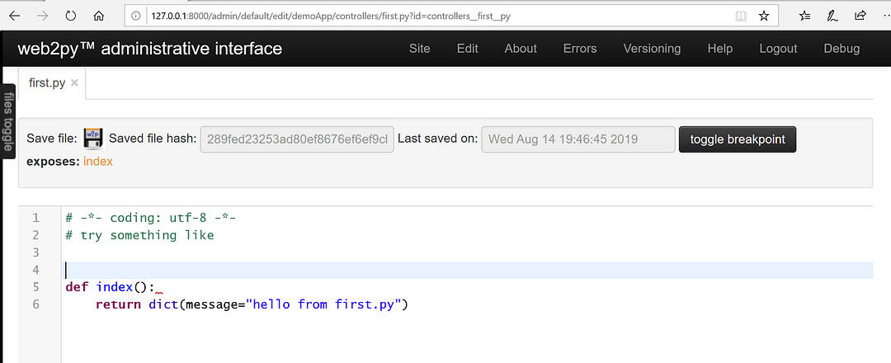
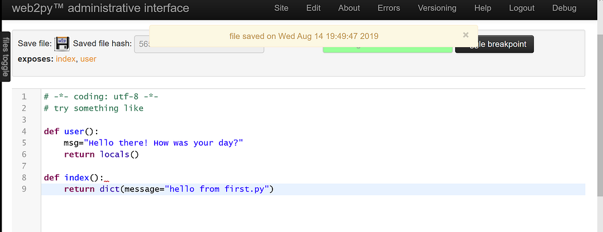
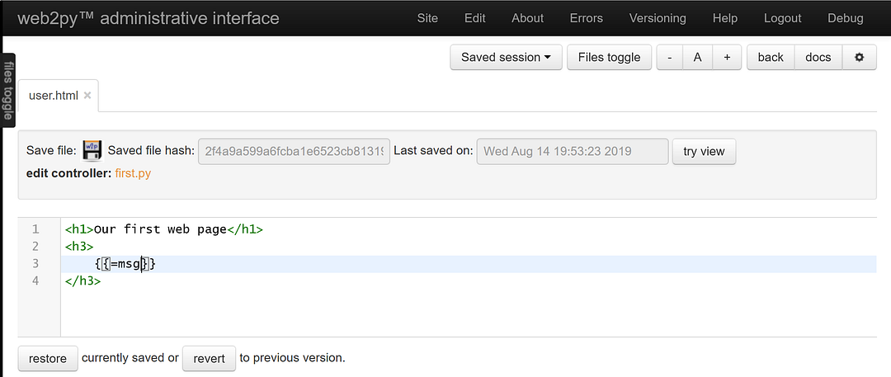
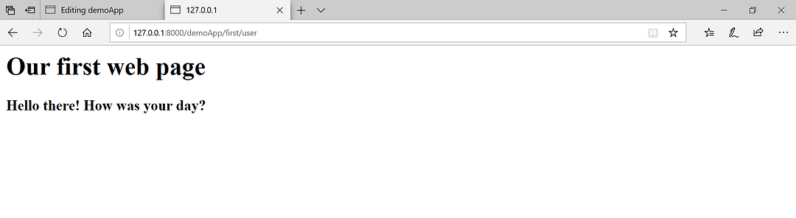


Fond of Python? Thinking how to use it for web development?

I come from a similar background. I have always had a thing for Python. It just attracts me a lot! Getting into web development right after my graduation took me away from Python but I though why not do the same thing, i.e., web development using Python?

And these Python frameworks fortunately help us do that! Django, Web2Py etc. are the various Python frameworks that developers have been using to build web pages.

In this blog post, I will focus on how to use WEB2PY to build a web page and I chose to write about it realizing how beginner-friendly and a productive framework Web2Py is!

We will start by looking at the installation of Web2PY. To understand what it looks like, the website web2py.com provides everything we need to build a web page using the framework. It is like a browser based IDE for you to write and implement the code for your web page.

It follows the Model-View-Controller (MVC) approach which is also followed by a number of other frameworks.

Let us quickly introduce ourselves to the web2py website.

The about tab of the website introduces us to what Web2py is, the version history, the way MVC approach works et cet era. To access the documentation of the framework and understand the working better, we are provided with the **Docs & Resources** section. To download the web2py web framework for Desktop, we can simply go to the **Download section** and download the version as per our respective operating systems. Python is a pre-requisite before installing it on our machine.

When we install it inside our system and extract the files, look for a folder called **applications** which contains all the data (models, controllers etc.) for the different applications that you create.

To start your Web2py web server, run the web2py.exe from your extracted files and it will then ask you to set up an administrative password to access your applications at a later point in time.

Clicking on start server will open your web2py applications in the browser.

Click on admin and enter the chosen password which leads you to the view of the default applications and the created ones(if any!)

You can now create a new application on the right panel and then edit this application any time when you need to.

Now before going on to create a new web page, let us understand the URL mapping which looks like:

> http://server/app/cntr/view/args

Here, in our case the server is localhost, ‘app’ is the application name that we give, ‘cntr’, the controller. The default controller is called default and the default view is the index. And the args come from request objects that are passed.

The controllers which are the .py files, can be edited in the browser-based IDe or in any IDE of your choice, like Sublime Text, Pycharm etc.

To create our first basic web page, let us edit the new application that we created and create new files here. The naming convention plays a huge value when working with the MVC approach. So we create a new controller (lets say first.py) inside the application and you will see the default index function. To implement what we want, we create a new function inside this controller and pass any message.

The index function comes by default inside the new controller that we create.

We can create any function that we want to display and return the data.

The variables that we take inside the new function that we create, we return them using the locals() function which returns all the locally defined variables.

Once we save the controller, the next task is to create the corresponding view for the same. So we click on edit again and add a new view following the naming convention.

> first/user

The IDE automatically add .html extension to your file since it is a part of the views.

We edit this html to display our first web page with the values returned from the controller.

The python variable value that we want to display inside the view comes inside two curly brackets {{…}}.

This is similar to how we interpolate the data coming from the component files in the template in frameworks like Angular.

Now to see the changes of our first web page, we go to the URL

> [http://server/demoApp/first/user](http://127.0.0.1:8000/demoApp/first/user)

In the next blog posts, I will talk about using request and response objects and deploying our Web2py-built web-page to platforms like pythonanywhere. Another advantage of Web2py being that is known for the ease of deploying web applications.

