
I will be writing about how to deploy an angular application on to the public IBM cloud platform and be able to access the application.

So, to put it briefly here about what this blog post will include, we will create an angular application using the CLI, make our application deploy-ready, build the application, create and access the IBM Cloud, create delivery chains, API keys and finally put in the build and deploy script to be able to deploy the application on the cloud. Clumsy? Let’s break this down and handle it!

To start with, lets do what we are good at and have done a lot! Let us create an angular application from the CLI. I assume the readers have node, npm, angular CLI installed in their systems.

To create an Angular application, we use the command:

> ng new <project-name>

As we know, we get a default template view when we compile the basic code generated on creating a new application.

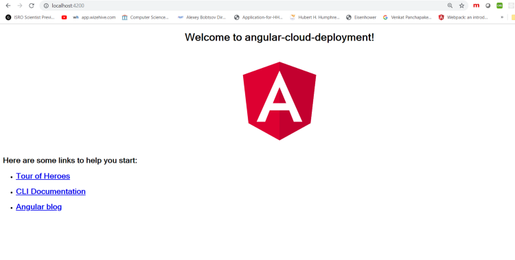

After making whatever changes you want in the first go, the next step is to make your application deploy-ready! To do that, we create a file known as **manifest.yml**

This file needs the information for the cloud to understand the application structure for deployment purposes.

```
---
applications :
- name: "angular-cloud-deployment"
  path : "dist/angular-cloud-deployment"
  memory : 256M
  buildpack :
  - "https://github.com/cloudfoundry/staticfile-buildpack.git"
```

manifest.yml file to deploy an application

Any other parameters can be included too in here as per the requirement. Create a git repository because you’ll deploy the app through the repository.

> <https://github.com/NishuGoel/ng-ibm-cloud-deploy>

Let us set up the IBM Cloud account now!

* Hop to cloud.ibm.com and choose to create an IBM Cloud account if you do not already own one. Since my email is already associated with an IBM id, I will be using a different email ID for demo purposes.

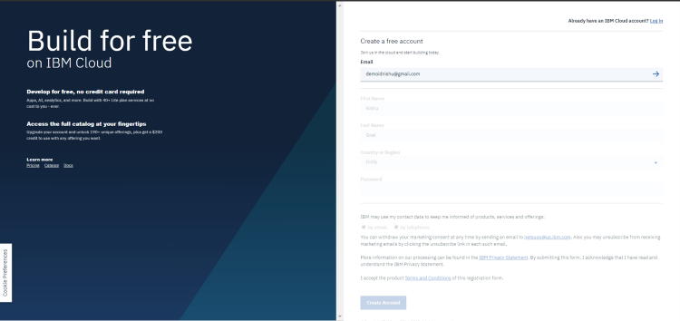

Once you are done, confirm the account from your email and log in to your account.

Proceed to the hamburger menu and choose DevOps from there which takes you to create your toolchain.

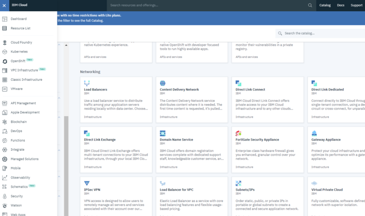

Create the toolchain and give it a name. When you toolchain is ready, click on add a tool, and select Delivery Pipeline.

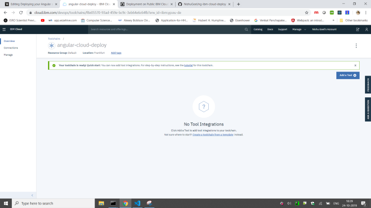

Give a pipeline name, and create integration. You will a warning related to service requirements, to do that, add the service.

After this add another tool, Github to be able to integrate your repo with the cloud. Authorize your github account with the IBM cloud.

Choose Existing repository and give the repo URL:

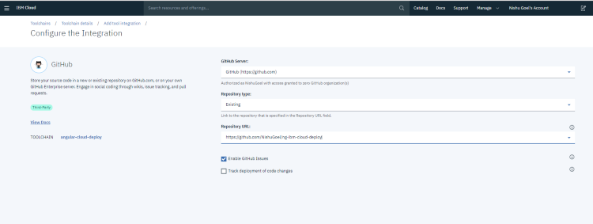

And create integration. You can check the track deployment of code changes option if wish to do so. The pipline should look like this now:

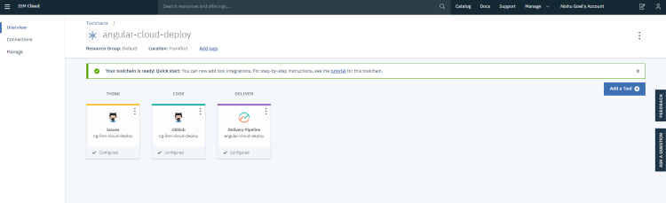

Go to the delivery pipeline now and Add a Stage:

The first stage will be a build stage so rename it to Build Stage and choose the branch and trigger stage as per your requirement. let us say on every commit that is push or manually.

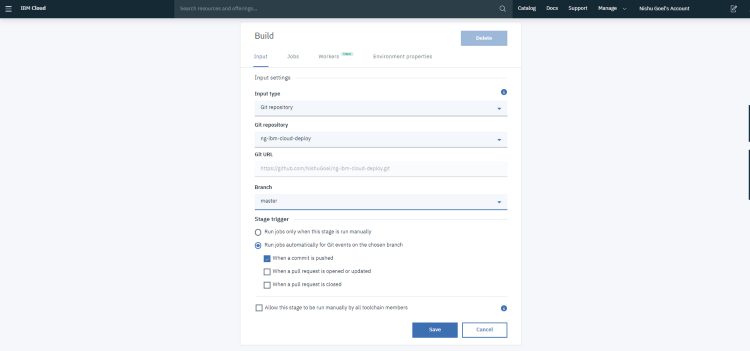

Now, under the jobs section, add a job, i.e., Build job.

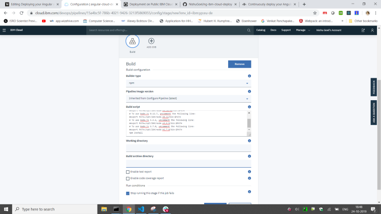

Choose the builder type as npm and the script as follows:

The script will install the node version you suggested your application will need, installs the dependencies, and completes a build for our application.

```
#!/bin/bash
 export NVM_DIR=/home/pipeline/nvm
 export NODE_VERSION=8.12.0
 export NVM_VERSION=0.29.0

 npm config delete prefix \
   && curl https://raw.githubusercontent.com/creationix/nvm/v${NVM_VERSION}/install.sh | sh \
   && . $NVM_DIR/nvm.sh \
   && nvm install $NODE_VERSION \
   && nvm alias default $NODE_VERSION \
   && nvm use default \
   && node -v \
   && npm -v

 npm install -g @angular/cli
 npm install

 ng build --prod
```

Replace the node version with the version of your node. Add the build archive directory as ‘dist/app-name’. In our case,   
‘dist/angular-cloud-deployment’.

### NOTE: At this point, do make sure that the dist folder is pushed too to the git repo and not ignore due to being placed in the gitignore file.

Time to add another stage now, i.e., the Deploy stage.  
Rename the stage to Deploy and make sure that the input type is set to Build artifacts and the stage as Build.

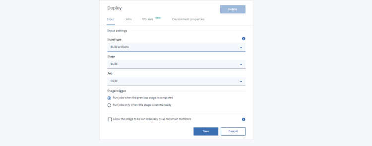

Under the Jobs section, add the Deploy job and set the deployer type as Cloud Foundry and the location as per your location and space. Choose the cloud foundry type as IBM Public Cloud. Next you’d need to create an API key and authenticate with that.

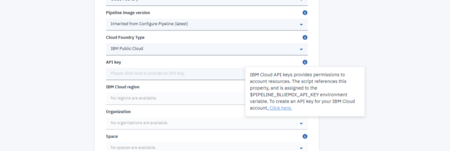

Once you have authenticated with the API key, change your deploy script as :

```
#!/bin/bash
 cf push "${CF_APP}" --hostname <YOUR HOSTNAME> --no-manifest -b 'https://github.com/cloudfoundry/staticfile-buildpack
```

Change the host name as per your requirement here and finally click save.

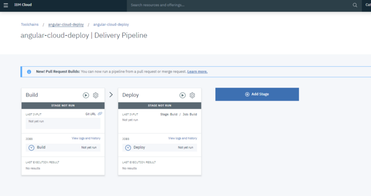

Trigger the build stage and once it is completed, it starts the deploy stage. If any of the stage fails, it will show up in red and you can check the logs from there.

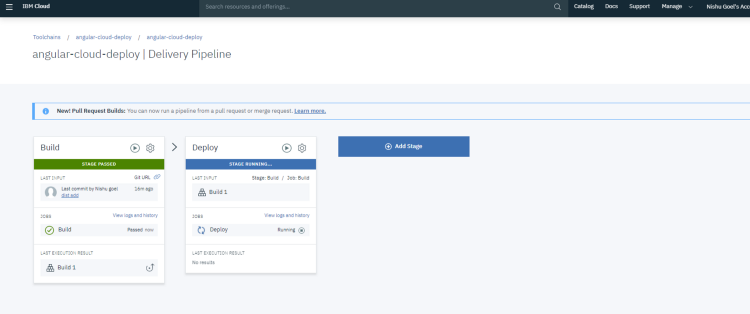

Once both the stages are completed, you can run your application on the URL by click on the **Visit App URL** option and you are good to go!

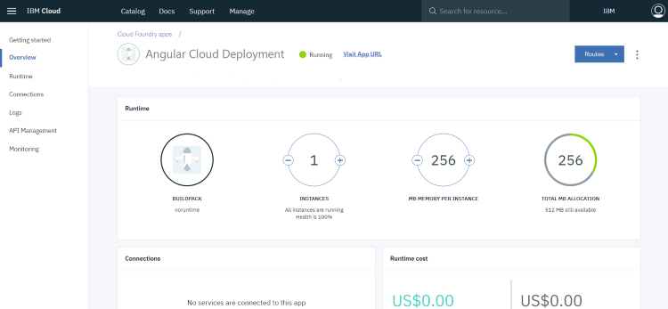

#### There is a variety of issues that you can run into in the process. You can put them in the comment section, if you face any!

Thank you for reading the blog post. 🙂

