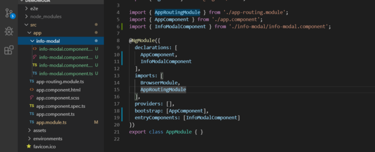
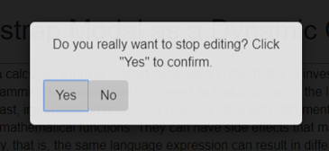
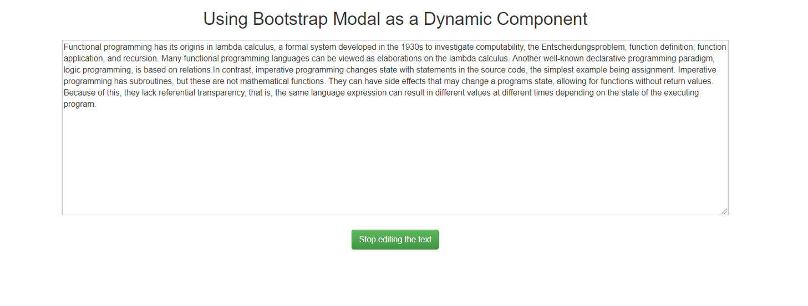
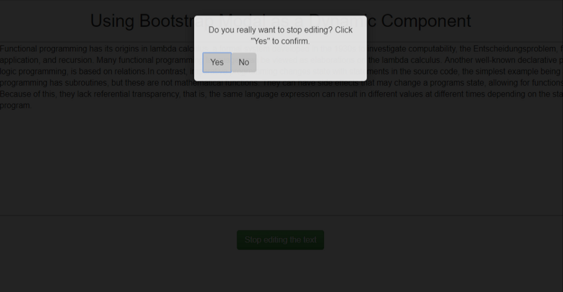


Working in an application involving multiple components under different modules, there are scenarios where in you’d not want to fix another template for a simple functionality like a modal component, let’s say!

For such components, we can actually build a dynamic component where in we would not need to render the template at the build time but as and when required at the runtime.

So, in this blog post, I will be writing about using a bootstrap modal as an info modal entry component for our application.

To start, we will create a regular Angular component using

ng generate component <component-name>

So let us start by creating an Info modal component which we will render only when we require it on an operation in another component.

Assuming that we have set up an Angular application, we will create a component and insert it in the **entryComponents**array inside NgModule.



The next step is to include the bootstrap modal inside our application. To do that we will install ng-bootstrap as a dependency inside the application.

npm i — save @ng-bootstrap/ng-bootstrap

You would also need bootstrap 4 CSS in yor app so add that inside the angular.json in the styles array.

Once, this is set up, we can go to the InfoModal component and start implementing the modal.

In the **info-modal.component.ts,**

The first step is to import NgbModal from ng-bootstrap library

> import { NgbActiveModal } from ‘@ng-bootstrap/ng-bootstrap’;

On the info modal view, we want to have something that looks like this:



To have this view, we need two buttons on the info-modal.component.html,

```
<section>
```

The data for this component comes as an Input from the component that wants to render this component. So on the **info-modal.component.ts,**

```
import { Component, OnInit, Input} from '@angular/core';
import { NgbActiveModal } from '@ng-bootstrap/ng-bootstrap';

@Component({
  selector: 'app-info-modal',
  templateUrl: './info-modal.component.html',
  styleUrls: ['./info-modal.component.scss']
})
export class InfoModalComponent implements OnInit {
  @Input() modalData: {
    primaryButton: { showButton: boolean, buttonText: string },
    secondaryButton: { showButton: boolean, buttonText: string}, modalContent: string
  };
  ngOnInit() {
  }
}
```

On the click on primary button, we perform some action whereas on the click of the secondary button, we would simply dismiss the modal.

To dismiss the modal, we’d simply use the reference to **NgbActiveModal** like follows:

```
import { Component, OnInit, Input, Output, EventEmitter } from '@angular/core';
import { NgbActiveModal } from '@ng-bootstrap/ng-bootstrap';

@Component({
  selector: 'app-info-modal',
  templateUrl: './info-modal.component.html',
  styleUrls: ['./info-modal.component.scss']
})
export class InfoModalComponent implements OnInit {
  @Input() modalData: {
    primaryButton: { showButton: boolean, buttonText: string },
    secondaryButton: { showButton: boolean, buttonText: string}, modalContent: string
  };
  
  constructor(
    private _activeModal: NgbActiveModal
  ) {}

  ngOnInit(){}

  public dismissModal() {
    this._activeModal.dismiss();
  }
```

To want to perform an operation on the click of the primary button, we would need to emit an event from the info-modal component to the one that renders this component. To do that, we’ll use Output and EventEmitter and emit the event on the click of the primarybutton.

```
import { Component, OnInit, Input, Output, EventEmitter } from '@angular/core';
import { NgbActiveModal } from '@ng-bootstrap/ng-bootstrap';

@Component({
  selector: 'app-info-modal',
  templateUrl: './info-modal.component.html',
  styleUrls: ['./info-modal.component.scss']
})
export class InfoModalComponent implements OnInit {
  @Input() modalData: {
    primaryButton: { showButton: boolean, buttonText: string },
    secondaryButton: { showButton: boolean, buttonText: string}, modalContent: string
  };
  @Output() emitUserOp = new EventEmitter<{ opStatus: string }>();
  constructor(
    private _activeModal: NgbActiveModal
  ) { }

  ngOnInit() {
  }

  public emitUserApprovalStatus() {
    this.emitUserOp.emit({ opStatus: 'confirmed' });
    this._activeModal.dismiss();
  }

  public dismissModal() {
    this._activeModal.dismiss();
  }
}
```

This is the ready info modal component that we want to render from every component wherever and whenever we require it. This should receive the data through Input() and emit the action that should be performed when clicked on the primary button.

Let us render this component in our application now. Remember we have not rendered this component now since we have **NOT**placed the selector of this component on any template as we always do!

<app-info-modal></app-info-modal>

So instead, we will create the component instance and use it to render the InfoModal component.

# **Let us render the component now!**

I have created a new component, RenderInfoModal, which looks like this:



On the click of Stop editing this text, we want to invoke the InfoModal.

<button (click)=”invokeInfoModal()”>Stop editing the text</button>

Now let us create an instance of this inside the invokeInfoModal method.

Inside the invokeInfoModal method,

```
import { Component, OnInit } from '@angular/core';
import { NgbModalRef, NgbModal, NgbModalOptions } from '@ng-bootstrap/ng-bootstrap';

@Component({
  selector: 'app-render-info-modal',
  templateUrl: './render-info-modal.component.html',
  styleUrls: ['./render-info-modal.component.scss']
})
export class RenderInfoModalComponent implements OnInit {

  public stopEditingModal: NgbModalRef;

  constructor(  ) { }

  ngOnInit() {
  }

  public invokeInfoModal() {
    const modalConfig: NgbModalOptions = {
      windowClass: 'info-modal-sm',
      size: 'sm',
      ariaLabelledBy: 'info-modal',
      centered: true
    };
  }
}
```

we have taken a variable as an instance of **NgbModalRef**and inside the method, we have created a modalconfig coming from the **NgbModalOptions**package.

To render the component now, we will use the open method of a modalservice like this:

this.stopEditing= this.\_modalService.open(InfoModalComponent, modalConfig);

This is the vital thing to understand here:

The **stopEditing**variable takes the input to render the dynamic component using the open method and specifying the name of the component that is to be loaded and as we have specified in the **modalConfig** which is this:

const modalConfig: NgbModalOptions = {  
windowClass: ‘info-modal-sm’,  
size: ‘sm’,  
ariaLabelledBy: ‘info-modal’,  
centered: true  
};

If you look closely at the code inside the modal.d.ts file, you will see how the bootstrap modal component is generated as a dynamic component using the ComponentFactoryResolver, Injector services.

constructor(\_moduleCFR: ComponentFactoryResolver, \_injector: Injector, \_modalStack: NgbModalStack, \_config: NgbModalConfig);

When we use **\_modalservice.open**, this does the trick for us and loads the dynamically generated component.

Look at the open method in the modal.d.ts,

```
import { Injector, ComponentFactoryResolver } from '@angular/core';
import { NgbModalOptions, NgbModalConfig } from './modal-config';
import { NgbModalRef } from './modal-ref';
import { NgbModalStack } from './modal-stack';
/**
 * A service for opening modal windows.
 *
 * Creating a modal is straightforward: create a component or a template and pass it as an argument to
 * the `.open()` method.
 */
export declare class NgbModal {
    private _moduleCFR;
    private _injector;
    private _modalStack;
    private _config;
    constructor(_moduleCFR: ComponentFactoryResolver, _injector: Injector, _modalStack: NgbModalStack, _config: NgbModalConfig);
    /**
     * Opens a new modal window with the specified content and supplied options.
     *
     * Content can be provided as a `TemplateRef` or a component type. If you pass a component type as content,
     * then instances of those components can be injected with an instance of the `NgbActiveModal` class. You can then
     * use `NgbActiveModal` methods to close / dismiss modals from "inside" of your component.
     *
     * Also see the [`NgbModalOptions`](#/components/modal/api#NgbModalOptions) for the list of supported options.
     */
    open(content: any, options?: NgbModalOptions): NgbModalRef;
    /**
     * Dismisses all currently displayed modal windows with the supplied reason.
     *
     * @since 3.1.0
     */
    dismissAll(reason?: any): void;
    /**
     * Indicates if there are currently any open modal windows in the application.
     *
     * @since 3.3.0
     */
    hasOpenModals(): boolean;
}
```

To send the data to our dynamic component just like we do property binding, we would use the componentInstance to receive the data in the modalData property of the InfoModal component. Instead of hard coding the data here, I am getting it from a INFO\_MODAL\_CONSTANT.ts file.

```
    this.stopEditing.componentInstance.modalData = INFO_MODAL_CONSTANT.STOP_EDITING_MODAL_DATA;
```

The INFO\_MODAL\_CONSTANT file contains the template structure for the STOP\_EDITING\_MODAL\_DATA:

```
export const INFO_MODAL_CONSTANT = {
    STOP_EDITING_MODAL_DATA: {
        modalContent: 'Do you really want to stop editing? Click "Yes" to confirm.',
        primaryButton: {
            showButton: true,
            buttonText: 'Yes'
        },
        secondaryButton: {
            showButton: true,
            buttonText: 'No'
        }
    },
};
```

Also, to catch the emitted event here inside the rendering component, we would use the componentInstance as:

```
  public invokeInfoModal() {
    const modalConfig: NgbModalOptions = {
      windowClass: 'info-modal-sm',
      size: 'sm',
      ariaLabelledBy: 'info-modal',
      centered: true
    };
    this.stopEditingModal = this._modalService.open(InfoModalComponent, modalConfig);
    this.stopEditingModal.componentInstance.modalData = INFO_MODAL_CONSTANT.STOP_EDITING_MODAL_DATA;
    this.stopEditingModal.componentInstance.emitUserOp
    .subscribe({ next: this._confirmToStop });
  }

private _confirmToStop = (response: { opStatus: string }) => {
    if (response.opStatus.toLowerCase() === 'confirmed') {
      // do operation
      console.log('Perform operation here!');
    }
  }
```

This should open the modal as well as perform operation with the emitted event.



Now when you click on ‘Yes’, which is the primary button here, it should emit an action to the rendering component that can then perform any action that it needs to, for example, for making an API call, routing to a different view, performing some other action or just dismissing the modal.

This is an example of using this dynamic modal component by the ng-bootstrap library. However, we can create our own dynamic component and render it in our application.

In the next blog post, I will write about creation of a dynamic component, using the **ComponentFactoryResolver** from ‘@angular/core’ package.

Thank you for reading this blog post and I am very open to feedback. Please let me know on how can it be improved.

THANK YOU!

