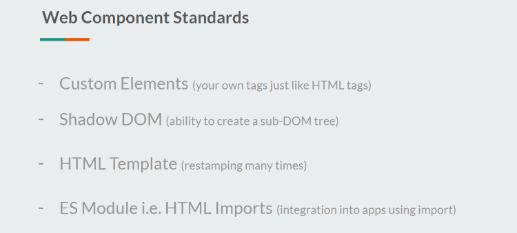
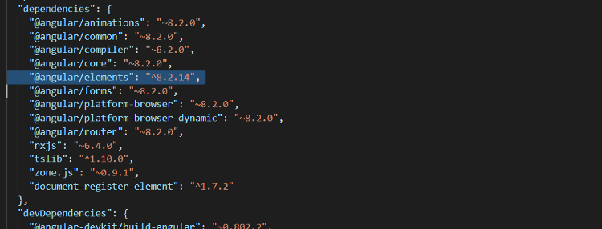
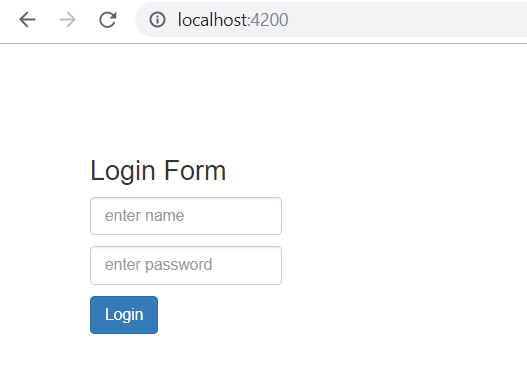
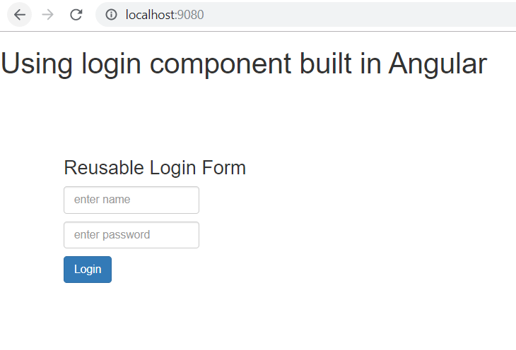
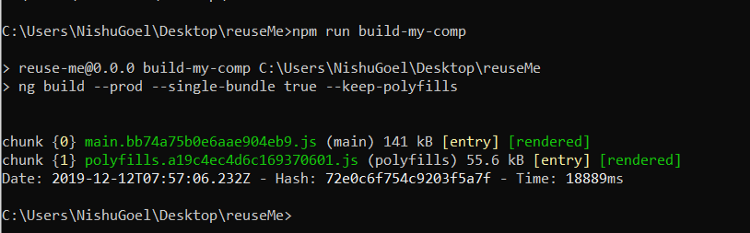
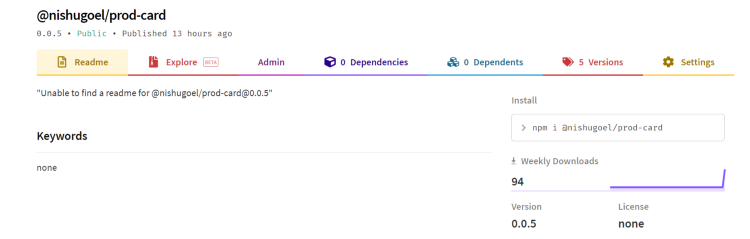
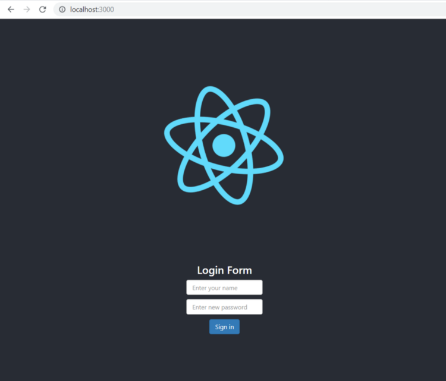


---

Wait, framework-agnostic web components? What is that!   
Let us try to understand the meaning of this term by an example, apparently my own example.

> TL;DR **This article shares about the need for web components, web component specifications, what are Angular elements, how can we create web components using Angular elements, and finally how we can we utilize this web components in our Vanilla JS or React/any other framework project.**

The setting in which I work at my company is based on a Garage concept. This translates to not having a single account which you work for, and instead getting to work on many short-duration, faster-delivery projects which keep flowing in and out of the garage. And the technology/framework for the deliverable is arrantly based on the requirement of the project.  
Therefore, this means that one can get to work on Angular for let’s say one 7-month project whereas React/Vue for another project for some amount of time.  
Now in this kind of setting where I have created lets say, a loader component for one of my projects in Angular, I wouldn’t want to redo the effort of creating a similar component for another project now that it is a react-based project let’s say. I would want something reusable, wouldn’t I?

So this small story was to set the context of why would one want to create a **Web Component** instead of a regular component in any of the frameworks that they code in.

### Web components though?

Does it mean components coming from the web?   
Well, the best way to explain web components would be to say that you can create a reusable custom element in any technology and use its functionality inside your web-apps by using the element.

As per the MDN web docs, Web components are defined as:

> Web Components is a suite of different technologies allowing you to create reusable custom elements — with their functionality encapsulated away from the rest of your code — and utilize them in your web apps.

The amazing thing about web components is that they only work on the web standards without the involvement of third-party libraries.

Now to understand this term web component which has a bigger meaning in a simple way, lets try to understand what it actually contains.  
Like I mentioned before, web components follow certain web standards and work as per those. These web component specifications are:

* Custom Elements
* Shadow DOM
* HTML Template
* ES Module i.e. HTML Imports

Each one of these standards are independently capable of being used. To leverage Web Components, we combine these four web standards and use and re-use our created custom elements built with the functionality of the holding framework in any of the frameworks/libraries, vanilla JavaScript etc.



Let us look at each one of these one by one.

### First Spec: Custom Elements

This is the first standard of Web component spec which allows us to create our own tags just like another HTML element but we decide which behavior should be contained inside that tag.   
A Custom Element can be created as:

```
class MyElement extends HTMLElement {
  […]
}
customElements.define("my-element", MyElement);
```

More about Custom Elements and the two types of custom elements that can be created can be read [**here**](https://developers.google.com/web/fundamentals/web-components/customelements).

### Second Spec: Shadow DOM

The shadow DOM specification for web components basically means that the custom element would have supported style encapsulation and it wouldn’t conflict with the ID or class of your other elements in the DOM. It does so by creating a sub-DOM tree of the element.  
These elements enters as children of the element and have their own encapsulated styles.

This works by using `<slot>` element as a placeholder for the the custom element. This, therefore, gets added in a sub-DOM tree like below:

```
<section>
  <div>
    <slot></slot> //Content of the custom element gets placed here
  </div>
</section>

// Custom Element
<my-element>
  <button>Custom button</button>
</my-element>
```

More on the DOM API, Shadow DOM, slots etc. can be read here in this amazing [**article**](https://developers.google.com/web/fundamentals/web-components/shadowdom).

### Third Spec: HTML Template

This third standard of the web component basically helps it to be have some chunk to the template to be loaded at runtime. This is achieved by using the <template></template> tag.  
Whatever is placed inside these template tags can be rendered at runtime by cloning and inserting them though JS.

After retrieving the template tag in JS, you can activate it using:

> var clonedObj = document.importNode(templateRef.content, true);

We can then append this using to the DOM as a sub-DOM tree.

### Final Spec: HTML Import i.e. ES Module Specification

This specification helps you integrate your custom element with the different JS apps by defining the interface using the script.

> <script type=”module”>  
>  import {example} from ‘[@example/example](http://twitter.com/example/example)’;  
> </script>

This will then allow us to use the custom tag inside our app like:

> <example>…</example>

These four web component specifications help us understand how and why the components are to be used in which ever frameork/ JS app as you wish to.

Now that we have an understanding of Web components, in general, custom elements, Shadow DOM etc. We can proceed to create one custom element inside the Angular framework and be able to use it inside other library projects.

---

### Creating a Web Component in Angular

Starting Angular v6, we can use regular Angular components as web components and load these components inside any of the frameworks/libraries or a JavaScript code.

This is achieved using [**Angular Elements**](https://next.angular.io/guide/elements)**.** Angular Elements is an Angular package that helps us create regular Angular components as Web components (custom elements) and use them in other technologies.

As [**Rob Wormald**](https://twitter.com/robwormald) mentioned in his talk,


To start with this, the first step would be to install the package **@angular/elements .**

> ng add @angular/elements



```
npm install --save @webcomponents/webcomponentsjs
```

`import ‘@webcomponents/custom-elements/src/native-shim’;  
import ‘@webcomponents/custom-elements/custom-elements.min’;`

The installation of @angular/elements also adds polyfills which are lighter in size but the support for some browsers is quite limited. Therefore, these two above-mentioned polyfills come to be of best use and thus we can avoid installing the polyfills of @angular/elements by simply doing:

`npm install @angular/elements`

The next step is to create a traditional Angular component (to be used as a web component) which looks like this:

```
@Component({
  templateUrl: './custom-elements.component.html',
  styleUrls: ['./custom-elements.component.scss']
})
export class ComponentName {
  title = 'custom-elements-demo';
}
```

The selector name will be the one used while creating the web-component. Also, you would want to give it a generic name as this web component is going to be a re-usable one which you’d definitely want to use in your other projects as well.

The next step then is to create the custom Element inside the module of your app. To do this, we first need to declare it inside the **entryComponents** array inside NgModule.

> Note: Starting Angular v9, this would not be required as with Ivy, we do not need to explicitly specify a component as an entryComponent.

Inside the module class, define the custom element component now as:

```
//Inside NgModule  
  
  entryComponents: [CustomElementDemoComponent],

  })
  
  export class FeatureModule {
  constructor(private injector: Injector) {
  }

  ngDoBootstrap() {
      const customElement = createCustomElement(CustomElementDemoComponent, { injector: this.injector });
      customElements.define('custom-element', customElement);
  }
  }
```

Inside the module, We use the injector service to basically wrap this Angular component as a web component using the **createCustomElement** method from Angular Elements. **customElements.define** registers this component on to the browser. This is done inside the **ngDoBootstrap** method as you want to manually bootstrap the component instead of asking Angular to do it using the bootstrap array.

> <custom-element></custom-element>

Once this is done, you can use it on an **Angular component**’s template as above and to make sure that the Angular component recognizes this custom Element, we add **CUSTOM\_ELEMENTS\_SCHEMA** in the schemas array in NgModule inside AppModule.

You custom Element is now ready to be used and is accessible inside any of your Angular projects.



#### Wait, just Angular projects?

You now might be wondering that I mentioned about using these anywhere across apps created using different frameworks or in JavaScript. Well, officially Angular does not yet support stand-alone web components which can be used outside the Angular projects, however, you can still use these custom elements in other frameworks by a variety of ways. Let us look at that.

The community project, `ngx-build-plus` by [**Manfred Steyer**](https://twitter.com/ManfredSteyer), allows us to create the required polyfills and the optional –single-bundle switch, helps create a single bundle which then exposes our web component.

> There is an amazing series of blog posts about Angular elements in detail by [Manfred](https://twitter.com/ManfredSteyer) himself [**here**](https://www.softwarearchitekt.at/aktuelles/angular-elements-part-i/)**.**

To add it to your web component project,

`npm i ngx-build-plus --save`

This will update the build target in your **angular.json** to ngx-build-plus:build and update scripts related to polyfills.  
Also, remember we manually added polyfills to our web component project? We can avoid doing that as well with the help of ngx-build-plus!

We can do this by using the command: `ng g ngx-build-plus:wc-polyfill`

Now, to use the single-bundle flag, we would update our scripts in the package.json for building the web component.

`“build-my-comp”:` `“ng build --prod --single-bundle true --keep-polyfills”`

The single-bundle flag defaults to false so we set it to true explicitly in the build script. When you try to build your component now using npm run `build-my-comp` , you might get to see another error saying:

`Schema validation failed with the following errors: Data path “.budgets[1].type” should be equal to one of the allowed values.`

To solve this, remove the following lines of code from `angular.json`

`{  
 “type”: “anyComponentStyle”,  
 “maximumWarning”: “6kb”,  
 “maximumError”: “10kb”  
}`

Finally, you will get a `main` bundle created now that can be exported to a Vanilla JS project, or any other framework and can be used as a web component, with, ofcourse, polyfills in place.

To test this, in a basic project inside index.html, I included the file as:

`http://”main.js”` and used the custom element

> <custom-element></custom-element>

To run this to be able to see the output now, you can install static-server from npm

`npm i -g static-server` , open the app on the port specified, and there you go with own web component in a non-Angular project (where the web component was created.)



The web component can now be published to npm and used in other frameworks as well.

For this blog post, I will be publishing this login form to the npm registry and using it in a React project.  
After building the web component using `npm run build-my-comp` , you get a single bundle generated for your web component, looking like this:



You can now publish it to npm by creating a package.json file in the dist directory. This needs only the name and version of the package that you will be publishing. To avoid the deletion of package.json every time you build the component, you can place it inside another folder.

The package.json looks like:

```
{
    "name" : "@nishugoel/prod-card",
    "version": "0.0.5"
}
```

We can now cd into the built package and pack it into a package to be published to npm using `npm pack` . This will generate .`tgz`file for you. To publish it to npm, make sure you are logged in to npm, if not, use npm login.

Finally publish using,

`npm publish packagedfile.tgz --access public`

Our web component is finally on npm and can be used in other frameworks now 🙂



---

### Using my web component in React

Create a new react app and inside the index.html, use the reference to your main.js script from npm.

```
//Inside index.html

            https://unpkg.com/@nishugoel/prod-card@0.0.5/main.js
    
//Use the custom element in the App.js file  
    
            <prod-card username='Enter your name' password='Enter new password' btnname='Sign in'></prod-card>
```

### Install webcomponents.js

```
npm install --save @webcomponents/webcomponentsjs
```

Put the required polyfills for `custom-elements-es5-adapter.js` and `webcomponents-bundle.js`

And finally use the custom element in your app.js file with your own property values to the component.



And here we go!

In the upcoming articles, I will be writing more on binding the data i.e. properties, events to the web components made in Angular.

