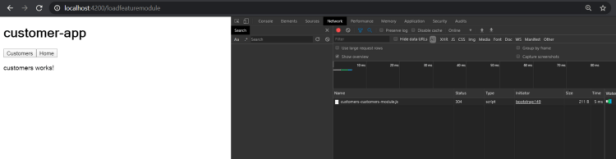


When I published my [***book***](https://www.amazon.in/Step-Angular-Routing-Nishu-Goel/dp/9388511662/) on Angular Routing, Angular 8 was not yet released. Some of the topics that I covered in my book are Router events, lazy loading etc. When I was implementing lazy loading as a demo for one of the chapters in the book, I was scratching my head.

Now this was because I made a typo in the **loadChildren**string of the module that had to be lazily loaded. With Angular 8 came support for dynamic import statements to lazy load modules.

*{path: ‘user’, loadChildren: () => import(‘./users/user.module’).then(m => m.UserModule)};*

I shared this to highlight how much a small typo in a string format wasted my time and how dynamic import of the module could have made it super easy to avoid one such problem.

> Now, this is one of the updates in the newer versions of the Angular router. **In this blog post, I will talk about the router updates in the newer versions of Angular.**

# Updates in Angular Router 9

1. **make routerLinkActive work with query params which contain arrays**

The `routerLinkActive` directive does not accept query params that contain arrays. This can be looked through inside the[**packages/router/src/url\_tree.ts**](https://github.com/angular/angular/blob/master/packages/router/src/url_tree.ts)**.**

With this fix, the comparison in the [**packages/router/src/url\_tree.ts**](https://github.com/angular/angular/blob/master/packages/router/src/url_tree.ts) has been moved inside the `equalArrayOrString` method which accepts both arrays and strings as shown in *Listing 1*. This makes the `routerLinkActive` directive work properly with the `queryParams` containing arrays too.

```
export function equalArraysOrString(a: string | string[], b: string | string[]) {
  if (Array.isArray(a) && Array.isArray(b)) {
    if (a.length != b.length) return false;
    return a.every(aItem => b.indexOf(aItem) > -1);
  } else {
    return a === b;
  }
}
```

*Listing 2* simply shows the usage of the method now that is doing the comparison.

```
Object.keys(containee).every(key => containee[key] === container[key]);

          //changed to

Object.keys(containee).every(key => equalArraysOrString(container[key], containee[key]));
```

# How does it work now?

**Earlier**, the routerLinkActive or router.isActive would work with queryParams as:

`<a routerLink="/newRoute" [queryParams]="{ myParam: 1 }" routerLinkActive="active">Link</a>`

when passing an integer value to the query param.

**However**, passing an array to the queryParam wouldn’t work with routerLinkActive.

With the latest update, you can use arrays in queryParams when using routerLinkActive like:

`<a routerLink="/newRoute" [queryParams]="{ myParam: [1] }" routerLinkActive="active">Link</a>`

---

# Updates in Angular Router 8

1. **Dynamic import of lazy loaded routes**

The major update that came in Angular Router 8 was the deprecation of the loadChildren string to lazy load routes. This is what I was talking about in the beginning of this blog post.

Instead of using a string syntax like this:

`{path: 'user', loadChildren: './users/user.module#UserModule'}`

The Angular CLI now supports dynamic import which leaves no room for typos and makes lazy loading a module more robust and easy to reason about. This looks like:

`{path: 'user', loadChildren: () => import('./users/user.module').then(m => m.UserModule)};`

I have written in depth on Lazy Loading in Angular 8 [**here**](https://medium.com/@nishu0505/lazy-loading-in-angular-8-10fc59fdfb04).

To see how the chunk loads, check this repo here:  
  
[NishuGoel/checkLazyloadingng8This project was generated with Angular CLI version 8.3.21. Run ng serve for a dev server. Navigate to…github.com](https://github.com/NishuGoel/checkLazyloadingng8)



This solution offered multiple advantages like type checking, simplicity of code, potential for browser support. Read more about this commit [**here**](https://github.com/angular/angular/commit/c61df39)**.**

**2) add hash-based navigation option to setUpLocationSync**

As per Angular docs, when upgrading routing applications, the [**setUpLocationSync**](https://angular.io/api/router/upgrade/setUpLocationSync)method,

> sets up a location change listener to trigger `history.pushState`. Works around the problem that `onPopState` does not trigger `history.pushState`. Must be called *after* calling `UpgradeModule.bootstrap`.

Earlier, we could not sync hash-based navigations with setUpLocationSync function. However, with [**this change**](https://github.com/angular/angular/commit/71d0eeb)**,**we can pass the hash option as true to the method to make sure that it works in hash-based navigation too.

This is shown here in *Listing 3*

```
setUpLocationSync(ngUpgrade: UpgradeModule, urlType: "path" | "hash" = 'path')
```

More on **HashLocationStrategy**can be read [**here**](https://angular.io/api/common/HashLocationStrategy)**.**

3) **Bug Fix: Adjust setting navigationTransition when a new navigation cancels an existing one.**

Previously, after the cancellation of an existing navigation, the currentNavigation could not take place properly even though the navigation was happening. This was because the value was getting set to ‘null’ in a `finally` block. However, with this fix, the code for setting the currentNavigation moves inside switchMap ands solves this timing problem.

See [**here**](https://github.com/angular/angular/commit/e884c0c)**.**

---

# Updates in Router in Angular 7

1. **add pathParamsChange mode for runGuardsAndResolvers**

As per the Angular docs, the method **runGuardsAndResolvers**suggests when to run guards and resolvers on a route.

Earlier the method would re-run guards and resolvers :

‘**paramsChange’**: when path or matrix params change. This ignores query param changes.

`runGuardsAndResolvers: 'paramsChange'`

‘**paramsOrQueryParamsChange**’: when any parameters change. This includes path, matrix, and query params.

`runGuardsAndResolvers: 'paramsOrQueryParamsChange'`

When set to ‘**always**’, they will run on every navigation.

`runGuardsAndResolvers: 'always'`

See *Listing 4*.

```
export type RunGuardsAndResolvers = 'pathParamsChange' | 'paramsChange' | 'paramsOrQueryParamsChange' | 'always';
```

However, with the fix in [**this commit**](https://github.com/angular/angular/commit/bf6ac6c)**,**it would also add pathParamsChange and then the guards or resolvers will ignore the change in matrix parameters or query parameters and re-run when path or path parameters change.

`runGuardsAndResolvers: 'pathParamsChange'`

**2. Return UrlTree from guard**

This was a very interesting update that came with the Angular version 7 which allowed the guard to return either true, false, or a UrlTree. The Urltree represents a url string in the route.

The url can be parsed to UrlTree using:

```
const tree: UrlTree = this.router.parseUrl(url);
```

Now, Returning ‘true’ from the **canActivateGuard**would activate the guard, ‘false’ would always cancel the navigation, however returning a tree from the guard like shown in *Listing 5* will cancel the current navigation and initiate a new one. This new navigation will take place as per what the **UrlTree**has returned from the guard.

```
canActivate(route: ActivatedRouteSnapshot, state: RouterStateSnapshot): boolean | UrlTree { 
  const url = 'dest'; 
  const tree: UrlTree = this.router.parseUrl(url); 
  return tree; 
}
```

Interested in digging deeper into what all changes in the code took place? Check this [**commit**](https://github.com/angular/angular/commit/4e9f2e5)**.**

**3. Guard priority using**[**prioritizedGuardValue**](https://github.com/angular/angular/blob/master/packages/router/src/operators/prioritized_guard_value.ts)

When multiple guards execute navigation and return UrlTree, there jumps in the issue to decide which navigation to execute first. That’s where guard priority comes in the picture. The custom RxJS operator [**prioritizedGuardValue**](https://github.com/angular/angular/blob/master/packages/router/src/operators/prioritized_guard_value.ts)ensures that the guard with the highest priority executes the navigation first.

***Observable<boolean|UrlTree>***

[Nate Lapinski](https://medium.com/@natelapinski?source=post_page-----fd67d526ad05----------------------) has well described the guard priority in his blog post, so I will not go into the details of this one. Check [**here**](https://medium.com/angular-in-depth/new-in-angular-v7-1-updates-to-the-router-fd67d526ad05).

